# TÀI LIỆU TỔNG QUAN DỰ ÁN: EDUALERT
## Hệ Thống Giám Sát Cảnh Báo Sớm Học Vụ & Trợ Lý Học Tập Thông Minh Tích Hợp AI
> **Phiên bản:** v2.5 Enterprise (Tích hợp Trợ lý Cố vấn AI)  
> **Nền tảng công nghệ:** Next.js 16 (App Router), React 19, Tailwind CSS, TypeScript, Node.js, Google Gemini API  
> **Đơn vị áp dụng chuẩn:** Trường Đại học Mở TP.HCM (HCMCOU) theo **Thông tư 08/2021/TT-BGDĐT**

---

## 1. DỰ ÁN NÀY RA ĐỜI ĐỂ GIẢI QUYẾT VẤN ĐỀ GÌ? (VÌ SAO CẦN EDUALERT?)

### Thực trạng tại các trường đại học:
Mỗi học kỳ, có hàng trăm sinh viên rơi vào tình trạng **bị cảnh báo học vụ (CBHV)**, thậm chí **buộc thôi học** trong sự ngỡ ngàng của cả sinh viên, phụ huynh lẫn nhà trường:
* **Sinh viên:** Thấy bị rớt môn (điểm F) thì hoang mang hoặc bỏ mặc, không nắm được cơ chế thế điểm môn học lại và không biết rằng điểm F kéo tụt GPA tích lũy nghiêm trọng như thế nào cho đến khi chạm ngưỡng bị đuổi học.
* **Cố vấn học tập (CVHT):** Một giảng viên phải quản lý từ 45 đến 80 sinh viên. Nếu chỉ dựa vào file Excel với các con số thô, giảng viên **không thể phát hiện kịp thời** sinh viên nào đang trên bờ vực nguy hiểm trước khi phòng Đào tạo ban hành quyết định kỷ luật.
* **Nhà trường:** Xử lý hậu quả bị động (khi sinh viên đã bị thôi học thì không cứu vãn được), tỷ lệ thôi học tăng và tỷ lệ tốt nghiệp đúng hạn sụt giảm.

### Sứ mệnh của EduAlert:
> **Chuyển từ "xử lý hậu quả bị động" sang "cảnh báo sớm chủ động", kết hợp Trợ lý AI để đưa ra lộ trình cứu nguy và kế hoạch hành động cụ thể cho từng sinh viên.**

---

## 2. DỰ ÁN DỰA TRÊN CƠ SỞ QUY CHẾ VÀ CÔNG NGHỆ NÀO?

Hệ thống được xây dựng dựa trên sự kết hợp giữa **Quy chế đào tạo chính thống** và **Trí tuệ nhân tạo (AI)**:

### A. Quy chế đào tạo tín chỉ Đại học Mở TP.HCM (HCMCOU)
1. **Công thức tính điểm học phần:**
   $$\text{Điểm TK10} = (\text{Điểm QT} \times 0.4) + (\text{Điểm Thi} \times 0.6)$$
   *(Làm tròn đến 1 chữ số thập phân, quy đổi sang thang 4.0 và điểm chữ A+, A, B+, B, C+, C, D+, D, F)*
2. **Quy tắc "Thế điểm" (Chìa khóa lội ngược dòng):**
   Khi sinh viên học lại một môn bị F và đạt điểm mới, điểm mới sẽ **thay thế hoàn toàn** điểm 0 cũ khi tính GPA tích lũy. Đây là cơ sở cốt lõi để xây dựng tính năng mô phỏng cứu nguy.

### B. 4 Quy Tắc Cảnh Báo Học Vụ (Theo Thông tư 08/2021/TT-BGDĐT)
Hệ thống tự động rà soát sinh viên theo 4 quy tắc của Bộ GD&ĐT:
* **Rule 1 (Rớt môn trong kỳ quá nửa):** Số tín chỉ rớt (F) trong kỳ $> 50\%$ tổng số tín chỉ đăng ký học kỳ đó.
* **Rule 2 (Tổng nợ đọng toàn khóa):** Tổng số tín chỉ nợ chưa trả $> 24$ tín chỉ.
* **Rule 3 (ĐTB học kỳ chạm sàn):** $\text{GPA học kỳ} < 0.8$ (HK đầu) hoặc $< 1.0$ (các HK sau).
* **Rule 4 (ĐTB tích lũy chạm đáy):** $\text{GPA tích lũy}$ dưới ngưỡng sàn theo năm học (Năm 1: $< 1.20$; Năm 2: $< 1.40$; Năm 3: $< 1.60$; Năm 4 trở đi: $< 1.80$).
* **Buộc thôi học (Mức 3):** Bị cảnh báo học vụ 2 lần liên tiếp hoặc hết thời gian đào tạo tối đa.

### C. Nâng Cấp Công Nghệ AI (Trợ Lý Cố Vấn Ảo & Phân Tắc Tâm Lý)
* **Không chỉ dừng lại ở tính toán số học khô cứng**, EduAlert tích hợp **API Gemini LLM** (kèm Intelligent Academic Fallback Engine) để:
  * **AI Sentiment & Risk Clustering:** Phân tích nguyên nhân cốt lõi khiến sinh viên sa sút (*Đi làm thêm quá giờ / Hổng kiến thức nền tảng / Mất phương hướng, chọn nhầm ngành*).
  * **AI Generative Action Plan:** Tự động sinh lộ trình can thiệp 3 bước thực tế và **soạn sẵn bản thảo Email động viên, nhắc nhở** để CVHT gửi ngay cho sinh viên/phụ huynh.

---

## 3. ĐẦU VÀO (INPUT) $\to$ XỬ LÝ (ENGINE) $\to$ ĐẦU RA (OUTPUT)

```mermaid
flowchart LR
    subgraph INPUT["1. DỮ LIỆU ĐẦU VÀO"]
        A["Cơ cấu Khoa & Ngành (141 TC)"]
        B["Danh sách Lớp & Sinh viên"]
        C["Bảng điểm chi tiết (QT 40%, Thi 60%)"]
    end

    subgraph ENGINE["2. ĐỘNG CƠ XỬ LÝ & AI"]
        D["Tính TK10, GPA HK, GPA TL"]
        E["Quét 4 Rules TT 08/2021"]
        F["Phân 4 Tầng Nguy Cơ Can Thiệp"]
        G["Target GPA & What-If Engine"]
        H["Trợ Lý AI (Gemini LLM API)"]
    end

    subgraph OUTPUT["3. KẾT QUẢ ĐẦU RA"]
        I["Dashboard Giám Sát Cảnh Báo"]
        J["Hồ Sơ Học Vụ 360°"]
        K["Báo Cáo AI & Bản Thảo Email"]
        L["Smart Planner: Dự Báo Trả Nợ F"]
    end

    INPUT --> ENGINE --> OUTPUT
```

---

## 4. BỨC TRANH TOÀN CẢNH 5 PHÂN HỆ TRÊN GIAO DIỆN

Hệ thống được thiết kế theo phong cách **Enterprise ERP Clean (Forest Emerald & Slate)** tinh gọn, thoáng đãng, không text thừa:

### 1. Quản Lý Khoa (Faculty Management)
* **Đối tượng:** Ban Giám hiệu / Trưởng khoa / Quản trị hệ thống.
* **Chức năng:** Quản lý danh mục khoa, mã tự sinh `OU + YYMMDD + XXX` (ví dụ: `OU261104001`), cơ chế chặn xóa an toàn (không cho xóa khoa khi đã có ngành liên kết), theo dõi nhật ký lịch sử chỉnh sửa (Audit Log).

### 2. Quản Lý Ngành & Chương Trình Đào Tạo (Major & Curriculum)
* **Đối tượng:** Ban Đào tạo / Cố vấn chuyên môn.
* **Chức năng:** Cấu hình khung CTĐT chuẩn **141 tín chỉ** cho từng ngành (ví dụ: Khoa học máy tính). Cho phép nạp cả môn chuyên ngành lẫn **môn liên ngành từ các khoa khác** (Kinh tế, Ngoại ngữ). Quản lý danh sách các lớp thuộc ngành.

### 3. Quản Lý Bảng Điểm (Course Grade Management)
* **Đối tượng:** Giảng viên bộ môn / Giáo vụ khoa.
* **Chức năng:** Danh sách bảng điểm gom nhóm theo môn học (`Group by Course`), mở rộng xem các lớp đang học môn đó. Giao diện nhập điểm trực tiếp QT & Thi với tính năng tự động tính điểm TK10, điểm chữ và thang 4.0 tức thì.

### 4. Giám Sát Cảnh Báo Sớm & Hồ Sơ Học Vụ 360° (Early Warning Dashboard)
* **Đối tượng:** Cố vấn học tập (CVHT).
* **Case study trọng điểm:** Giám sát lớp **DH22CS01C (45 sinh viên)** ngành Khoa học máy tính.
* **Tự động phân loại 45 sinh viên thành 4 nhóm can thiệp:**
  1. 🔴 **Nhóm 1 - Nguy cơ Buộc thôi học:** Ví dụ bạn *Nguyễn Văn An* (GPA 1.15, nợ 26 TC, vi phạm cả 4 Rule).
  2. 🟠 **Nhóm 2 - Cảnh báo học vụ Mức 1:** GPA dưới sàn, nợ từ 8 – 14 TC.
  3. 🟡 **Nhóm 3 - Tín hiệu sớm:** GPA từ 1.25 – 1.68, rải rác môn D/F cần nhắc nhở.
  4. 🟢 **Nhóm 4 - An toàn & Xuất sắc:** Tiến độ tốt, học lực Khá, Giỏi, Xuất sắc.
* **Hồ Sơ Học Vụ 360° tích hợp AI:**
  - Bóc tách chi tiết bài test 4 Rule của Bộ GD&ĐT và diễn biến điểm qua từng kỳ.
  - **Nút "AI Cố Vấn & Email":** Kích hoạt Gemini AI phân loại nguyên nhân tâm lý, đưa ra lộ trình 3 bước và **sinh sẵn bản thảo email gửi sinh viên với 1 nút sao chép**.
  - Sổ tay ghi chép nhật ký tư vấn của CVHT.

### 5. Kế Hoạch Học Tập Thông Minh (Smart Academic Planner)
* **Đối tượng:** Sinh viên tự xem hoặc CVHT cùng ngồi tư vấn với sinh viên.
* **Gồm 4 công cụ mạnh mẽ:**
  1. **Đối Chiếu CTĐT (141 TC):** Nắm rõ đã tích lũy bao nhiêu môn, đang nợ môn F nào, còn lại bao nhiêu môn để tốt nghiệp.
  2. **Bảng Điểm Đã Lưu:** Xem chi tiết toàn bộ lịch sử điểm học phần.
  3. **Tính Điểm Cần Đạt (Target GPA):** Đặt mục tiêu tốt nghiệp (GPA 2.50, 3.00, 3.20, 3.60) để hệ thống tự động tính điểm trung bình cần đạt cho các môn còn lại.
  4. **Mô Phỏng Học Tập "What-If":** Giả định kỳ tới trả nợ môn F đạt B/A: Hệ thống lập tức chạy thử cơ chế thế điểm và dự phóng: **GPA từ 1.15 nhảy vọt lên 1.95, nợ giảm từ 26 xuống 20 TC, THOÁT KHỎI DIỆN ĐUỔI HỌC!**

---

## 5. CASE STUDY TIÊU BIỂU: CỨU NGUY BẠN NGUYỄN VĂN AN (LỚP DH22CS01C)

* **Hiện trạng ban đầu:** GPA tích lũy chỉ **1.15**, nợ **26 tín chỉ** (rớt F môn *Cấu trúc dữ liệu* và *Tiếng Anh 2*), vi phạm cả 4 Rule $\to$ Đứng trước quyết định Buộc thôi học.
* **Quy trình giải quyết bằng EduAlert:**
  1. **Phát hiện:** CVHT mở màn hình cảnh báo, thấy bạn An đứng đầu danh sách cờ đỏ.
  2. **Phân tích AI:** Mở Hồ sơ 360° $\to$ Bấm **AI Cố Vấn & Email** $\to$ AI chỉ ra An đang bị khủng hoảng tâm lý do hổng kiến thức lập trình nền tảng và đi làm thêm quá nhiều; AI tự soạn sẵn bức thư động viên chân thành.
  3. **Hành động:** CVHT gửi thư hẹn An lên văn phòng $\to$ Mở tab **Smart Planner (Mô phỏng What-If)**.
  4. **Kết quả:** Thử nghiệm kịch bản đăng ký giảm tải (12 TC) và học lại 2 môn F đạt B+: GPA dự phóng nhảy lên **1.95**, thoát hoàn toàn diện cảnh báo học vụ. Sinh viên lấy lại niềm tin và có lộ trình học tập rõ ràng.

---

## 6. TỔNG KẾT GIÁ TRỊ DỰ ÁN MANG LẠI

| Đối tượng | Giá trị nhận được |
| :--- | :--- |
| **Sinh viên** | Hiểu rõ vị trí học vụ của bản thân, có công cụ What-If để tự tin lên lộ trình cải thiện GPA, không còn bị động trước nguy cơ đuổi học. |
| **Cố vấn học tập (CVHT)** | Khoanh vùng chính xác sinh viên nguy cơ cao chỉ trong 3 giây; có Trợ lý AI phân tích tâm lý, gợi ý lộ trình và soạn sẵn email hỗ trợ. |
| **Khoa & Nhà trường** | Giảm thiểu tối đa tỷ lệ sinh viên bị buộc thôi học, nâng cao tỷ lệ tốt nghiệp đúng hạn, hiện đại hóa toàn diện công tác quản trị học vụ. |
