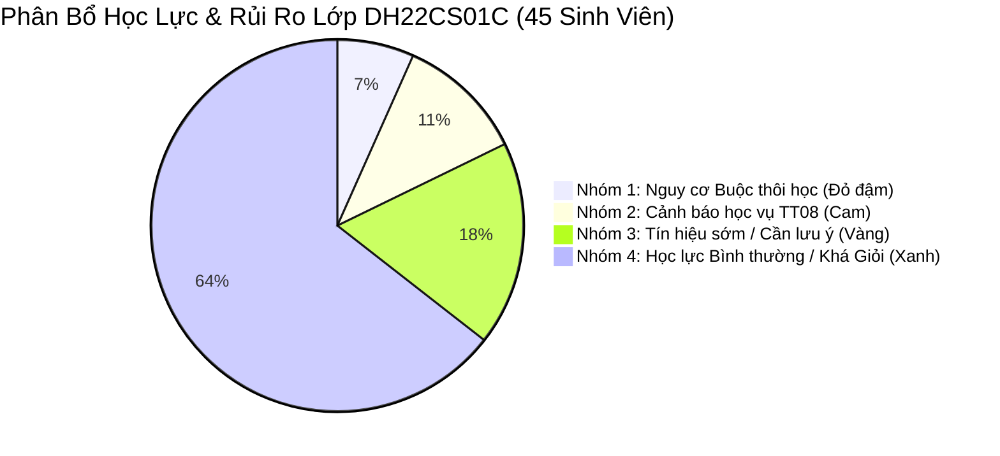

# TÀI LIỆU TỔNG QUAN DỰ ÁN EDUALERT (VERSION 2.5 - ENTERPRISE SIS)

> **Tên dự án:** EduAlert - Hệ Thống Quản Lý Đào Tạo, Giám Sát Học Vụ & Cảnh Báo Sớm Nguy Cơ Sinh Viên  
> **Đơn vị ứng dụng mẫu:** Trường Đại học Mở TP.HCM (HCMCOU)  
> **Căn cứ pháp lý:** Quy chế Đào tạo Tín chỉ Đại học & Thông tư 08/2021/TT-BGDĐT  
> **Kiến trúc công nghệ:** Next.js 16 (App Router), React 19, TypeScript, Clean ERP UI Theme, Tailwind/CSS Module  

---

## 1. Ý Tưởng & Mục Đích Dự Án

### 1.1. Ý Tưởng
Trong mô hình đào tạo theo học chế tín chỉ, sinh viên được tự do đăng ký học phần theo năng lực và sở thích. Tuy nhiên, việc tự chủ này dẫn đến nhiều hệ quả nghiêm trọng:
* Sinh viên tích lũy rải rác, không nắm rõ môn tiên quyết dẫn đến bị "kẹt môn", chậm tiến độ.
* Điểm số quá trình và kết thúc môn được công bố muộn, đến khi sinh viên nhận quyết định cảnh báo học vụ hoặc buộc thôi học từ Phòng Đào tạo thì đã rơi vào tình thế không thể cứu vãn.
* Cố vấn học tập (CVHT) và Giảng viên bộ môn thiếu công cụ kết nối dữ liệu để theo dõi sức khỏe học tập theo từng lớp sinh hoạt cụ thể.

**EduAlert** ra đời như một hệ sinh thái số khép kín: từ **Quản trị cơ cấu đào tạo** (Khoa, Ngành, Khung CTĐT đa ngành, Lớp học), **Nhập điểm phân cấp** theo Môn & Lớp, cho đến **Động cơ phân tích rủi ro học vụ thời gian thực** (Rule Engine TT 08/2021) và **Trợ lý định hướng lộ trình học tập cá nhân hóa** cho sinh viên.

### 1.2. Mục Đích Cốt Lõi
1. **Chuẩn hóa quản trị cơ cấu:** Quản lý Khoa, Ngành, Môn học, CTĐT với các quy tắc sinh mã tự động chống trùng lặp, bảo toàn dữ liệu liên kết và ghi nhận nhật ký kiểm toán (Audit Trail) cho mọi thao tác.
2. **Minh bạch hóa điểm số & lớp học phần:** Gom nhóm quản lý bảng điểm theo Môn học $\rightarrow$ Lớp học phần, giúp giảng viên nhập điểm tức thì, hệ thống tự động quy đổi thang 10 $\to$ thang Chữ $\to$ thang 4.
3. **Phát hiện sớm nguy cơ & Can thiệp cá nhân hóa:** Phân tích cụ thể từng lớp học (điển hình lớp `DH22CS01C` - 45 sinh viên), chia nhóm rủi ro và gợi ý hành động hỗ trợ cho từng sinh viên cụ thể.
4. **Tối ưu trải nghiệm người dùng (Clean ERP UI):** Giao diện tinh tế, gọn gàng, loại bỏ các khối chữ rườm rà, tập trung vào bảng dữ liệu trực quan, thao tác nhanh.

---

## 2. Đầu Vào (Inputs) & Đầu Ra (Outputs) Của Hệ Thống

```
+----------------------------------------------------------------------------------------------------+
|                                         INPUTS (ĐẦU VÀO)                                          |
|  1. Cơ cấu Khoa: Tên tiếng Việt, Tên tiếng Anh, Ký hiệu viết tắt (FIT, FECO...).                   |
|  2. Ngành & CTĐT: Mã ngành, Chuẩn tín chỉ (141 TC), Danh mục môn học (tiên quyết, bắt buộc/tự chọn)|
|  3. Lớp & Sinh viên: Lớp sinh hoạt, Danh sách sinh viên (MSSV, Họ tên, Khóa, CVHT).                 |
|  4. Bảng điểm học phần: Điểm QT (40%), Điểm Thi (60%) của sinh viên theo từng lớp học phần.        |
|  5. Mục tiêu cá nhân: GPA mong muốn của sinh viên, danh sách môn dự kiến đăng ký kỳ tới.          |
+----------------------------------------------------------------------------------------------------+
                                                  │
                                                  ▼
                                      [ ĐỘNG CƠ XỬ LÝ EDUALERT ]
                           - Bộ sinh mã tự động (Khoa, Ngành, Bảng điểm)
                           - Kiểm toán dữ liệu (Audit Log: Cũ -> Mới)
                           - Công thức tính điểm & Thế điểm F (Quy chế HCMCOU)
                           - Rule Engine 4 điều kiện Thông tư 08/2021
                           - Thuật toán Target GPA & What-If Sandbox
                                                  │
                                                  ▼
+----------------------------------------------------------------------------------------------------+
|                                        OUTPUTS (ĐẦU RA)                                           |
|  1. Cây danh mục đào tạo chuẩn hóa, phân cấp rõ ràng kèm lịch sử vết thao tác.                     |
|  2. Bảng điểm tổng hợp theo Môn/Lớp (Group by Môn -> Expand Lớp) với đầy đủ TK10, Chữ, Thang 4.    |
|  3. Dashboard Giám sát Lớp học (VD: Lớp DH22CS01C): Danh sách sinh viên phân loại 4 nhóm nguy cơ.   |
|  4. Hồ sơ học vụ chi tiết: 4 tiêu chí vi phạm TT08, GPA lịch sử, Biên bản tư vấn CVHT.             |
|  5. Bản phân tích lộ trình Smart Planner: Tỷ lệ hoàn thành CTĐT, Điểm cần đạt, Kịch bản What-If.   |
+----------------------------------------------------------------------------------------------------+
```

---

## 3. Kiến Trúc Vai Trò & Phân Quyền (RBAC - Role Based Access Control)

Loại bỏ hoàn toàn tính năng giả lập vai trò trên giao diện người dùng. Hệ thống định tuyến và hiển thị chức năng theo tài khoản đăng nhập thực tế:

| Phân hệ / Tính năng | Quản Trị Viên / Giáo Vụ (`ADMIN / KHOA`) | Giảng Viên Bộ Môn (`LECTURER`) | Cố Vấn Học Tập (`CVHT`) | Sinh Viên (`STUDENT`) |
| :--- | :---: | :---: | :---: | :---: |
| **Quản lý Khoa** (CRUD, Mã tự sinh, Audit log) | **Toàn quyền** | Không | Không | Không |
| **Quản lý Ngành & CTĐT** (CRUD, Môn liên ngành) | **Toàn quyền** | Không | Xem | Xem CTĐT ngành mình |
| **Quản lý Lớp & Sinh viên** | **Toàn quyền** | Không | Xem các lớp phụ trách | Xem thông tin bản thân |
| **Bảng điểm (Group by Môn $\to$ Lớp)** | Xem toàn trường / Mở bảng điểm | **Nhập điểm lớp mình dạy** | Xem điểm lớp mình phụ trách | Xem điểm cá nhân |
| **Giám sát lớp & Cảnh báo sớm (Lớp DH22CS01C)**| Xem báo cáo toàn khoa | Xem tình hình lớp đang dạy | **Toàn quyền giám sát & Lập biên bản tư vấn** | Xem trạng thái học vụ của mình |
| **Smart Academic Planner (What-If)** | Hỗ trợ SV | Không | Tư vấn định hướng | **Toàn quyền mô phỏng & lập mục tiêu** |

---

## 4. Phân Tích Chuyên Sâu Case Study: Lớp `DH22CS01C` (45 Sinh Viên)

* **Ngành:** Khoa học máy tính (Mã: `FIT2200001` / Chuẩn: 141 tín chỉ)
* **Khoa:** Công nghệ thông tin (Ký hiệu: `FIT`)
* **Khóa tuyển sinh:** 2022 (Sinh viên năm thứ 2; đợt rà soát hiện tại là **sau khi kết thúc HK3, năm học 2023–2024**, sắp bước vào HK4 — khớp với dữ liệu mẫu và thanh header của ứng dụng)
* **Quy mô:** 45 sinh viên
* **CVHT phụ trách:** ThS. Nguyễn Hoàng Nam

### 4.1. Ma Trận Phân Tầng 4 Nhóm Sinh Viên Trong Lớp



| Phân nhóm | Số lượng | Tiêu chí nhận diện (TT 08/2021 & HCMCOU) | Danh sách sinh viên tiêu biểu |
| :--- | :---: | :--- | :--- |
| **Nhóm 1: Nguy cơ Buộc thôi học (Mức rất cao)** | **3 SV** (6.7%) | • **Tiêu chí xếp nhóm:** đã bị CBHV $\ge 2$ lần liên tiếp.<br/>• Thường đi kèm: GPA tích lũy Năm 2 $< 1.40$, nợ $> 24$ TC. | 1. Nguyễn Văn An (`2251050001` - CPA: 1.15, Nợ 26 TC, CBHV lần 2)<br/>2. Trần Quốc Bảo (`2251050015` - CPA: 1.28, Nợ 28 TC, CBHV lần 2)<br/>3. Lê Hoàng Long (`2251050032` - CPA: 1.32, Nợ 25 TC, Rớt 60% TC kỳ rồi) |
| **Nhóm 2: Cảnh báo học vụ (Mức cao)** | **5 SV** (11.1%) | • **Tiêu chí xếp nhóm:** bị CBHV lần 1, tức vi phạm $\ge 1$ Rule (xem `02_Quy_Tac_Tinh_Diem_OU.md`, mục 4–5):<br/>- Rule 1: tín chỉ rớt trong kỳ $> 50\%$ ĐK.<br/>- Rule 3: GPA học kỳ $< 1.00$.<br/>- Rule 4: GPA tích lũy $< 1.40$ (Năm 2). | 1. Phạm Minh Tuấn (`2251050008` - GPA HK: 0.85, CPA 1.36, Nợ 15 TC)<br/>2. Đỗ Thanh Hà (`2251050019` - CPA: 1.38, Rớt 8 TC kỳ rồi)<br/>3. Vũ Anh Khoa (`2251050024` - Rớt môn Giải tích 2 & Cấu trúc dữ liệu)<br/>4. Hoàng Trọng Nghĩa (`2251050036`)<br/>5. Bùi Thu Trang (`2251050041`) |
| **Nhóm 3: Tín hiệu sớm (Mức trung bình)** | **8 SV** (17.8%) | • Chưa vi phạm Rule nào nhưng GPA tích lũy tiệm cận ngưỡng ($1.45 - 1.70$).<br/>• Rớt 1 môn tiên quyết quan trọng (VD: Lập trình hướng đối tượng).<br/>• Điểm rèn luyện thấp ($< 60$). | Nhóm sinh viên có nguy cơ tuột dốc nếu kỳ tới không trả nợ môn kịp thời. |
| **Nhóm 4: An toàn & Khá Giỏi** | **29 SV** (64.4%) | • CPA $\ge 2.50$, tiến độ đạt chuẩn CTĐT, không nợ môn cốt lõi. | Nhóm sinh viên phát triển bình thường, tập trung vào tính năng định hướng tốt nghiệp Xuất sắc / Giỏi. |

---

### 4.2. Hướng Phân Tích & Giải Pháp Can Thiệp Hỗ Trợ Từng Cá Nhân Cụ Thể

#### Đối với Sinh viên Nguyễn Văn An (MSSV: `2251050001`) - Nhóm 1 (Nguy cơ Buộc thôi học)
* **Chẩn đoán nguyên nhân:** Sinh viên nợ 26 tín chỉ, trong đó có chuỗi môn tiên quyết bị đứt: *Nhập môn lập trình (F) $\to$ Kỹ thuật lập trình (F) $\to$ Cấu trúc dữ liệu & giải thuật (Chưa thể đăng ký)*. Bị CBHV lần 1 ở HK2 năm nhất, tiếp tục vi phạm GPA HK3 ($0.82$).
* **Giải pháp hỗ trợ của CVHT & Hệ thống:**
  1. **Khống chế số tín chỉ đăng ký kỳ 4:** Áp dụng quy chế giới hạn không quá $14$ tín chỉ trong kỳ này.
  2. **Ưu tiên 100% kịch bản trả nợ F:** Hệ thống tự động đẩy 2 môn: *Nhập môn lập trình (3 TC)* và *Toán rời rạc (3 TC)* vào giỏ mô phỏng What-If.
  3. **Kích hoạt cơ chế thế điểm F:** Khi đạt điểm $B$ (2.5) cho cả 2 môn này, điểm mới thế điểm $F$ cũ (mẫu số CPA không đổi: $28 + 26 = 54$ TC; tổng điểm $1.15 \times 54 = 62.1 \to 77.1$), CPA tăng từ $1.15 \to 1.43$, **vượt ngưỡng $1.40$** và tín chỉ nợ giảm $26 \to 20$ TC (dưới trần 24). *(Nếu chỉ đạt $C$ (1.5) thì CPA mới $\approx 1.32$, chưa vượt ngưỡng.)*
  4. **Kế hoạch can thiệp:** CVHT đặt lịch hẹn trực tiếp, yêu cầu sinh viên ký cam kết học tập và cử 1 sinh viên giỏi kèm cặp (Peer Tutoring).

#### Đối với Sinh viên Phạm Minh Tuấn (MSSV: `2251050008`) - Nhóm 2 (Cảnh báo học vụ lần 1)
* **Chẩn đoán nguyên nhân:** Sinh viên có năng lực nhưng đăng ký quá tải kỳ trước (21 tín chỉ) dẫn đến thi trượt 4 môn (12 tín chỉ $\approx 57\% > 50\%$ số đăng ký), GPA học kỳ $0.85$.
* **Giải pháp hỗ trợ:**
  1. Hướng dẫn sinh viên giảm tải, chỉ đăng ký $15$ tín chỉ ở kỳ kế tiếp.
  2. Chọn học lại 1 môn $F$ có số tín chỉ cao nhất (Cơ sở dữ liệu - 4 TC).
  3. Chuyển sang Smart Planner tính toán Target GPA: Đặt mục tiêu kỳ tới $\ge 2.20$ để xóa án cảnh báo.

---

## 5. Danh Mục Quy Tắc Nghiệp Vụ Cốt Lõi (Core Business Rules)

### 5.1. Quy tắc sinh mã tự động
* **Mã Khoa:** `OU` + `YYMMDD` + `XXX`
  * Ví dụ tạo ngày 04/11/2026: `OU261104001`, `OU261104002`...
* **Mã Ngành:** `[Ký hiệu viết tắt của Khoa]` + `YYMM` + `XXX`
  * Ví dụ (minh họa cách sinh mã) Khoa CNTT (`FIT`) tạo ngành tháng 11/2026: `FIT2611001`, `FIT2611002`...
  * **Lưu ý dữ liệu khởi tạo:** các ngành mẫu `FIT2200001`, `FIT2200002`, `FIT2200003` là mã seed có sẵn, **không** theo công thức (phần `2200` không phải `YYMM` hợp lệ). Chỉ ngành tạo mới trong ứng dụng mới sinh mã đúng công thức.
* **Mã Bảng Điểm:** `BD-` + `[Mã Lớp]` + `-` + `[Mã Môn]`
  * Ví dụ: `BD-DH22CS01C-COSC1301`.
  * Mỗi (Lớp, Môn, Học kỳ) chỉ có 1 bảng điểm. Khi cùng một lớp mở lại cùng môn ở học kỳ khác (học lại), mã cơ bản đã tồn tại nên **thêm hậu tố học kỳ**: `BD-DH22CS01C-COSC1301-2324HK3`. *(Quy tắc hậu tố này là đặc tả; code hiện chưa xử lý.)*

### 5.2. Quy tắc Audit Log (Nhật ký kiểm toán)
Mọi thao tác chỉnh sửa (Tên khoa, Tên tiếng Anh, Ký hiệu, Trạng thái) hoặc thao tác thêm/xóa môn trong CTĐT phải được ghi lại vết với định dạng:
`{ id, timestamp, userId, userName, action, fieldChanged, oldValue, newValue }`.

### 5.3. Quy tắc Ràng buộc toàn vẹn & Chặn xóa
* **Khoa:** Tuyệt đối không cho phép xóa nếu Khoa đã có Ngành trực thuộc hoặc có lớp học/sinh viên. Chỉ cho phép Xóa khi Khoa mới tạo, chưa có dữ liệu liên kết. Khi không còn hoạt động, chỉ được chuyển trạng thái sang **Vô hiệu hóa**.
* **Ngành:** Chặn xóa nếu Ngành đã có Lớp học hoặc đã nạp sinh viên.

---

*Tài liệu này là căn cứ kiến trúc chính thức để triển khai giao diện và mã nguồn EduAlert v2.5.*

