# BÁO CÁO TOÀN DIỆN ĐỒ ÁN / DỰ ÁN: EDUALERT
## HỆ THỐNG GIÁM SÁT CẢNH BÁO SỚM HỌC VỤ & TRỢ LÝ HỌC TẬP THÔNG MINH TÍCH HỢP AI
> **Đơn vị đào tạo chuẩn tham chiếu:** Trường Đại học Mở TP.HCM (HCMCOU)  
> **Khung pháp lý áp dụng:** Thông tư 08/2021/TT-BGDĐT & Quy chế đào tạo tín chỉ HCMCOU  
> **Phiên bản hệ thống:** v2.6 Enterprise Cloud  
> **Chủ nhiệm đề tài / Nhóm tác giả:** Lê Gia Hân & Cộng sự  
> **Source code Repository:** [https://github.com/legiahan2705/Project-EduAlert](https://github.com/legiahan2705/Project-EduAlert)  
> **Môi trường triển khai:** Vercel Serverless Cloud & MongoDB Atlas Cloud  

---

## MỤC LỤC CHI TIẾT
1. [TỔNG QUAN & BỐI CẢNH ĐỀ TÀI](#1-tổng-quan--bối-cảnh-đề-tài)
2. [MỤC TIÊU DỰ ÁN & ĐỐI TƯỢNG PHỤC VỤ](#2-mục-tiêu-dự-án--đối-tượng-phục-vụ)
3. [CƠ SỞ PHÁP LÝ & BỘ QUY TẮC NGHIỆP VỤ (BUSINESS RULES)](#3-cơ-sở-pháp-lý--bộ-quy-tắc-nghiệp-vụ-business-rules)
4. [KIẾN TRÚC HỆ THỐNG (FULLSTACK ARCHITECTURE - FE, BE, DB & AI)](#4-kiến-trúc-hệ-thống-fullstack-architecture---fe-be-db--ai)
5. [THIẾT KẾ CƠ SỞ DỮ LIỆU CLOUD (MONGODB SCHEMA & ERD)](#5-thiết-kế-cơ-sở-dữ-liệu-cloud-mongodb-schema--erd)
6. [HỆ THỐNG CÁC TÍNH NĂNG VÀ USER STORIES (US)](#6-hệ-thống-các-tính-năng-và-user-stories-us)
7. [LOGIC THUẬT TOÁN ĐIỀU HÀNH (RULE ENGINE, TARGET GPA & WHAT-IF)](#7-logic-thuật-toán-điều-hành-rule-engine-target-gpa--what-if)
8. [ỨNG DỤNG TRÍ TUỆ NHÂN TẠO (AI GENERATIVE & SENTIMENT CLUSTERING)](#8-ứng-dụng-trí-tuệ-nhân-tạo-ai-generative--sentiment-clustering)
9. [CASE STUDY ĐIỂN HÌNH: GIẢI CỨU HỌC VỤ SINH VIÊN NGUYỄN VĂN AN](#9-case-study-điển-hình-giải-cứu-học-vụ-sinh-viên-nguyễn-văn-an)
10. [HƯỚNG DẪN CÀI ĐẶT, VẬN HÀNH & TRIỂN KHAI (DEPLOYMENT GUIDE)](#10-hướng-dẫn-cài-đặt-vận-hành--triển-khai-deployment-guide)
11. [KẾT LUẬN & ĐỊNH HƯỚNG MỞ RỘNG ĐỀ TÀI](#11-kết-luận--định-hướng-mở-rộng-đề-tài)

---

## 1. TỔNG QUAN & BỐI CẢNH ĐỀ TÀI

### 1.1. Thực trạng trong quản trị học vụ bậc đại học
Trong phương thức đào tạo theo hệ thống tín chỉ tại các trường đại học hiện nay, tính tự chủ trong học tập của sinh viên được đặt lên hàng đầu. Tuy nhiên, mặt trái của mô hình này là:
* **Sinh viên thiếu định hướng và thông tin:** Sinh viên (đặc biệt là năm 1 và năm 2) chưa quen với cường độ học đại học. Khi nhận điểm F (rớt môn), phần lớn sinh viên có tâm lý xem nhẹ, nghĩ rằng "kỳ sau học bù là xong". Sinh viên không hề biết rằng điểm F ($0.0$) kéo tụt Điểm trung bình tích lũy (GPA) nghiêm trọng như thế nào và ngưỡng vi phạm nào sẽ dẫn đến quyết định buộc thôi học từ Ban Giám hiệu.
* **Cố vấn học tập (CVHT) quá tải và thiếu công cụ:** Mỗi giảng viên thường làm cố vấn cho 1 đến 2 lớp (khoảng 45 – 90 sinh viên). Dữ liệu gửi về cho giảng viên thường là các file Excel điểm thô, tách biệt giữa điểm quá trình và điểm thi cuối kỳ. CVHT không có công cụ tính toán tự động để rà quét sinh viên nào đang vi phạm quy chế trước khi Phòng Quản lý Đào tạo ban hành danh sách kỷ luật.
* **Nhà trường xử lý hậu quả ở phần ngọn:** Các quyết định Cảnh báo học vụ (CBHV) và Buộc thôi học thường chỉ được công bố khi học kỳ đã kết thúc hoàn toàn. Lúc này, mọi sự can thiệp đều đã quá muộn, gây thiệt hại lớn về kinh tế cho gia đình và ảnh hưởng trực tiếp đến chỉ số hoàn thành khóa học của nhà trường.

### 1.2. Sứ mệnh của dự án EduAlert
> **EduAlert là nền tảng chuyển đổi số trong quản lý học vụ: Chuyển dịch toàn diện từ mô hình "Xử lý kỷ luật bị động" sang "Giám sát cảnh báo sớm chủ động", đồng thời trao quyền cho sinh viên bằng các công cụ tính toán kế hoạch học tập thông minh và Trợ lý Cố vấn AI cá nhân hóa.**

---

## 2. MỤC TIÊU DỰ ÁN & ĐỐI TƯỢNG PHỤC VỤ

### 2.1. Mục tiêu cốt lõi
1. **Tự động hóa 100% việc sàng lọc rủi ro học vụ:** Bám sát Thông tư 08/2021/TT-BGDĐT để phân loại toàn bộ sinh viên trong lớp thành 4 nhóm can thiệp ngay khi có điểm thành phần.
2. **Trợ lý ảo hỗ trợ Cố vấn học tập (CVHT):** Cung cấp Dashboard theo dõi lớp trọng điểm, mở Hồ sơ học vụ 360° chỉ trong 1 cú click, tích hợp AI phân tích nguyên nhân tâm lý và tự soạn thảo thư động viên sinh viên.
3. **Cung cấp công cụ tự phục vụ (Self-Service) cho sinh viên:** Giúp sinh viên tự đối chiếu tiến độ hoàn thành 141 tín chỉ, tính điểm trung bình cần đạt để tốt nghiệp loại Khá/Giỏi, và thử nghiệm kịch bản "thế điểm" What-If để thoát hiểm.

### 2.2. Đối tượng phục vụ (User Personas)

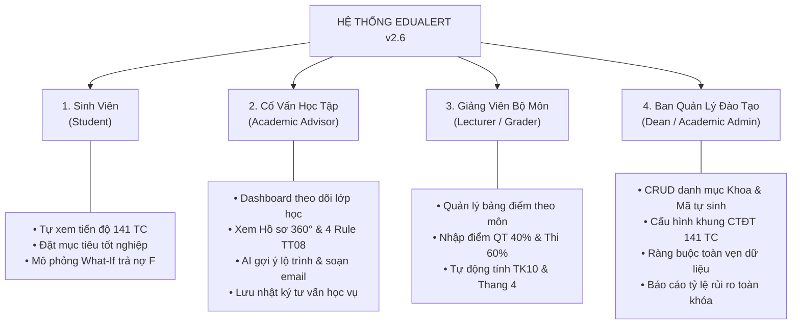

---

## 3. CƠ SỞ PHÁP LÝ & BỘ QUY TẮC NGHIỆP VỤ (BUSINESS RULES)

Hệ thống được lập trình tuân thủ nghiêm ngặt theo 2 bộ quy chế chính thống:

### 3.1. Quy chế đào tạo tín chỉ Đại học Mở TP.HCM (HCMCOU)
1. **Công thức tính điểm học phần (Điểm tổng kết thang 10):**
   $$\text{Điểm TK10} = (\text{Điểm QT} \times 0.4) + (\text{Điểm Thi} \times 0.6)$$
   *(Quy tắc làm tròn: Làm tròn số học đến 1 chữ số thập phân)*
2. **Bảng quy đổi điểm chữ và thang điểm 4.0 chuẩn:**
   * $9.0 \le \text{TK10} \le 10.0 \to \text{Điểm chữ: } \text{A+} \ (4.0) \ - \text{Xuất sắc}$
   * $8.5 \le \text{TK10} < 9.0 \to \text{Điểm chữ: } \text{A} \ (3.5) \ - \text{Giỏi}$
   * $8.0 \le \text{TK10} < 8.5 \to \text{Điểm chữ: } \text{B+} \ (3.0) \ - \text{Khá giỏi}$
   * $7.0 \le \text{TK10} < 8.0 \to \text{Điểm chữ: } \text{B} \ (2.5) \ - \text{Khá}$
   * $6.5 \le \text{TK10} < 7.0 \to \text{Điểm chữ: } \text{C+} \ (2.0) \ - \text{Trung bình khá}$
   * $5.5 \le \text{TK10} < 6.5 \to \text{Điểm chữ: } \text{C} \ (1.5) \ - \text{Trung bình}$
   * $5.0 \le \text{TK10} < 5.5 \to \text{Điểm chữ: } \text{D+} \ (1.0) \ - \text{Trung bình yếu}$
   * $4.0 \le \text{TK10} < 5.0 \to \text{Điểm chữ: } \text{D} \ (1.0) \ - \text{Yếu (Đạt)}$
   * $\text{TK10} < 4.0 \to \text{Điểm chữ: } \text{F} \ (0.0) \ - \text{Kém (Không đạt / Rớt môn)}$

3. **Cơ chế "Thế điểm" môn học lại (Grade Replacement Rule):**
   * Khi sinh viên đăng ký học lại một học phần từng bị điểm F ($0.0$) và đạt điểm mới ($\ge 4.0$), điểm số mới sẽ **thay thế hoàn toàn** điểm F cũ khi tính Điểm trung bình tích lũy (GPA).
   * Đây là cơ chế đòn bẩy quan trọng nhất mà EduAlert ứng dụng vào tính năng mô phỏng What-If giúp sinh viên lội ngược dòng.

### 3.2. 4 Quy tắc Cảnh báo học vụ (Theo Thông tư 08/2021/TT-BGDĐT)
Sinh viên bị hệ thống cảnh báo nếu vi phạm một trong các điều kiện sau:
* **Rule 1 (Rớt môn trong kỳ quá nửa):** Tổng số tín chỉ không đạt trong học kỳ $> 50\%$ tổng số tín chỉ đăng ký học kỳ đó.
* **Rule 2 (Tổng nợ đọng toàn khóa):** Tổng số tín chỉ nợ chưa trả vượt quá 24 tín chỉ ($> 24$ TC).
* **Rule 3 (ĐTB học kỳ chạm sàn):** $\text{GPA học kỳ} < 0.80$ (đối với học kỳ đầu tiên) hoặc $< 1.00$ (đối với các học kỳ tiếp theo).
* **Rule 4 (ĐTB tích lũy chạm đáy theo năm đào tạo):** $\text{GPA tích lũy}$ dưới ngưỡng sàn an toàn:
  * Năm thứ nhất: $< 1.20$
  * Năm thứ hai: $< 1.40$
  * Năm thứ ba: $< 1.60$
  * Năm thứ tư trở đi: $< 1.80$
* **Khung chế tài Buộc thôi học (Mức 3):** Sinh viên bị cảnh báo học vụ 2 lần liên tiếp hoặc vượt quá thời gian tối đa được phép học tập tại trường.

---

## 4. KIẾN TRÚC HỆ THỐNG (FULLSTACK ARCHITECTURE - FE, BE, DB & AI)

Hệ thống được thiết kế theo kiến trúc **Fullstack Cloud-Native** hiện đại:

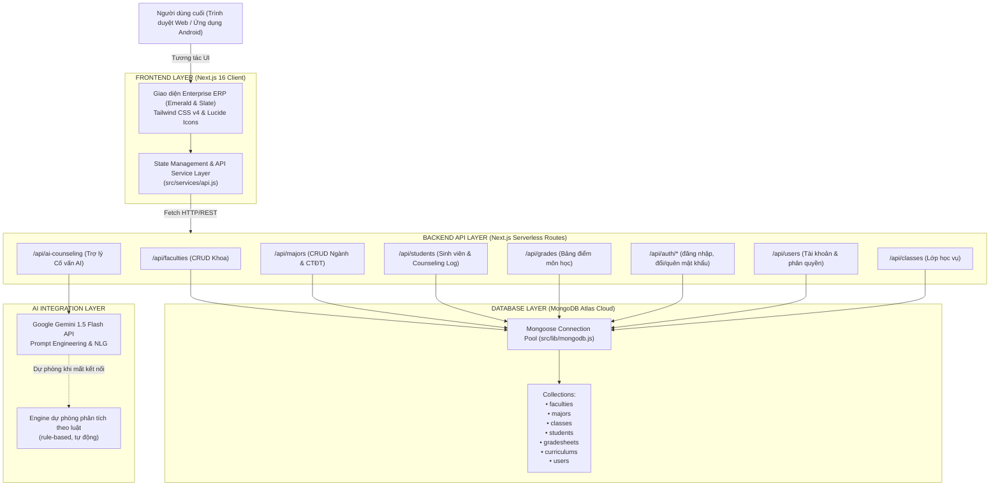

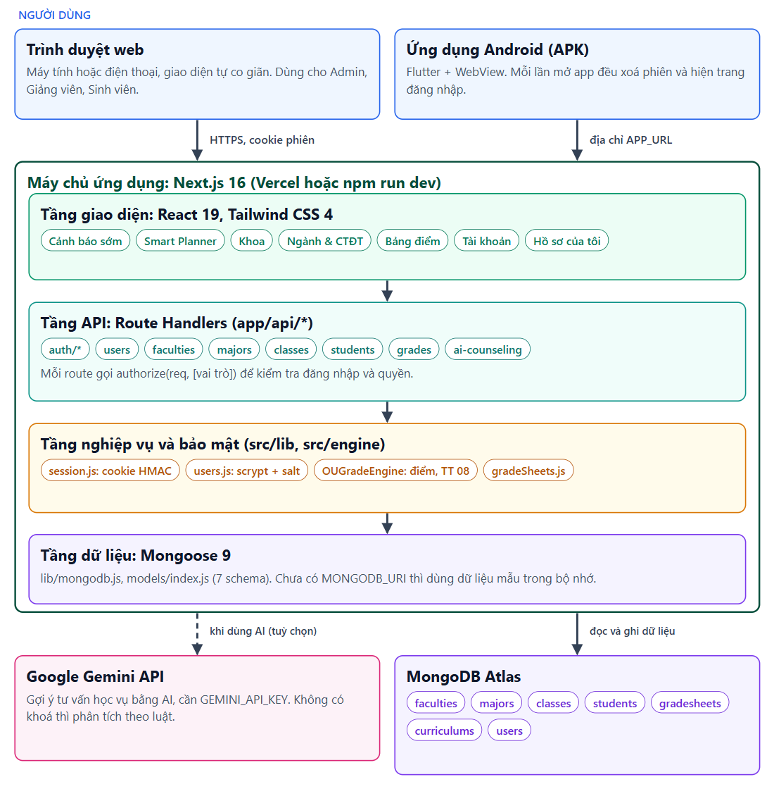


### Chi tiết các tầng công nghệ:
1. **Frontend:**
   - **Framework:** Next.js 16.4.3 (Turbopack bundler), React 19.
   - **Styling:** Tailwind CSS v4, phong cách thiết kế **Enterprise ERP Clean System** lấy cảm hứng từ các hệ thống quản trị chất lượng hiện đại (Tone màu chủ đạo: Xanh rừng ngọc bích `#064e3b` và Đá phiến `#0f172a`).
   - **Thư viện biểu tượng:** Lucide React Icons đồng bộ.
2. **Backend API:**
   - **Kiến trúc:** Next.js Serverless API Routes (`app/api/*`) hỗ trợ mở rộng không giới hạn trên hạ tầng Serverless.
   - **Tổ chức mã nguồn:** một ứng dụng Next.js duy nhất (giao diện và API chung một dự án, viết bằng JavaScript/JSX), không có máy chủ backend riêng; khi cần mở rộng có thể tách các API Route thành dịch vụ độc lập.
3. **Cơ sở dữ liệu (Database):**
   - **Cloud Database:** MongoDB Atlas Serverless Cloud (cụm Atlas riêng của dự án, kết nối qua biến môi trường `MONGODB_URI`).
   - **Quản lý dữ liệu:** Mongoose ODM với cơ chế tự động Seed dữ liệu mẫu khi khởi tạo lần đầu và cơ chế In-memory fallback bảo đảm ứng dụng không bao giờ bị gián đoạn.
4. **Trí tuệ nhân tạo (AI):**
   - **Mô hình:** Google Gemini 1.5 Flash API thông qua kỹ thuật Prompt Engineering đóng vai Chuyên gia Cố vấn học vụ.
5. **Nền tảng triển khai (DevOps / Deployment):**
   - Tích hợp Git Version Control trên GitHub (`legiahan2705/Project-EduAlert`).
   - Tự động Build & Deploy liên tục (CI/CD) trên **Vercel Cloud**.
6. **Ứng dụng di động:**
   - Flutter (`webview_flutter`) — vỏ Android bọc giao diện web.

### Phân quyền (RBAC) và bảo mật

Hệ thống có **3 vai trò cố định**: Quản trị viên (`admin`), Giảng viên (`lecturer`) và Sinh viên (`student`). Quyền được kiểm tra ở **hai lớp**: giao diện chỉ hiện các tab thuộc vai trò (`src/lib/roles.js`), và mọi API Route đều gọi `authorize(req, [vai trò])` trước khi xử lý, nên người dùng không thể vượt quyền bằng cách gọi API trực tiếp. Dữ liệu sinh viên còn được lọc theo phạm vi: quản trị viên thấy tất cả, giảng viên chỉ thấy sinh viên thuộc các lớp mình phụ trách, sinh viên chỉ thấy bản ghi của chính mình.

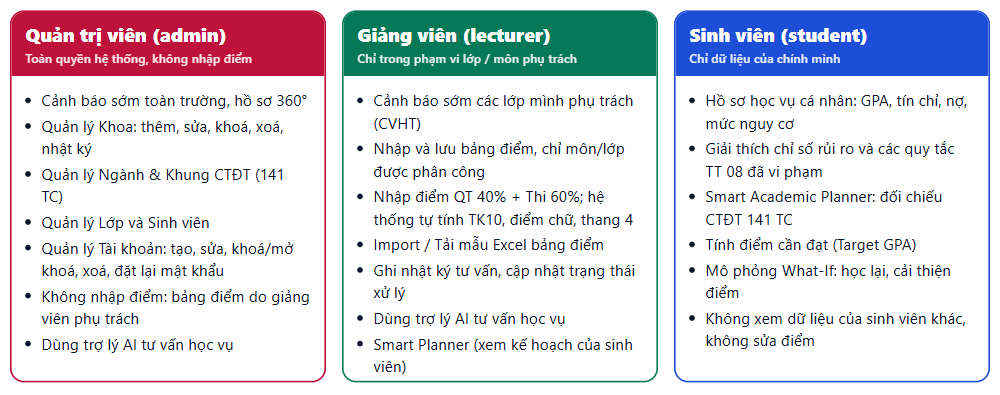

**Các tab giao diện theo vai trò:**

| Tab | Quản trị viên | Giảng viên | Sinh viên |
| :--- | :---: | :---: | :---: |
| Cảnh báo sớm nguy cơ | ✔ | ✔ | – |
| Hồ sơ của tôi | – | – | ✔ |
| Smart Planner | ✔ | ✔ | ✔ |
| Nhập bảng điểm môn | – | ✔ | – |
| Quản lý Khoa | ✔ | – | – |
| Quản lý Ngành & CTĐT | ✔ | – | – |
| Quản lý Tài khoản | ✔ | – | – |

**Quyền truy cập ở tầng API:**

| API | Vai trò được phép |
| :--- | :--- |
| `GET /api/faculties`, `majors`, `classes` | Cả ba vai trò (đã đăng nhập) |
| `POST/PUT/DELETE` faculties, majors, classes, students | Chỉ quản trị viên |
| `GET /api/students` | Cả ba vai trò; kết quả được lọc theo phạm vi (`canAccessStudent`) |
| `GET/PUT /api/grades` | Quản trị viên, giảng viên; khi lưu điểm, giảng viên phải là người phụ trách môn hoặc lớp đó (nếu không trả 403) |
| `POST /api/ai-counseling`, ghi nhật ký tư vấn | Quản trị viên, giảng viên (trong phạm vi sinh viên của mình) |
| `/api/users` (toàn bộ) | Chỉ quản trị viên |
| `POST /api/auth/change-password` | Mọi người dùng đã đăng nhập |
| `POST /api/auth/login`, `forgot-password` | Công khai |

**Cơ chế bảo mật:**

| Cơ chế | Mô tả |
| :--- | :--- |
| Băm mật khẩu | `scrypt` với salt ngẫu nhiên cho từng tài khoản; chỉ lưu `passwordHash` và `salt` |
| Phiên đăng nhập | Cookie `edualert_session`: `httpOnly`, `SameSite=Lax`, thêm cờ `secure` ở production; nội dung ký HMAC-SHA256 bằng `AUTH_SECRET`; hết hạn sau 8 giờ |
| Giới hạn đăng nhập sai | Tối đa 5 lần trong 10 phút cho mỗi tổ hợp IP, vai trò và tên đăng nhập (chỉ bật ở production) |
| Khoá tài khoản | Tài khoản `LOCKED` bị từ chối đăng nhập; quản trị viên khoá và mở khoá được |
| Bắt đổi mật khẩu lần đầu | Cờ `mustChangePassword` bật khi admin tạo tài khoản mới hoặc đặt lại mật khẩu; giao diện hiện cửa sổ đổi mật khẩu **không thể đóng** cho tới khi đổi xong (≥ 6 ký tự, khác mật khẩu cũ) |
| Quên mật khẩu | Hai bước: xác minh bằng tên đăng nhập/MSSV cùng email hoặc số điện thoại trong hồ sơ, sau đó đặt mật khẩu mới |

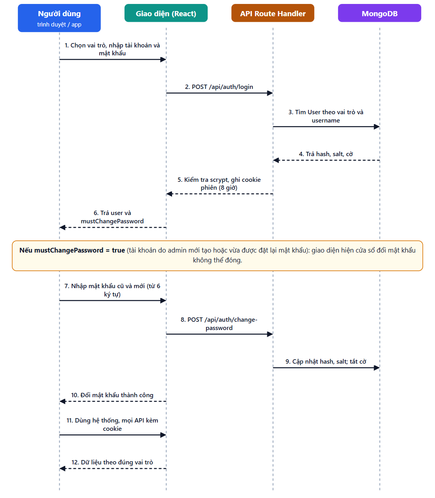

### Ứng dụng Android (Flutter WebView)

Thư mục `edualert_app` chứa một ứng dụng **Flutter** bọc giao diện web EduAlert trong **WebView** (`webview_flutter`). Ứng dụng không chứa dữ liệu hay giao diện riêng nên **chỉ hoạt động khi web đang chạy và truy cập được**.

* **Địa chỉ web** được truyền khi build: `flutter build apk --release --dart-define=APP_URL=<địa chỉ web>`. Mặc định là `http://10.0.2.2:3000` — địa chỉ chỉ dùng được trên **máy ảo** Android; trên điện thoại thật phải dùng IP trong mạng LAN hoặc tên miền Vercel.
* Manifest khai báo quyền `INTERNET` và `usesCleartextTraffic` để chạy được với web nội bộ qua `http`.
* **Mỗi lần mở app đều xoá phiên đăng nhập** (cookie và bộ nhớ trang) nên luôn bắt đầu từ trang đăng nhập; nếu chuyển sang ứng dụng khác từ 30 giây trở lên rồi quay lại thì cũng phải đăng nhập lại.
* Khi không tải được trang, app hiện màn hình lỗi kết nối kèm nút **Thử lại**; nút Back lùi trang trong WebView.
* Giao diện web tự co giãn theo màn hình: thanh bên thành ngăn kéo, khối tóm tắt xếp lưới 2 cột, bảng dữ liệu chuyển thành dạng thẻ.

<p align="center">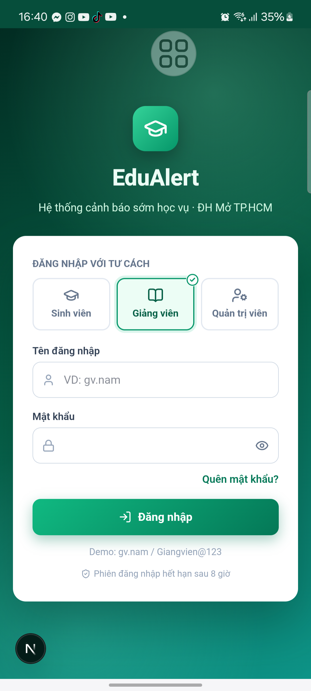</p>


---

## 5. THIẾT KẾ CƠ SỞ DỮ LIỆU CLOUD (MONGODB SCHEMA & ERD)

Dữ liệu học vụ được chuẩn hóa thành 7 Collection chính trong MongoDB Atlas, quản lý bởi Mongoose ORM:

```mermaid
erDiagram
    FACULTY ||--o{ MAJOR : "chứa các ngành (1-n)"
    MAJOR ||--o{ CLASS : "quản lý các lớp sinh hoạt (1-n)"
    MAJOR ||--|| CURRICULUM : "quy định khung 141 TC 8 học kỳ (1-1)"
    CLASS ||--o{ STUDENT : "danh sách sinh viên từ Năm 1 (1-n)"
    CLASS ||--o{ GRADE_SHEET : "các bảng điểm học phần theo CTĐT (1-n)"
    USER ||--o{ STUDENT : "tài khoản đăng nhập sinh viên (1-1)"
    USER ||--o{ CLASS : "giảng viên chủ nhiệm / CVHT (1-n)"

    FACULTY {
        string id PK "OU261104001"
        string code "Mã Khoa tự sinh"
        string name "Tên Khoa tiếng Việt"
        string nameEn "Tên Khoa tiếng Anh"
        string shortCode "FIT, FECO, FAAF, FBA, FFL"
        string status "ACTIVE/INACTIVE"
        array auditLogs "Lịch sử chỉnh sửa"
    }

    MAJOR {
        string id PK "FIT2611001"
        string code "[Ký hiệu Khoa] + YYMM + XXX"
        string name "Tên Ngành tiếng Việt"
        string nameEn "Tên Ngành tiếng Anh"
        string facultyId "Id khoa (OU261104001)"
        string facultyCode "Ký hiệu khoa (FIT) = Faculty.shortCode"
        number creditsStandard "141 TC"
        string status "ACTIVE/INACTIVE"
        array auditLogs "Lịch sử cập nhật"
    }

    CLASS {
        string id PK "DH22CS01C"
        string maLop "DH22CS01C"
        string tenLop "Lớp KHMT Khóa 2022"
        string maNganh "FIT2200001"
        number siSo "Sĩ số sinh viên"
        string cvht "Cố vấn học tập"
        string emailCVHT "Email CVHT"
    }

    CURRICULUM {
        string majorCode PK "FIT2200001"
        array courses "Danh mục môn học qua 8 học kỳ (KHMT: 30 môn, kèm môn liên ngành)"
    }

    STUDENT {
        string maSV PK "2251050001"
        string hoTen "Nguyễn Văn An"
        string lop "DH22CS01C"
        string maNganh "FIT2200001"
        number namHoc "Năm 1, 2, 3, 4"
        number gpaTL "Tự động tính từ bảng điểm các môn"
        number gpaHK "GPA học kỳ gần nhất"
        number tcTichLuy "Tổng TC các môn đạt (pass)"
        number tcNo "Tổng TC môn rớt F (debt)"
        string level "NORMAL/WARNING/HIGH_RISK/DROP_OUT_RISK"
        array historySemesters "Lịch sử điểm các học kỳ"
        array counselingLog "Nhật ký tư vấn CVHT"
    }

    GRADE_SHEET {
        string id PK "BD-DH22CS01C-COSC2301"
        string maLop "DH22CS01C"
        string maMon "COSC2301"
        string tenMon "Cấu trúc dữ liệu và giải thuật"
        number soTC "3"
        string hocKy "HK3"
        string giangVien "TS. Phạm Minh Tuấn"
        string trangThai "COMPLETED/IN_PROGRESS/NOT_STARTED"
        array grades "Chi tiết điểm QT, Thi, TK10, Thang 4 của từng SV"
    }

    USER {
        string username PK "2251050001 / gv.nam / admin"
        string passwordHash "Băm bảo mật qua scryptSync"
        string salt "Muối ngẫu nhiên 16 bytes"
        string role "admin / lecturer / student"
        string name "Họ và tên"
        string email "Email trường OU"
        string phone "Số điện thoại"
        string status "ACTIVE / LOCKED"
        boolean mustChangePassword "Bắt đổi mật khẩu ở lần đăng nhập kế tiếp"
        string facultyCode "Ký hiệu khoa (giảng viên)"
        array classes "Mã lớp phụ trách (giảng viên)"
        array coursesTaught "Mã môn giảng dạy (giảng viên)"
        string maSV "Mã sinh viên (tài khoản sinh viên)"
    }
```

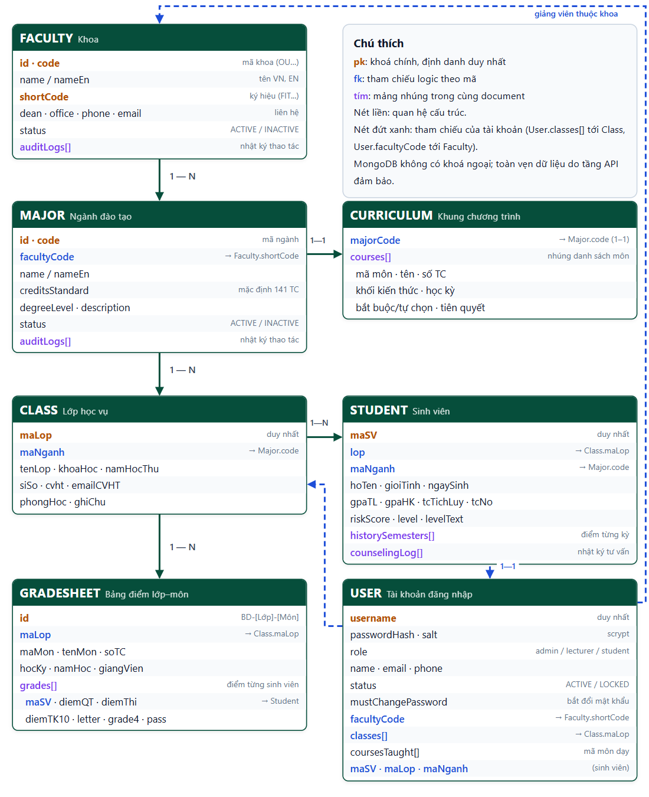

> **Ghi chú:** MongoDB không có khoá ngoại; các quan hệ là tham chiếu logic theo mã và tính toàn vẹn do tầng API đảm bảo. Tên collection trong MongoDB là `faculties`, `majors`, `classes`, `students`, `gradesheets`, `curriculums`, `users`. Trường `facultyCode` của `majors` và `users` là **ký hiệu khoa** (ví dụ `FIT`, trỏ tới `faculties.shortCode`); mã khoa dạng `OU…` nằm ở `faculties.id/code` và `majors.facultyId`.


---

## 6. HỆ THỐNG CÁC TÍNH NĂNG VÀ USER STORIES (US)

Dự án được phân rã thành 7 User Story nghiệp vụ tương ứng với các phân hệ giao diện:

### 6.1. User Story US-01: Quản Lý Danh Mục Khoa (Faculty Management)
* **User Story:** *"Là Ban Quản lý Đào tạo, tôi muốn CRUD danh mục khoa với mã tự sinh theo cấu trúc quy định, lưu nhật ký sửa đổi và ngăn chặn việc xóa các khoa đã có ngành trực thuộc để bảo đảm toàn vẹn dữ liệu."*
* **Tính năng:**
  * Mã Khoa tự sinh: `OU + YYMMDD + XXX` (Ví dụ: `OU261104001`).
  * Khai báo tên tiếng Việt, tiếng Anh, ký hiệu viết tắt duy nhất (`FIT`, `FECO`, `FAAF`, `FBA`, `FFL`).
  * Chặn xóa thông minh: Nếu khoa đã có ngành liên kết $\to$ Khóa nút xóa, chỉ cho phép Vô hiệu hóa / Kích hoạt.
  * Audit Trail: Xem lịch sử ai đã sửa, vào lúc nào, giá trị cũ và mới.

### 6.2. User Story US-02: Quản Lý Ngành & Khung CTĐT 141 Tín Chỉ
* **User Story:** *"Là Ban Đào tạo, tôi muốn tạo ngành học mới với mã tự sinh theo ký hiệu khoa kèm Live Preview trực quan, cấu hình khung CTĐT chuẩn 141 tín chỉ gồm 8 học kỳ và các môn liên ngành để phục vụ lộ trình học tập."*
* **Tính năng:**
  * Mã ngành tự sinh: `[Ký hiệu Khoa] + YYMM + XXX` (Ví dụ: `FIT2611001`).
  * Giao diện Modal hiện đại với Live Preview Badge: Hiển thị ngay mã ngành sẽ phát sinh theo thời gian thực và phân giải công thức cấu thành.
  * Bố cục 2 cột cân xứng: Tên tiếng Việt, Tên tiếng Anh, Chuẩn tín chỉ (kèm badge `TC`), Hệ đào tạo.
  * Workspace 4 Subtabs:
    1. *Tổng quan:* Chuẩn 141 TC, văn bằng, quy mô đào tạo.
    2. *Chương trình đào tạo:* Quản lý khung môn học qua 8 học kỳ (ngành Khoa học máy tính: 30 môn), hỗ trợ môn liên ngành từ Khoa Ngoại ngữ (`ENGL1301`) hoặc Khoa Kinh tế (`ECON1301`).
    3. *Danh sách lớp & Sinh viên:* Quản lý các lớp và sinh viên trực thuộc ngành.
    4. *Lịch sử:* Nhật ký kiểm toán thay đổi chương trình.

### 6.3. User Story US-03: Quản Lý Lớp Học Vụ & Tiếp Nhận Sinh Viên Từ Năm 1
* **User Story:** *"Là Giáo vụ / Ban Đào tạo, tôi muốn tạo lớp học và thêm sinh viên vào lớp theo đúng lộ trình Năm 1 (HK1), không cho phép nhập điểm GPA tích lũy tùy tiện mà hệ thống phải tự động tính toán từ bảng điểm các môn học trong CTĐT."*
* **Tính năng:**
  * Thêm lớp học mới với mã lớp tự động, niên khóa 4 năm (Ví dụ: `DH22CS01C`, khóa `2022 - 2026`).
  * Modal thêm sinh viên hiện đại: Nhập MSSV, Họ tên, Giới tính, Ngày sinh, Số điện thoại, Email sinh viên (tự gợi ý `[MSSV]@student.ou.edu.vn`).
  * **Bỏ ô nhập GPA và tín chỉ ban đầu:** Mọi sinh viên đều xuất phát từ Năm 1 với trạng thái `Mới (Năm 1)`.
  * **Tự động liên kết bảng điểm:** Khi sinh viên được thêm vào lớp, hệ thống tự động bổ sung sinh viên vào danh sách điểm của toàn bộ các bảng điểm môn học thuộc lớp đó.
  * Tự động tạo tài khoản sinh viên đăng nhập hệ thống (`Sinhvien@123`).

### 6.4. User Story US-04: Quản Lý Bảng Điểm & Tự Động Tái Tính GPA (Course Grades)
* **User Story:** *"Là Giảng viên bộ môn / CVHT, tôi muốn bảng điểm được gom nhóm theo môn học và mở rộng ra từng lớp, có thể nhập điểm quá trình và thi trực tiếp để hệ thống tự động tính điểm tổng kết và tự động cập nhật kết quả học tập cho toàn bộ sinh viên trong lớp."*
* **Tính năng:**
  * **Phân định vai trò:** Quản trị viên (Admin) không trực tiếp quản lý bảng điểm; chỉ Giảng viên bộ môn được phân công mới có quyền mở và lưu điểm.
  * Bố cục **Group by Course:** Gom nhóm theo môn học $\to$ bung mở danh sách bảng điểm các lớp.
  * Nhập điểm tương tác: Nhập QT (40%) và Thi (60%), tự tính TK10, quy đổi điểm chữ và thang điểm 4.
  * **Tự động tái tính toán GPA tích lũy:** Khi giảng viên lưu bảng điểm môn học (`PUT /api/grades/[sheetId]`), hệ thống tự động quét toàn bộ bảng điểm của lớp, tính tổng điểm nhân tín chỉ, cập nhật ngay `gpaTL`, `tcTichLuy`, `tcNo` và mức độ rủi ro học vụ cho từng sinh viên trong CSDL.

### 6.5. User Story US-05: Dashboard Giám Sát Cảnh Báo Sớm & Hồ Sơ 360°
* **User Story:** *"Là Cố vấn học tập, tôi muốn có Dashboard theo dõi sinh viên lớp phụ trách, tự động khoanh vùng các sinh viên có nguy cơ bị đuổi học và mở Hồ sơ 360° để nắm rõ các quy tắc vi phạm."*
* **Tính năng:**
  * Phân tầng tự động 4 nhóm học vụ:
    * 🔴 **Nhóm 1 - Nguy cơ Buộc thôi học (3 SV):** đã bị cảnh báo học vụ từ 2 lần liên tiếp.
    * 🟠 **Nhóm 2 - Cảnh báo học vụ Mức 1 (5 SV):** vi phạm ít nhất 1 quy tắc Thông tư 08 (bị cảnh báo lần 1).
    * 🟡 **Nhóm 3 - Tín hiệu sớm (8 SV):** chưa vi phạm quy tắc nào nhưng GPA tích lũy từ 1.70 trở xuống.
    * 🟢 **Nhóm 4 - An toàn (29 SV):** các sinh viên còn lại, tích lũy tốt, đúng tiến độ.
    * *(Số liệu trên lớp DH22CS01C, 45 sinh viên.)*
  * **Hồ Sơ Học Vụ 360°:** Bóc tách bài test 4 Rule của Bộ GD&ĐT, lịch sử điểm HK1–HK8, và Form ghi nhận nhật ký tư vấn lưu trực tiếp về CSDL đám mây.

### 6.6. User Story US-06: Kế Hoạch Học Tập Thông Minh (Smart Academic Planner)
* **User Story:** *"Là Sinh viên, tôi muốn đối chiếu tiến độ tích lũy với chuẩn 141 tín chỉ, tính điểm cần đạt để tốt nghiệp loại Khá/Giỏi, và mô phỏng việc học lại môn F để thấy trước kết quả thoát khỏi diện đuổi học."*
* **Tính năng:**
  * Thước đo hoàn thành CTĐT: Phân loại môn Đạt (🟢), môn Nợ F (🔴), môn Còn lại (🟡).
  * Công cụ Target GPA Calculator: Tính toán điểm trung bình cần đạt cho các tín chỉ còn lại.
  * Bộ mô phỏng What-If: Thử nghiệm kịch bản học lại môn rớt $\to$ Kích hoạt cơ chế thế điểm và hiển thị kết quả thoát khỏi diện cảnh báo học vụ.

### 6.7. User Story US-07: Quản Lý Tài Khoản (RBAC) & Tự Khôi Phục Mật Khẩu
* **User Story:** *"Là Người dùng hệ thống (Sinh viên, Giảng viên, Admin), nếu tôi quên mật khẩu, tôi muốn có thể tự xác thực và cập nhật mật khẩu mới ngay trên màn hình đăng nhập mà không cần chờ quản trị viên can thiệp."*
* **Tính năng:**
  * Quản trị người dùng (Admin): Tạo tài khoản, khóa/mở khóa tài khoản, phân công giảng dạy và CVHT.
  * **Quên mật khẩu tự phục vụ (Self-Service Forgot Password):**
    * Bước 1: Xác thực tài khoản qua Tên đăng nhập/MSSV + Email trường hoặc Số điện thoại hồ sơ.
    * Bước 2: Nhập và xác nhận mật khẩu mới (tối thiểu 6 ký tự, có toggle xem mật khẩu).
    * Bước 3: Đổi mật khẩu thành công và tự động điền thông tin để đăng nhập ngay chỉ với 1 click.
  * Mã hóa an toàn bằng thuật toán `scrypt` kèm muối ngẫu nhiên `salt`.
  * **Bắt đổi mật khẩu lần đầu:** tài khoản do quản trị viên tạo mới hoặc vừa được đặt lại mật khẩu phải đổi mật khẩu ngay ở lần đăng nhập đầu; người dùng cũng tự đổi được ở menu tài khoản trên thanh tiêu đề.
  * Ma trận phân quyền 3 vai trò và các cơ chế bảo mật: xem mục *Phân quyền (RBAC) và bảo mật* ở phần 4.

### Hình ảnh minh họa giao diện

Các ảnh dưới đây chụp từ hệ thống đang chạy với dữ liệu mẫu (6 khoa, 7 ngành, 8 lớp, 150 sinh viên, 161 tài khoản).

**Đăng nhập**

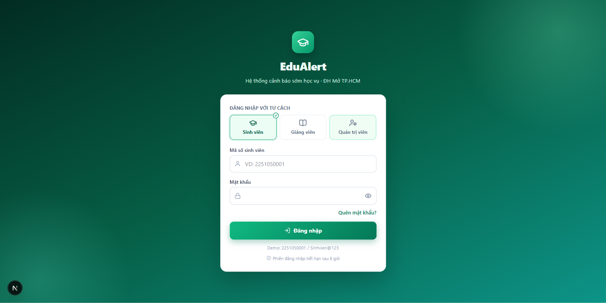

**Dashboard Cảnh báo sớm (quản trị viên / giảng viên)** — phân tầng lớp DH22CS01C (45 sinh viên) thành 4 nhóm: Buộc thôi học 3, Cảnh báo học vụ 5, Tín hiệu sớm 8, An toàn 29.

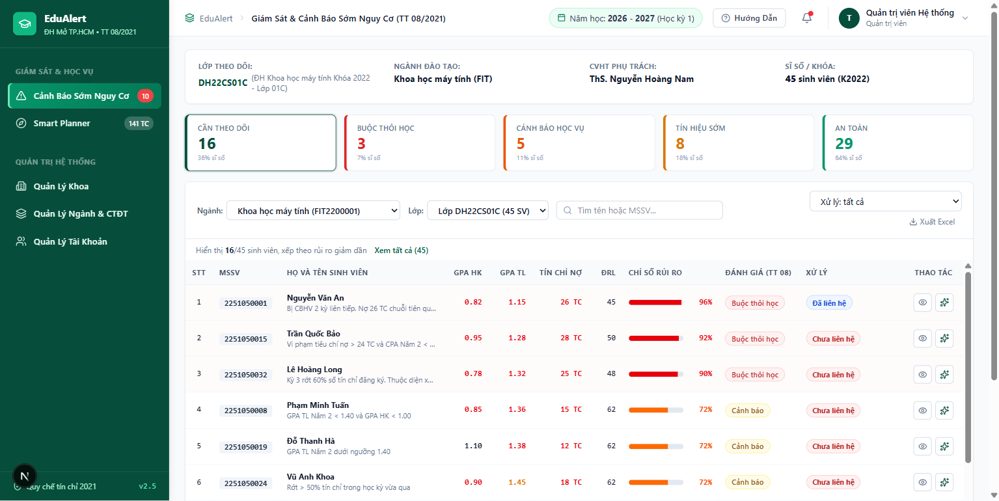

**Hồ sơ học vụ 360° (sinh viên Nguyễn Văn An)** — giải thích chỉ số rủi ro và kết quả đối chiếu 4 quy tắc Thông tư 08.

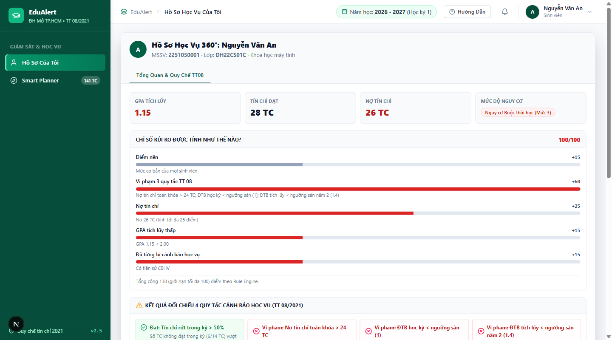

**Smart Academic Planner** — đối chiếu chương trình 141 tín chỉ, môn rớt F cần trả nợ, các môn còn lại.

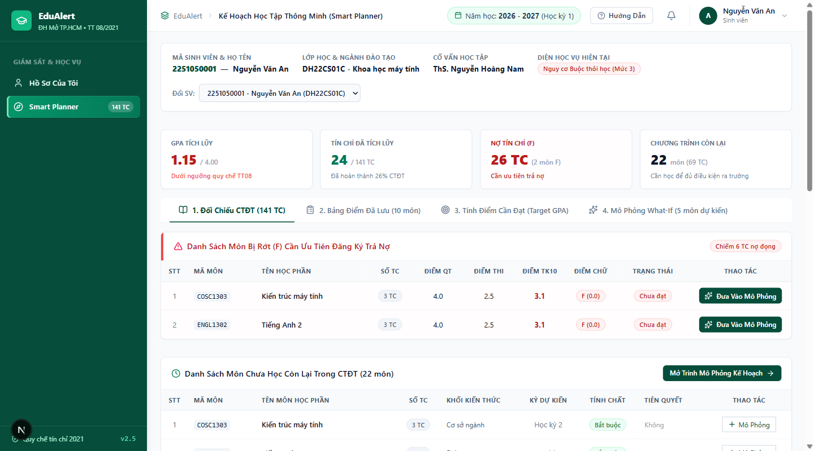

**Mô phỏng What-If** — thế điểm 2 môn F (Kiến trúc máy tính, Tiếng Anh 2): GPA tích lũy 1.15 → 1.80, nợ tín chỉ 26 → 20 TC, trạng thái chuyển sang Bình thường (kịch bản 5 môn, 15 TC, mục tiêu A+).

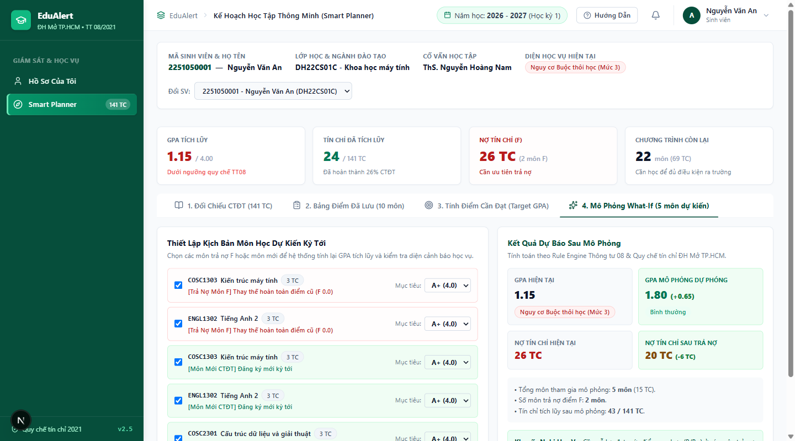

**Nhập bảng điểm (giảng viên)** — nhập điểm quá trình 40% và điểm thi 60%, hệ thống tự tính TK10, điểm chữ, thang 4 và kết quả Đạt/Rớt.

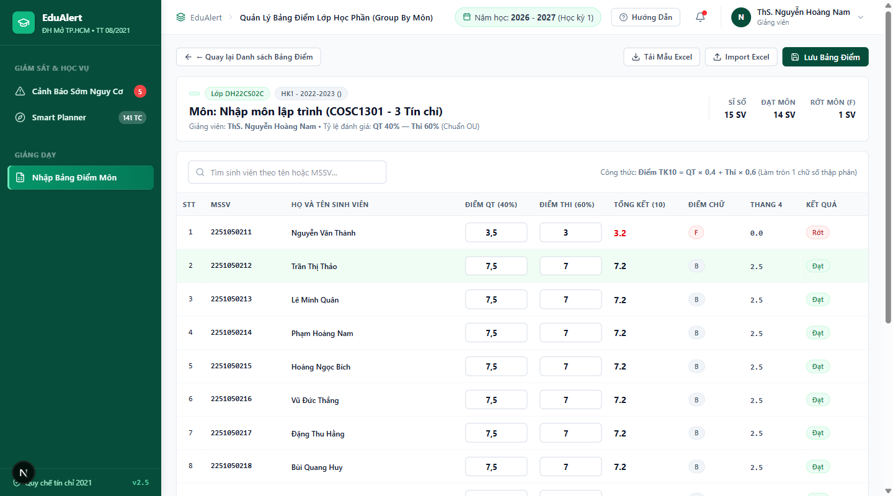

**Quản lý Khoa và Quản lý Tài khoản (quản trị viên)**

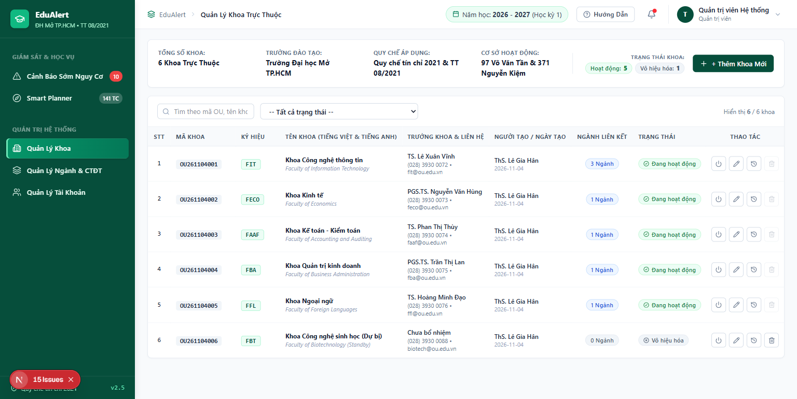

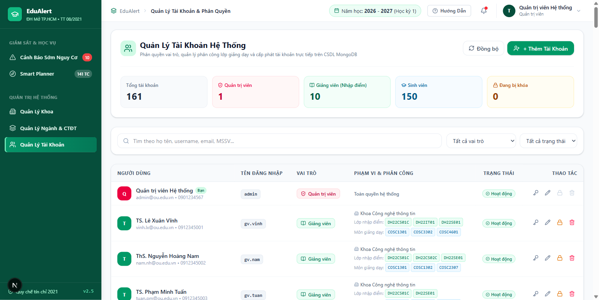

**Giao diện trên điện thoại** — bảng dữ liệu chuyển thành thẻ, tab con cuộn ngang.

<table>
  <tr>
    <td align="center">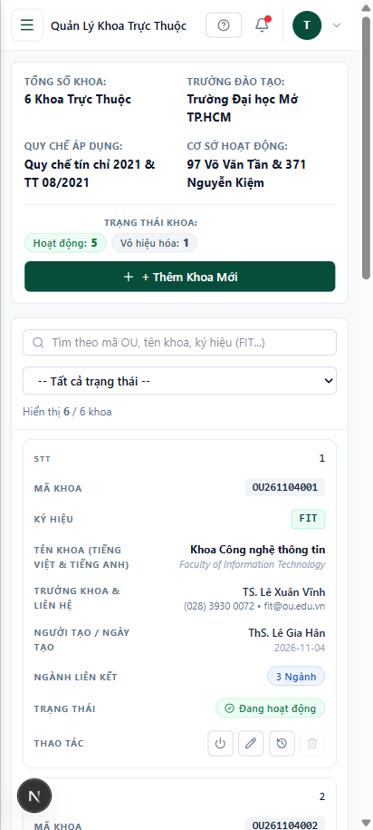<br><sub>Quản lý Khoa</sub></td>
    <td align="center">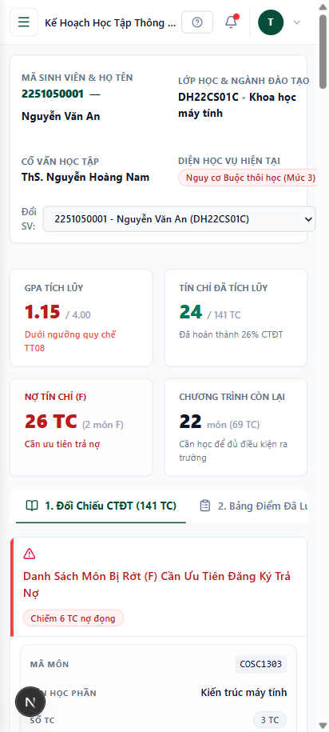<br><sub>Smart Planner</sub></td>
    <td align="center">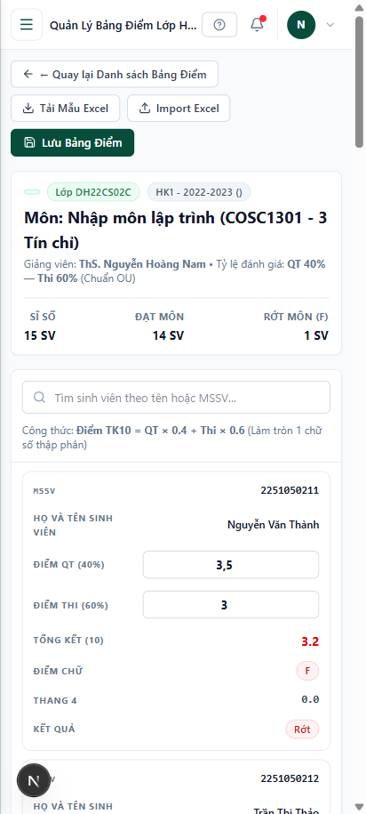<br><sub>Nhập điểm</sub></td>
  </tr>
</table>

---

## 7. LOGIC THUẬT TOÁN ĐIỀU HÀNH (RULE ENGINE, TARGET GPA & WHAT-IF)

### 7.1. Thuật toán phân tầng rủi ro (Risk Evaluation Algorithm)
```javascript
// Trích xuất logic từ src/engine/OUGradeEngine.js
evaluateAcademicWarning({ year, semesterCredits, failedCreditsInSem, gpaSem, gpaCumulative, debtCreditsTotal, hadPreviousWarning }) {
  const minGPA_TL = year <= 1 ? 1.2 : year <= 2 ? 1.4 : year <= 3 ? 1.6 : 1.8;
  const minGPA_Sem = 1.0;

  const rule1 = semesterCredits > 0 && failedCreditsInSem > 0.5 * semesterCredits;
  const rule2 = debtCreditsTotal > 24;
  const rule3 = gpaSem < minGPA_Sem;
  const rule4 = gpaCumulative < minGPA_TL;

  // Xếp loại nguy cơ
  if (hadPreviousWarning && (rule1 || rule2 || rule3 || rule4)) {
    return { level: 'DROP_OUT_RISK', text: 'Nguy cơ Buộc thôi học (Mức 3)' };
  }
  if (rule1 || rule2 || rule3 || rule4) {
    return { level: 'WARNING', text: 'Cảnh báo học vụ (Mức 1)' };
  }
  if (gpaCumulative <= 1.70) {
    return { level: 'EARLY_SIGNAL', text: 'Tín hiệu sớm (Nguy cơ rớt môn)' };
  }
  return { level: 'SAFE', text: 'An toàn' };
}
```

### 7.2. Thuật toán tính điểm cần đạt (Target GPA Engine)
$$\text{GPA}_{\text{cần đạt}} = \frac{\text{GPA}_{\text{mục tiêu}} \times 141 - \text{GPA}_{\text{hiện tại}} \times \text{TC}_{\text{đã tích lũy}}}{\text{TC}_{\text{còn lại}}}$$
* Nếu $\text{GPA}_{\text{cần đạt}} \le 3.20$: Mục tiêu rất khả thi, duy trì phong độ.
* Nếu $3.20 < \text{GPA}_{\text{cần đạt}} \le 3.60$: Thách thức cao, đòi hỏi tỷ lệ điểm A/B+ chiếm trên 70%.
* Nếu $\text{GPA}_{\text{cần đạt}} > 4.00$: **Bất khả thi nếu chỉ học môn mới** $\to$ Hệ thống kích hoạt khuyến nghị: *"Bắt buộc sinh viên phải đăng ký học cải thiện từ 2 đến 4 môn điểm D/D+ để thay thế điểm cũ"*.

### 7.3. Thuật toán mô phỏng thế điểm What-If (What-If Simulation Engine)
1. Lấy danh sách các môn học tham gia mô phỏng (gồm môn học lại điểm F và môn học mới).
2. Với môn học lại: Tìm môn F cũ trong lịch sử, trừ điểm chất lượng cũ ($0 \times \text{Số TC}$) và cộng điểm chất lượng mới ($\text{TargetGrade} \times \text{Số TC}$).
3. Giảm số tín chỉ nợ tương ứng: $\text{Nợ mới} = \text{Nợ cũ} - \sum \text{TC môn F được trả nợ}$.
4. Tính lại GPA tích lũy mới và chạy lại Rule Engine để kiểm tra điều kiện thoát cảnh báo.

---

## 8. ỨNG DỤNG TRÍ TUỆ NHÂN TẠO (AI GENERATIVE TRONG HỖ TRỢ CỐ VẤN)

Hệ thống tích hợp mô hình **Google Gemini 1.5 Flash API** qua Endpoint `/api/ai-counseling` nhằm tự động hóa công tác tư vấn học vụ:

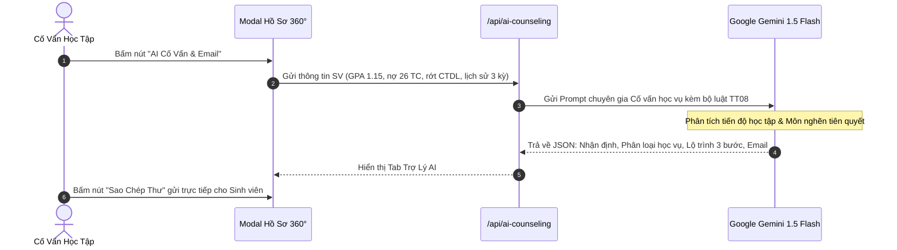

### 2 Năng lực AI phục vụ học vụ:
1. **Phân tích học vụ tự động (Academic Risk Classification):**
   - Tự động phát hiện các môn học gây nghẽn tiến độ (môn rớt nằm trong chuỗi môn tiên quyết: Lập trình $\to$ Cấu trúc dữ liệu).
   - Đánh giá mức độ khẩn cấp theo số tín chỉ nợ đọng so với giới hạn 24 TC của quy chế Thông tư 08.
2. **AI Generative Action Plan & Email Draft (Kế hoạch hành động & Soạn thư):**
   - Đề xuất mức giảm tải số tín chỉ học kỳ tới (tối đa 12 – 14 TC) để tránh quá tải.
   - Soạn sẵn bản thảo email thông báo học vụ trang trọng, ân cần để giảng viên gửi cho sinh viên.

---

## 9. CASE STUDY ĐIỂN HÌNH: GIẢI CỨU HỌC VỤ SINH VIÊN NGUYỄN VĂN AN

### 9.1. Thông số ban đầu của sinh viên
* **Họ tên:** Nguyễn Văn An | **MSSV:** `2251050001` | **Lớp:** `DH22CS01C`.
* **GPA tích lũy:** **1.15 / 4.00** | **GPA học kỳ gần nhất:** **0.82**.
* **Tín chỉ nợ đọng:** **26 TC** (Rớt môn *Kiến trúc máy tính* và *Tiếng Anh 2*).
* **Trạng thái quy chế:** Đã bị cảnh báo học vụ ở học kỳ trước $\to$ Kỳ này tiếp tục vi phạm cả 4 Rule $\to$ **Đứng trước quyết định Buộc thôi học**.

### 9.2. Kịch bản giải cứu qua 4 bước trên EduAlert
1. **Bước 1 - Phát hiện:** CVHT mở Dashboard Cảnh báo sớm, hệ thống lập tức gắn cờ đỏ sinh viên Nguyễn Văn An ở vị trí đầu tiên của Nhóm 1 (Nguy cơ buộc thôi học).
2. **Bước 2 - Phân tích AI:** 
   - CVHT mở Hồ sơ 360°, bấm **"AI Cố Vấn & Email"**.
   - AI bóc tách dữ liệu học vụ khách quan: An bị rớt chuỗi môn tiên quyết (*Kiến trúc máy tính* và *Tiếng Anh 2*), đồng thời nợ 26 TC vượt trần quy định.
   - AI tự động đưa ra kế hoạch can thiệp 3 bước và soạn sẵn bản thảo email mời An lên gặp cố vấn với giọng điệu trang trọng, ân cần, tập trung vào giải pháp đăng ký môn học kỳ mới.
3. **Bước 3 - Thiết lập kế hoạch với Smart Planner:** CVHT cùng An mở tab Mô phỏng What-If. Đưa 2 môn F (Kiến trúc máy tính, Tiếng Anh 2) vào kịch bản kỳ tới cùng các môn dự kiến (tổng 5 môn, 15 tín chỉ) và chọn mục tiêu điểm cho từng môn.
4. **Bước 4 - Kết quả mô phỏng:** Nhờ cơ chế "thế điểm", với kịch bản 5 môn (15 TC) và mục tiêu A+ (mặc định của công cụ), GPA tích lũy của An bật từ **1.15 lên 1.80 (+0.65)**, số tín chỉ nợ giảm từ 26 xuống **20 TC (−6 TC)** và trạng thái chuyển sang **Bình thường**. Kết quả thay đổi theo mục tiêu điểm người dùng chọn Sinh viên lấy lại niềm tin và có lộ trình học tập khả thi.

---

## 10. HƯỚNG DẪN CÀI ĐẶT, VẬN HÀNH & TRIỂN KHAI (DEPLOYMENT GUIDE)

### 10.1. Môi trường phát triển Local (Local Development)
Yêu cầu: Đã cài đặt **Node.js (v20.9 trở lên)** và **Git**.

```bash
# Bước 1: Clone mã nguồn từ GitHub
git clone https://github.com/legiahan2705/Project-EduAlert.git
cd Project-EduAlert

# Bước 2: Cài đặt toàn bộ thư viện dependencies
npm install

# Bước 3: Tạo file .env.local (KHÔNG commit file này lên GitHub)
cat > .env.local <<EOF
MONGODB_URI=<chuỗi kết nối MongoDB Atlas của bạn>
AUTH_SECRET=<chuỗi bí mật bất kỳ để ký cookie phiên>
GEMINI_API_KEY=<khóa Gemini, có thể để trống>
EOF

# Bước 4: Nạp dữ liệu mẫu (6 khoa, 7 ngành, CTĐT 8 học kỳ, 8 lớp, bảng điểm 4 năm, 150 sinh viên) và tài khoản
# (chỉ khi cơ sở dữ liệu còn trống)
npm run seed
npm run seed:users

# Bước 5: Khởi chạy môi trường phát triển
npm run dev

# Mở trình duyệt truy cập: http://localhost:3000
```

### 10.2. Triển khai Production lên Vercel Serverless Platform
1. Truy cập **[vercel.com](https://vercel.com)** và liên kết repository **`legiahan2705/Project-EduAlert`**.
2. Tại mục **Environment Variables**, khai báo các biến môi trường:
   * **`MONGODB_URI`**: Chuỗi kết nối MongoDB Atlas (lấy ở Atlas → Connect → Drivers); **không** đưa vào mã nguồn hay tài liệu
   * **`AUTH_SECRET`**: Khóa bí mật bảo vệ Session Cookie HMAC-SHA256
   * **`GEMINI_API_KEY`**: Khóa API Google Gemini AI
3. Mỗi khi đẩy mã nguồn mới lên nhánh `main`, Vercel sẽ tự động build và triển khai liên tục không gián đoạn: `https://project-edualert.vercel.app`.

---

## 11. KẾT LUẬN & ĐỊNH HƯỚNG MỞ RỘNG ĐỀ TÀI

### 11.1. Kết luận
Dự án **EduAlert v2.6 Enterprise Cloud** đã hiện thực hóa thành công một hệ sinh thái quản lý học vụ thông minh, khép kín từ khâu quản lý danh mục Khoa, Ngành, Khung CTĐT chuẩn 4 năm, Bảng điểm từng môn học đến khâu giám sát cảnh báo sớm và tư vấn cải thiện điểm số. Dự án chứng minh tính hiệu quả vượt trội khi kết hợp giữa **sự chuẩn xác của quy chế đào tạo** và **năng lực thấu hiểu, đồng cảm của Trí tuệ Nhân tạo Generative AI**.

### 11.2. Định hướng mở rộng trong tương lai
* **Đồng bộ thời gian thực với LMS (Canvas / Moodle):** Lấy dữ liệu chuyên cần và điểm quá trình giữa kỳ để đưa ra cảnh báo sớm từ tuần thứ 4 của học kỳ.
* **Tích hợp kênh liên lạc đa nền tảng:** Tự động gửi thông báo học vụ và thư nhắc nhở qua Zalo ZNS / Telegram Bot đến sinh viên và phụ huynh.
* **Thuật toán tối ưu hóa thời khóa biểu (Genetic Algorithm):** Tự động sắp xếp lịch học lại các môn nợ F cho sinh viên mà không bị trùng lịch với các môn học mới.

### 11.3. Hạn chế hiện tại và hướng xử lý

| Hạn chế | Đề xuất |
| :--- | :--- |
| Dữ liệu mẫu có **15 sinh viên lớp DH22CS02C trùng mã số** với lớp DH22CS01C (từ `2251050211` đến `2251050225`), gây cảnh báo trùng `key` của React và có thể chọn nhầm sinh viên theo MSSV | Đổi dãy mã của lớp DH22CS02C trong `src/engine/mockData.js` sang dãy khác rồi nạp lại dữ liệu |
| Việc bắt đổi mật khẩu lần đầu hiện chỉ chặn ở **giao diện**; người gọi API trực tiếp vẫn dùng được các API khác khi chưa đổi | Kiểm tra cờ `mustChangePassword` trong `authorize()` và từ chối các API khác cho tới khi đổi xong |
| Nếu thiếu `AUTH_SECRET`, hệ thống dùng khoá dự phòng viết sẵn trong mã nguồn | Bắt buộc đặt `AUTH_SECRET` khi deploy và bỏ khoá dự phòng ở production |
| Bộ đếm đăng nhập sai nằm trong bộ nhớ tiến trình, không dùng chung giữa nhiều phiên bản serverless | Lưu bộ đếm ở MongoDB hoặc dịch vụ cache dùng chung |
| Chưa có nhật ký thao tác toàn hệ thống (hiện chỉ có `auditLogs` của Khoa và Ngành) | Thêm collection nhật ký chung cho tạo, sửa, xoá và đăng nhập |
| Thêm sinh viên mới chỉ làm được từng người | Bổ sung nhập hàng loạt từ file Excel kèm xem trước và báo lỗi theo dòng |
| Ứng dụng Android phụ thuộc vào máy chủ web; bản thử nghiệm trỏ tới IP nội bộ nên chỉ dùng được khi máy tính bật | Triển khai web lên Vercel rồi build lại APK với địa chỉ `https` |
| Trợ lý AI cần khoá Gemini; khi thiếu khoá chỉ có phân tích theo luật | Cấu hình `GEMINI_API_KEY` và theo dõi chi phí sử dụng |
| Dữ liệu thử nghiệm là dữ liệu mẫu, chưa kiểm chứng trên dữ liệu thật của nhà trường | Thử nghiệm với dữ liệu thật đã ẩn danh hóa |

> **Lưu ý bảo mật:** không bao giờ đưa chuỗi kết nối MongoDB (có mật khẩu), `AUTH_SECRET` hay `GEMINI_API_KEY` vào mã nguồn hoặc tài liệu. Chỉ khai báo qua file `.env.local` (đã nằm trong `.gitignore`) hoặc mục Environment Variables của Vercel.
