# BÁO CÁO TỔNG KẾT ĐỒ ÁN / DỰ ÁN: EDUALERT
## HỆ THỐNG GIÁM SÁT CẢNH BÁO SỚM HỌC VỤ & TRỢ LÝ HỌC TẬP THÔNG MINH TÍCH HỢP AI
> **Đơn vị đào tạo tham chiếu:** Trường Đại học Mở TP.HCM (HCMCOU)  
> **Quy chế áp dụng:** Quy chế đào tạo tín chỉ HCMCOU & **Thông tư 08/2021/TT-BGDĐT**  
> **Phiên bản:** v2.6 Enterprise Cloud  
> **Tác giả / Nhóm phát triển:** Lê Gia Hân & Cộng sự  
> **Repository GitHub:** [https://github.com/legiahan2705/Project-EduAlert](https://github.com/legiahan2705/Project-EduAlert)  
> **Nền tảng Deploy:** Vercel Cloud Serverless & MongoDB Atlas Cloud  

---

## MỤC LỤC
1. [GIỚI THIỆU & BỐI CẢNH DỰ ÁN](#1-giới-thiệu--bối-cảnh-dự-án)
2. [MỤC TIÊU DỰ ÁN](#2-mục-tiêu-dự-án)
3. [CƠ SỞ PHÁP LÝ & QUY CHẾ NGHIỆP VỤ](#3-cơ-sở-pháp-lý--quy-chế-nghiệp-vụ)
4. [KIẾN TRÚC HỆ THỐNG & CÔNG NGHỆ (TECH STACK & ARCHITECTURE)](#4-kiến-trúc-hệ-thống--công-nghệ-tech-stack--architecture)
5. [THIẾT KẾ CƠ SỞ DỮ LIỆU (DATABASE SCHEMA - MONGODB)](#5-thiết-kế-cơ-sở-dữ-liệu-database-schema---mongodb)
6. [CHI TIẾT CÁC TÍNH NĂNG HỆ THỐNG](#6-chi-tiết-các-tính-năng-hệ-thống)
7. [VẬN DỤNG TRÍ TUỆ NHÂN TẠO (AI GENERATIVE & SENTIMENT ANALYSIS)](#7-vận-dụng-trí-tuệ-nhân-tạo-ai-generative--sentiment-analysis)
8. [CASE STUDY ĐIỂN HÌNH: CỨU NGUY SINH VIÊN NGUYỄN VĂN AN](#8-case-study-điển-hình-cứu-nguy-sinh-viên-nguyễn-văn-an)
9. [HƯỚNG DẪN CÀI ĐẶT & TRIỂN KHAI (DEPLOYMENT GUIDE)](#9-hướng-dẫn-cài-đặt--triển-khai-deployment-guide)
10. [KẾT LUẬN & HƯỚNG PHÁT TRIỂN](#10-kết-luận--hướng-phát-triển)

---

## 1. GIỚI THIỆU & BỐI CẢNH DỰ ÁN

### 1.1. Thực trạng nhức nhối trong giáo dục đại học
Trong mô hình đào tạo theo hệ thống tín chỉ tại các trường đại học Việt Nam hiện nay, mỗi năm có từ **3% đến 7% sinh viên bị cảnh báo học vụ**, và hàng trăm trường hợp bị **buộc thôi học** mỗi học kỳ.
* **Đối với sinh viên:** Sinh viên năm 1, năm 2 thường chưa thích nghi được với phương pháp tự học. Khi bị điểm F (rớt môn), phần lớn sinh viên có tâm lý buông xuôi hoặc nghĩ "để kỳ sau học bù". Sinh viên hoàn toàn không lường trước được điểm F kéo tụt Điểm trung bình chung tích lũy (GPA) khủng khiếp ra sao và ngưỡng vi phạm nào sẽ dẫn đến quyết định buộc thôi học từ Ban Giám hiệu.
* **Đối với Cố vấn học tập (CVHT):** Một giảng viên thường kiêm nhiệm quản lý từ 1 đến 2 lớp (khoảng 45 – 90 sinh viên). Dữ liệu điểm gửi về thường là các bảng tính Excel rời rạc, điểm quá trình và điểm thi tách biệt. CVHT **không thể rà soát thủ công** từng sinh viên để phát hiện nguy cơ trước khi Phòng Quản lý Đào tạo ban hành danh sách kỷ luật.
* **Đối với Nhà trường:** Xử lý kỷ luật chỉ là biện pháp "chữa cháy" ở phần ngọn. Việc sinh viên thôi học gây lãng phí nguồn lực xã hội, ảnh hưởng trực tiếp đến uy tín và chỉ số tốt nghiệp đúng hạn của nhà trường.

### 1.2. Sứ mệnh của EduAlert
> **EduAlert được xây dựng để chuyển đổi mô hình quản lý học vụ: từ "Xử lý kỷ luật bị động" sang "Cảnh báo sớm chủ động và Trợ lý đồng hành cứu nguy cho từng sinh viên".**

---

## 2. MỤC TIÊU DỰ ÁN

1. **Số hóa & Tự động hóa quy chế cảnh báo:** Tự động đối chiếu điểm số với 4 Quy tắc (Rules) của Bộ Giáo dục & Đào tạo (Thông tư 08/2021/TT-BGDĐT) để phân tầng sinh viên thành 4 nhóm nguy cơ ngay lập tức.
2. **Hỗ trợ Cố vấn học tập (CVHT) can thiệp sớm:** Cung cấp Dashboard trực quan theo dõi lớp học trọng điểm (Lớp DH22CS01C - 45 sinh viên), mở Hồ sơ 360° chỉ trong 1 cú click chuột.
3. **Trợ lý cá nhân hóa AI:** Ứng dụng mô hình Ngôn ngữ Lớn (Gemini LLM API) để phân loại nguyên nhân tâm lý sa sút và tự động soạn thảo kế hoạch hành động kèm Email động viên sinh viên.
4. **Trao quyền cho sinh viên (Student Self-Service):** Công cụ **Smart Academic Planner** giúp sinh viên đối chiếu tiến độ hoàn thành 141 tín chỉ, tính điểm cần đạt để ra trường bằng Khá/Giỏi, và đặc biệt là công cụ **Mô phỏng What-If** thấy trước hiệu ứng "thế điểm" học lại môn F để thoát khỏi diện đuổi học.

---

## 3. CƠ SỞ PHÁP LÝ & QUY CHẾ NGHIỆP VỤ

Dự án được lập trình tuân thủ nghiêm ngặt theo 2 văn bản pháp lý chính thống:

### 3.1. Quy chế đào tạo tín chỉ Đại học Mở TP.HCM (HCMCOU)
* **Công thức tính điểm học phần (Thang điểm 10):**
  $$\text{Điểm TK10} = (\text{Điểm QT} \times 0.4) + (\text{Điểm Thi} \times 0.6)$$
  *(Làm tròn đến 1 chữ số thập phân)*
* **Thang quy đổi chuẩn 4.0 và Điểm chữ:**
  * $9.0 - 10.0 \to \text{A+} (4.0)$ | $8.5 - 8.9 \to \text{A} (3.5)$ | $8.0 - 8.4 \to \text{B+} (3.0)$
  * $7.0 - 7.9 \to \text{B} (2.5)$ | $6.5 - 6.9 \to \text{C+} (2.0)$ | $5.5 - 6.4 \to \text{C} (1.5)$
  * $5.0 - 5.4 \to \text{D+} (1.0)$ | $4.0 - 4.9 \to \text{D} (1.0)$ | $< 4.0 \to \text{F} (0.0 - \text{Không đạt})$
* **Quy tắc "Thế điểm" (Chìa khóa lội ngược dòng):**
  Khi sinh viên đăng ký học lại một môn học từng bị điểm F ($0.0$) và đạt điểm mới ($\ge 4.0$), **điểm mới sẽ thay thế hoàn toàn điểm F cũ** trong công thức tính GPA tích lũy, giúp điểm tích lũy bật tăng trở lại nhanh chóng.

### 3.2. 4 Quy tắc Cảnh báo học vụ (Thông tư 08/2021/TT-BGDĐT)
Hệ thống cài đặt sẵn động cơ Rule Engine quét tự động:
* **Rule 1 (Rớt môn trong kỳ quá nửa):** Tổng số tín chỉ không đạt trong học kỳ $> 50\%$ tổng số tín chỉ đăng ký học kỳ đó.
* **Rule 2 (Nợ đọng tín chỉ toàn khóa):** Tổng số tín chỉ nợ chưa trả $> 24$ tín chỉ.
* **Rule 3 (ĐTB học kỳ chạm sàn):** $\text{GPA học kỳ} < 0.80$ (Học kỳ đầu tiên) hoặc $< 1.00$ (Các học kỳ tiếp theo).
* **Rule 4 (ĐTB tích lũy chạm đáy theo năm):** $\text{GPA tích lũy}$ dưới ngưỡng sàn:
  * Năm 1: $< 1.20$
  * Năm 2: $< 1.40$
  * Năm 3: $< 1.60$
  * Năm 4 trở đi: $< 1.80$
* **Buộc thôi học (Mức 3):** Sinh viên bị cảnh báo học vụ 2 lần liên tiếp hoặc vượt quá khung thời gian đào tạo tối đa.

---

## 4. KIẾN TRÚC HỆ THỐNG & CÔNG NGHỆ (TECH STACK & ARCHITECTURE)

Hệ thống được xây dựng theo kiến trúc **Fullstack Cloud-Native** hiện đại, sẵn sàng triển khai toàn cầu:

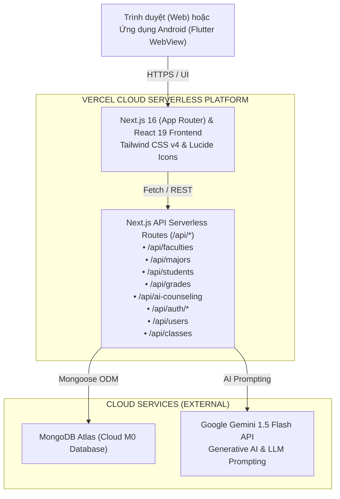

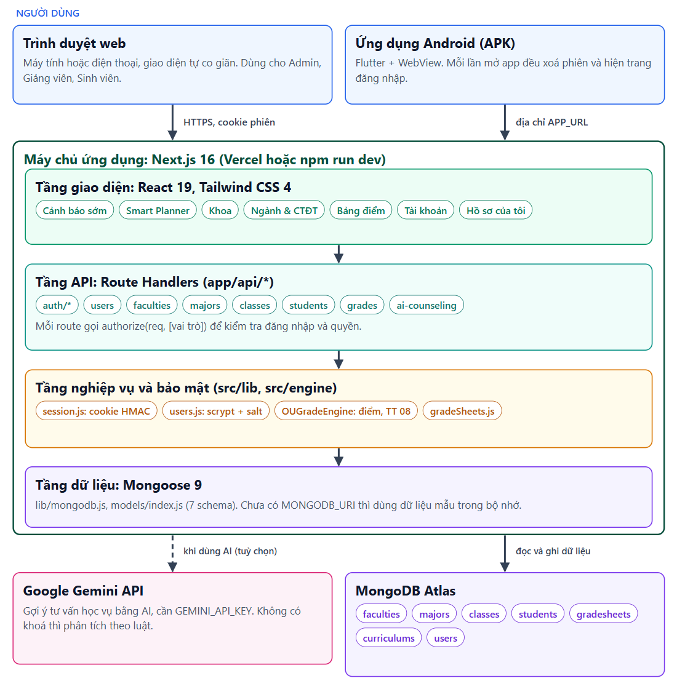


### Chi tiết Tech Stack:
* **Frontend Framework:** Next.js 16.4 (App Router với Turbopack), React 19 (viết bằng JavaScript/JSX).
* **UI/UX Design System:** Enterprise ERP Clean Design (Tone màu chủ đạo: Forest Emerald `#064e3b` & Slate), Tailwind CSS v4, Lucide React Icons.
* **Backend:** Next.js Serverless API Routes (`app/api/*`) — một ứng dụng Next.js duy nhất, không có máy chủ backend riêng.
* **Cơ sở dữ liệu (Database):** MongoDB Atlas Cloud (Cụm Cloud Serverless, kết nối qua Mongoose ODM) với cơ chế In-memory fallback dự phòng.
* **Trí tuệ nhân tạo (AI):** Google Gemini 1.5 Flash API tích hợp Prompt Engineering; khi chưa có khóa API hoặc mất kết nối, hệ thống dùng engine dự phòng phân tích theo luật (rule-based).
* **Nền tảng Deploy:** Vercel Cloud (Tự động CI/CD qua GitHub push).
* **Ứng dụng di động:** Flutter (`webview_flutter`) — vỏ Android bọc giao diện web.

### Phân quyền (RBAC) và bảo mật

Hệ thống có **3 vai trò cố định**: Quản trị viên (`admin`), Giảng viên (`lecturer`) và Sinh viên (`student`). Quyền được kiểm tra ở **hai lớp**: giao diện chỉ hiện các tab thuộc vai trò (`src/lib/roles.js`), và mọi API Route đều gọi `authorize(req, [vai trò])` trước khi xử lý, nên người dùng không thể vượt quyền bằng cách gọi API trực tiếp. Dữ liệu sinh viên còn được lọc theo phạm vi: quản trị viên thấy tất cả, giảng viên chỉ thấy sinh viên thuộc các lớp mình phụ trách, sinh viên chỉ thấy bản ghi của chính mình.

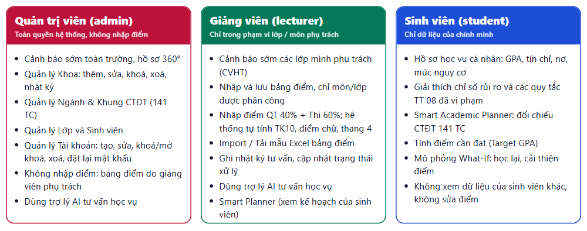

**Các tab giao diện theo vai trò:**

| Tab | Quản trị viên | Giảng viên | Sinh viên |
| :--- | :---: | :---: | :---: |
| Cảnh báo sớm nguy cơ | ✔ | ✔ | – |
| Hồ sơ của tôi | – | – | ✔ |
| Smart Planner | ✔ | ✔ | ✔ |
| Nhập bảng điểm môn | – | ✔ | – |
| Quản lý Khoa | ✔ | – | – |
| Quản lý Ngành & CTĐT | ✔ | – | – |
| Quản lý Tài khoản | ✔ | – | – |

**Quyền truy cập ở tầng API:**

| API | Vai trò được phép |
| :--- | :--- |
| `GET /api/faculties`, `majors`, `classes` | Cả ba vai trò (đã đăng nhập) |
| `POST/PUT/DELETE` faculties, majors, classes, students | Chỉ quản trị viên |
| `GET /api/students` | Cả ba vai trò; kết quả được lọc theo phạm vi (`canAccessStudent`) |
| `GET/PUT /api/grades` | Quản trị viên, giảng viên; khi lưu điểm, giảng viên phải là người phụ trách môn hoặc lớp đó (nếu không trả 403) |
| `POST /api/ai-counseling`, ghi nhật ký tư vấn | Quản trị viên, giảng viên (trong phạm vi sinh viên của mình) |
| `/api/users` (toàn bộ) | Chỉ quản trị viên |
| `POST /api/auth/change-password` | Mọi người dùng đã đăng nhập |
| `POST /api/auth/login`, `forgot-password` | Công khai |

**Cơ chế bảo mật:**

| Cơ chế | Mô tả |
| :--- | :--- |
| Băm mật khẩu | `scrypt` với salt ngẫu nhiên cho từng tài khoản; chỉ lưu `passwordHash` và `salt` |
| Phiên đăng nhập | Cookie `edualert_session`: `httpOnly`, `SameSite=Lax`, thêm cờ `secure` ở production; nội dung ký HMAC-SHA256 bằng `AUTH_SECRET`; hết hạn sau 8 giờ |
| Giới hạn đăng nhập sai | Tối đa 5 lần trong 10 phút cho mỗi tổ hợp IP, vai trò và tên đăng nhập (chỉ bật ở production) |
| Khoá tài khoản | Tài khoản `LOCKED` bị từ chối đăng nhập; quản trị viên khoá và mở khoá được |
| Bắt đổi mật khẩu lần đầu | Cờ `mustChangePassword` bật khi admin tạo tài khoản mới hoặc đặt lại mật khẩu; giao diện hiện cửa sổ đổi mật khẩu **không thể đóng** cho tới khi đổi xong (≥ 6 ký tự, khác mật khẩu cũ) |
| Quên mật khẩu | Hai bước: xác minh bằng tên đăng nhập/MSSV cùng email hoặc số điện thoại trong hồ sơ, sau đó đặt mật khẩu mới |

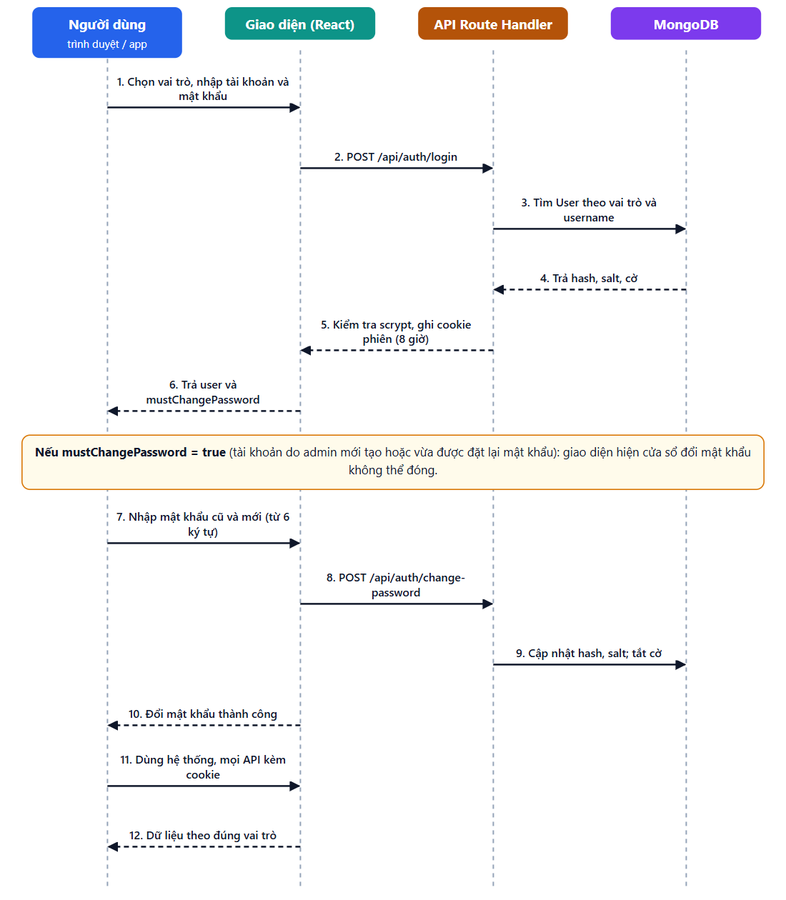

### Ứng dụng Android (Flutter WebView)

Thư mục `edualert_app` chứa một ứng dụng **Flutter** bọc giao diện web EduAlert trong **WebView** (`webview_flutter`). Ứng dụng không chứa dữ liệu hay giao diện riêng nên **chỉ hoạt động khi web đang chạy và truy cập được**.

* **Địa chỉ web** được truyền khi build: `flutter build apk --release --dart-define=APP_URL=<địa chỉ web>`. Mặc định là `http://10.0.2.2:3000` — địa chỉ chỉ dùng được trên **máy ảo** Android; trên điện thoại thật phải dùng IP trong mạng LAN hoặc tên miền Vercel.
* Manifest khai báo quyền `INTERNET` và `usesCleartextTraffic` để chạy được với web nội bộ qua `http`.
* **Mỗi lần mở app đều xoá phiên đăng nhập** (cookie và bộ nhớ trang) nên luôn bắt đầu từ trang đăng nhập; nếu chuyển sang ứng dụng khác từ 30 giây trở lên rồi quay lại thì cũng phải đăng nhập lại.
* Khi không tải được trang, app hiện màn hình lỗi kết nối kèm nút **Thử lại**; nút Back lùi trang trong WebView.
* Giao diện web tự co giãn theo màn hình: thanh bên thành ngăn kéo, khối tóm tắt xếp lưới 2 cột, bảng dữ liệu chuyển thành dạng thẻ.

<p align="center">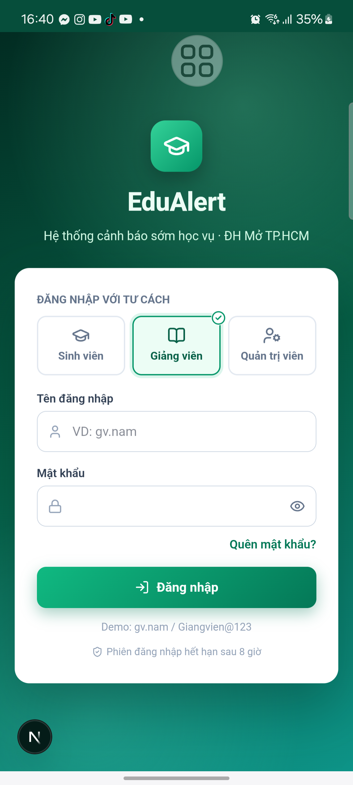</p>


---

## 5. THIẾT KẾ CƠ SỞ DỮ LIỆU (DATABASE SCHEMA - MONGODB)

Database được tổ chức thành 7 Collection chính trong MongoDB Cloud:

```mermaid
erDiagram
    FACULTY ||--o{ MAJOR : "trực thuộc (1-n)"
    MAJOR ||--o{ CLASS : "quản lý lớp sinh hoạt (1-n)"
    CLASS ||--o{ STUDENT : "danh sách sinh viên từ Năm 1 (1-n)"
    MAJOR ||--|| CURRICULUM : "khung 141 TC 8 học kỳ (1-1)"
    CLASS ||--o{ GRADE_SHEET : "bảng điểm môn học theo CTĐT (1-n)"
    USER ||--o{ STUDENT : "tài khoản đăng nhập SV (1-1)"
    USER ||--o{ CLASS : "giảng viên chủ nhiệm / CVHT (1-n)"

    FACULTY {
        string id PK
        string code "OU+YYMMDD+XXX"
        string name "Tên Khoa VN"
        string nameEn "Tên Khoa EN"
        string shortCode "FIT, FECO, FAAF, FBA, FFL"
        string status "ACTIVE/INACTIVE"
        array auditLogs "Lịch sử chỉnh sửa"
    }

    MAJOR {
        string id PK
        string code "[Ký hiệu Khoa] + YYMM + XXX"
        string name "Tên Ngành"
        string facultyId "Id khoa (OU...)"
        string facultyCode "Ký hiệu khoa (FIT) = Faculty.shortCode"
        number creditsStandard "141 TC"
        string status "ACTIVE/INACTIVE"
    }

    CLASS {
        string id PK "DH22CS01C"
        string maLop "DH22CS01C"
        string tenLop "Lớp KHMT Khóa 2022"
        string maNganh "FIT2200001"
        number siSo "Sĩ số sinh viên"
        string cvht "Cố vấn học tập"
    }

    STUDENT {
        string maSV PK "2251050001"
        string hoTen "Nguyễn Văn An"
        string lop "DH22CS01C"
        number namHoc "Năm 1, 2, 3, 4"
        number gpaTL "Tính tự động từ bảng điểm các môn"
        number gpaHK "GPA học kỳ gần nhất"
        number tcTichLuy "Tổng tín chỉ đạt (pass)"
        number tcNo "Tổng tín chỉ nợ F"
        string level "NORMAL/WARNING/DROP_OUT_RISK"
        array historySemesters "Lịch sử điểm các kỳ"
        array counselingLog "Nhật ký tư vấn CVHT"
    }

    GRADE_SHEET {
        string id PK "BD-DH22CS01C-COSC2301"
        string maLop "DH22CS01C"
        string maMon "COSC2301"
        string tenMon "Cấu trúc dữ liệu và giải thuật"
        number soTC "3"
        string giangVien "TS. Phạm Minh Tuấn"
        string trangThai "COMPLETED/IN_PROGRESS/NOT_STARTED"
        array grades "Chi tiết điểm QT, Thi, TK10, Thang 4"
    }

    CURRICULUM {
        string majorCode PK
        array courses "Danh mục môn học qua 8 học kỳ (KHMT: 30 môn, 141 TC)"
    }

    USER {
        string username PK "2251050001 / gv.nam / admin"
        string passwordHash "Mã hóa bảo mật scryptSync"
        string salt "Muối ngẫu nhiên"
        string role "admin / lecturer / student"
        string name "Họ và tên"
        string email "Email trường OU"
        string phone "Số điện thoại"
        string status "ACTIVE / LOCKED"
        boolean mustChangePassword "Bắt đổi mật khẩu ở lần đăng nhập kế tiếp"
        string facultyCode "Ký hiệu khoa (giảng viên)"
        array classes "Mã lớp phụ trách (giảng viên)"
        array coursesTaught "Mã môn giảng dạy (giảng viên)"
        string maSV "Mã sinh viên (tài khoản sinh viên)"
    }
```

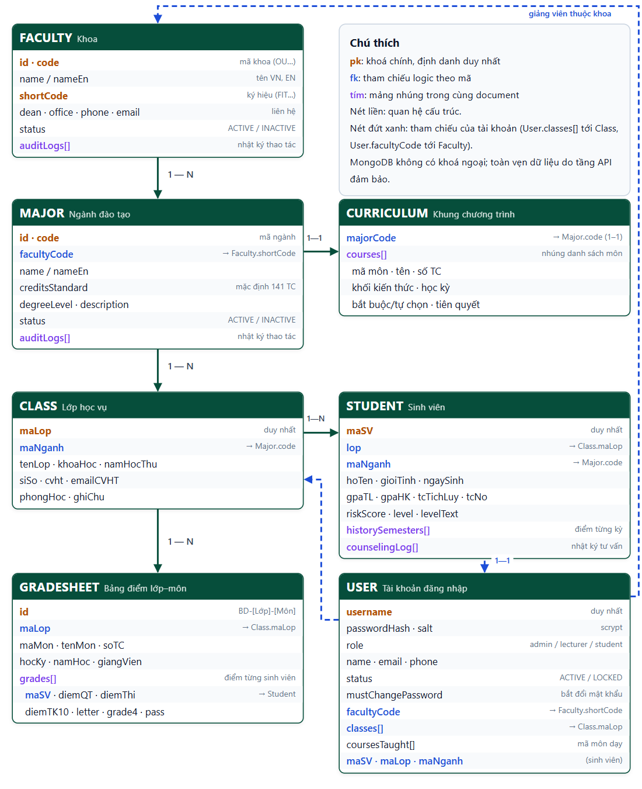

> **Ghi chú:** MongoDB không có khoá ngoại; các quan hệ là tham chiếu logic theo mã và tính toàn vẹn do tầng API đảm bảo. Tên collection trong MongoDB là `faculties`, `majors`, `classes`, `students`, `gradesheets`, `curriculums`, `users`. Trường `facultyCode` của `majors` và `users` là **ký hiệu khoa** (ví dụ `FIT`, trỏ tới `faculties.shortCode`); mã khoa dạng `OU…` nằm ở `faculties.id/code` và `majors.facultyId`.


---

## 6. CHI TIẾT CÁC TÍNH NĂNG HỆ THỐNG

### 6.1. Phân hệ 1: Quản lý Khoa (Faculty Management)
* Mã Khoa tự sinh chuẩn hệ thống: `OU + YYMMDD + XXX` (Ví dụ: `OU261104001`).
* Khai báo đầy đủ tên tiếng Việt, tiếng Anh, ký hiệu viết tắt không trùng lặp (`FIT`, `FECO`, `FAAF`, `FBA`, `FFL`).
* **Ràng buộc an toàn:** Không cho phép xóa khoa khi khoa đã có ngành đào tạo liên kết; chỉ cho phép kích hoạt / vô hiệu hóa.
* **Audit Trail:** Tra cứu lịch sử thao tác của người dùng (thời gian, người sửa, giá trị cũ, giá trị mới).

### 6.2. Phân hệ 2: Quản lý Ngành & Khung CTĐT 141 Tín Chỉ
* **Mã ngành tự sinh theo chuẩn:** `[Ký hiệu Khoa] + YYMM + XXX` (Ví dụ: `FIT2611001`).
* **Live Preview Card:** Hiển thị trực quan mã ngành tự sinh xem trước và phân giải công thức cấu thành.
* **Bố cục 2 cột cân xứng:** Nhập tên tiếng Việt, tên tiếng Anh, chuẩn tín chỉ kèm hậu tố `TC`, hệ đào tạo.
* **Không gian 4 Subtabs:**
  1. *Tổng quan:* Chuẩn 141 TC, văn bằng, quy mô đào tạo.
  2. *Chương trình đào tạo (CTĐT):* Quản lý lộ trình 8 học kỳ, nạp môn liên ngành từ Khoa Ngoại ngữ (`ENGL1301`) hoặc Khoa Kinh tế (`ECON1301`).
  3. *Danh sách lớp & Sinh viên:* Quản lý các lớp và sinh viên thuộc ngành.
  4. *Lịch sử:* Nhật ký kiểm toán thay đổi chương trình.

### 6.3. Phân hệ 3: Quản lý Lớp học & Tiếp nhận Sinh viên từ Năm 1
* **Lộ trình học vụ chuẩn:** Mọi sinh viên được tiếp nhận vào lớp từ đầu Năm 1 (HK1).
* **Bỏ nhập thủ công GPA & Tín chỉ ban đầu:** Điểm tích lũy và số tín chỉ đạt sẽ được hệ thống tính tự động từ bảng điểm từng môn học trong chương trình đào tạo của lớp khi giảng viên nhập điểm.
* **Tự động liên kết bảng điểm:** Khi thêm sinh viên vào lớp, sinh viên tự động được thêm vào danh sách điểm của toàn bộ các môn học thuộc lớp đó.
* **Khởi tạo tài khoản tự động:** Hệ thống tự động cấp tài khoản đăng nhập cho sinh viên với mật khẩu khởi tạo; sinh viên **phải đổi mật khẩu ở lần đăng nhập đầu tiên**.

### 6.4. Phân hệ 4: Quản lý Bảng điểm môn học & Tự động tái tính điểm
* **Phân định quyền Admin vs Giảng viên:** Quản trị viên (Admin) không trực tiếp quản lý/nhập bảng điểm; bảng điểm do Giảng viên bộ môn được phân công quản lý, và giảng viên chỉ lưu được điểm của môn/lớp mình phụ trách.
* Thiết kế dạng **Group by Course:** gom nhóm theo môn học, mở rộng (expand) để xem các lớp đang học môn đó. Mã bảng điểm tự sinh: `BD-[Mã Lớp]-[Mã Môn]`.
* Bảng nhập điểm tương tác nhanh (Spreadsheet-like): nhập điểm quá trình (40%) và điểm thi (60%), hệ thống tự tính điểm TK10, quy đổi thang 4.0 và điểm chữ tức thì; hỗ trợ tải mẫu và nhập từ Excel.
* **Tự động tái tính kết quả học vụ:** Khi giảng viên lưu bảng điểm, hệ thống tự động cập nhật lại GPA tích lũy, số tín chỉ đạt và nợ môn cho tất cả sinh viên trong lớp.

### 6.5. Phân hệ 5: Cảnh báo sớm rủi ro & Hồ sơ học vụ 360°
* **Case study trọng điểm:** Lớp **DH22CS01C (45 sinh viên)** ngành Khoa học máy tính, Khóa 2022.
* **Phân tầng can thiệp 4 nhóm sinh viên** (số liệu thực tế trên dữ liệu mẫu):
  1. 🔴 **Nhóm 1 - Nguy cơ Buộc thôi học (3 SV):** đã bị cảnh báo học vụ từ 2 lần liên tiếp (ví dụ Nguyễn Văn An - GPA 1.15, nợ 26 TC).
  2. 🟠 **Nhóm 2 - Cảnh báo học vụ Mức 1 (5 SV):** vi phạm ít nhất 1 quy tắc Thông tư 08 (bị cảnh báo lần 1).
  3. 🟡 **Nhóm 3 - Tín hiệu sớm (8 SV):** chưa vi phạm quy tắc nào nhưng GPA tích lũy từ 1.70 trở xuống.
  4. 🟢 **Nhóm 4 - An toàn (29 SV):** các sinh viên còn lại, tích lũy tốt, đúng tiến độ.
* **Hồ sơ học vụ 360° (Student Dossier):** bài test 4 Rule của Bộ GD&ĐT, giải thích chỉ số rủi ro (0–100%), diễn biến điểm các kỳ, và sổ tay nhật ký tư vấn của CVHT (lưu về CSDL đám mây). Trạng thái xử lý của sinh viên suy ra từ nhật ký mới nhất: Chưa liên hệ → Đã liên hệ → Đang hỗ trợ → Đã cam kết → Chuyển cố vấn → Hoàn thành.

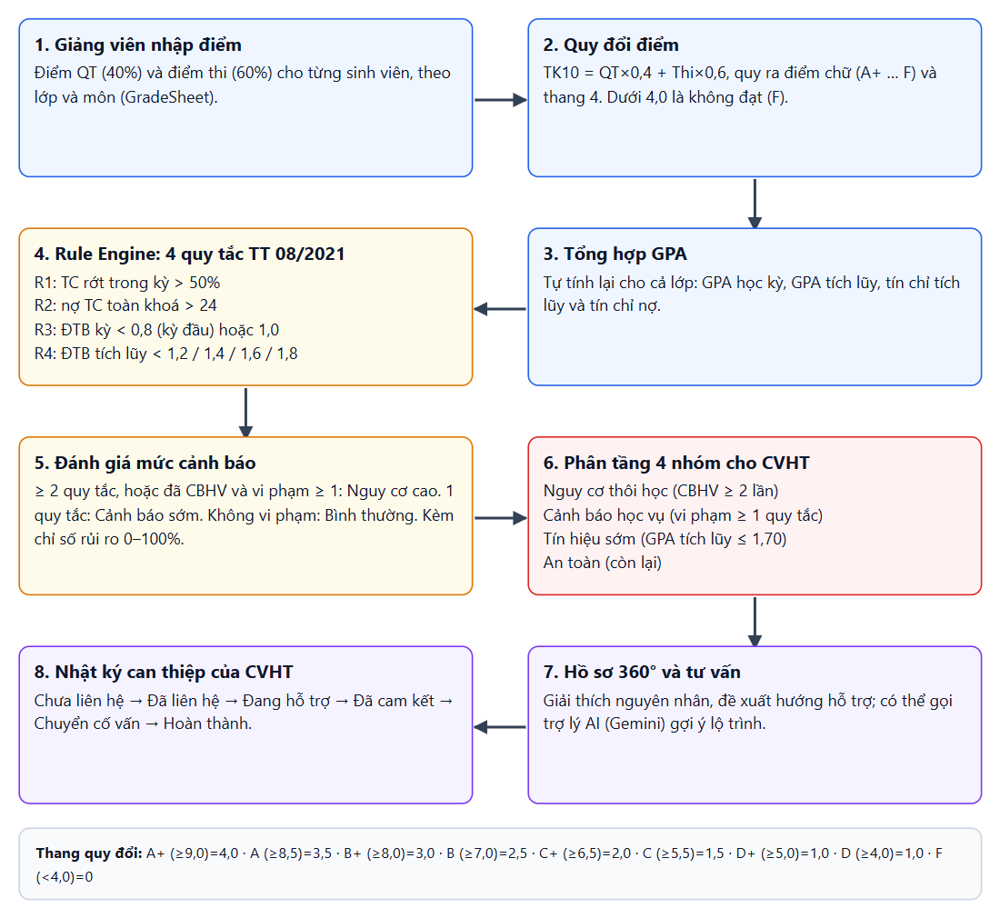

### 6.6. Phân hệ 6: Kế hoạch học tập thông minh (Smart Academic Planner)
* **Đối chiếu 141 Tín chỉ:** Thước đo hoàn thành CTĐT, phân chia rõ ràng: Môn đã đạt (🟢), Môn rớt F cần trả nợ (🔴), Môn còn lại chưa học (🟡).
* **Tính điểm cần đạt (Target GPA Calculator):**
  $$\text{GPA}_{\text{cần đạt}} = \frac{\text{GPA}_{\text{mục tiêu}} \times 141 - \text{GPA}_{\text{hiện tại}} \times \text{TC}_{\text{đã đạt}}}{\text{TC}_{\text{còn lại}}}$$
  Đưa ra cảnh báo tính khả thi: Rất khả thi, Thách thức cao, hoặc Bất khả thi (nếu vượt quá 4.0 $\to$ hướng dẫn bắt buộc phải học cải thiện môn D).
* **Mô phỏng học tập What-If:** Giả định kết quả học lại môn F và học môn mới kỳ tới $\to$ tính trước bước nhảy GPA, số tín chỉ nợ và xác nhận có thoát khỏi diện cảnh báo học vụ hay không.

### 6.7. Phân hệ 7: Quản lý tài khoản (RBAC) & Tự phục hồi mật khẩu
* **Quản trị viên** tạo tài khoản cho cả 3 vai trò, sửa, khoá/mở khoá, xoá, đặt lại mật khẩu, phân công lớp và môn cho giảng viên; có thống kê số lượng theo vai trò.
* **Bắt đổi mật khẩu lần đầu:** tài khoản mới tạo hoặc bị đặt lại mật khẩu phải đổi mật khẩu ngay lần đăng nhập đầu; người dùng cũng tự đổi mật khẩu được ở menu tài khoản trên thanh tiêu đề.
* **Quên mật khẩu tự phục vụ:** xác thực 2 bước trên màn hình đăng nhập qua Email trường hoặc SĐT hồ sơ, rồi cập nhật mật khẩu mã hóa an toàn bằng `scrypt`.
* Chi tiết ma trận phân quyền và cơ chế bảo mật xem mục *Phân quyền (RBAC) và bảo mật* ở phần 4.

### Hình ảnh minh họa giao diện

Các ảnh dưới đây chụp từ hệ thống đang chạy với dữ liệu mẫu (6 khoa, 7 ngành, 8 lớp, 150 sinh viên, 161 tài khoản).

**Đăng nhập**

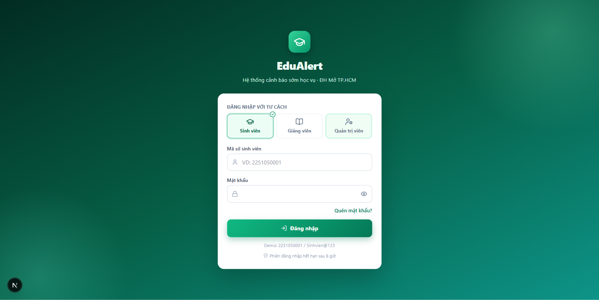

**Dashboard Cảnh báo sớm (quản trị viên / giảng viên)** — phân tầng lớp DH22CS01C (45 sinh viên) thành 4 nhóm: Buộc thôi học 3, Cảnh báo học vụ 5, Tín hiệu sớm 8, An toàn 29.

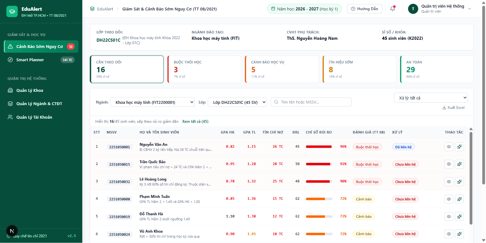

**Hồ sơ học vụ 360° (sinh viên Nguyễn Văn An)** — giải thích chỉ số rủi ro và kết quả đối chiếu 4 quy tắc Thông tư 08.

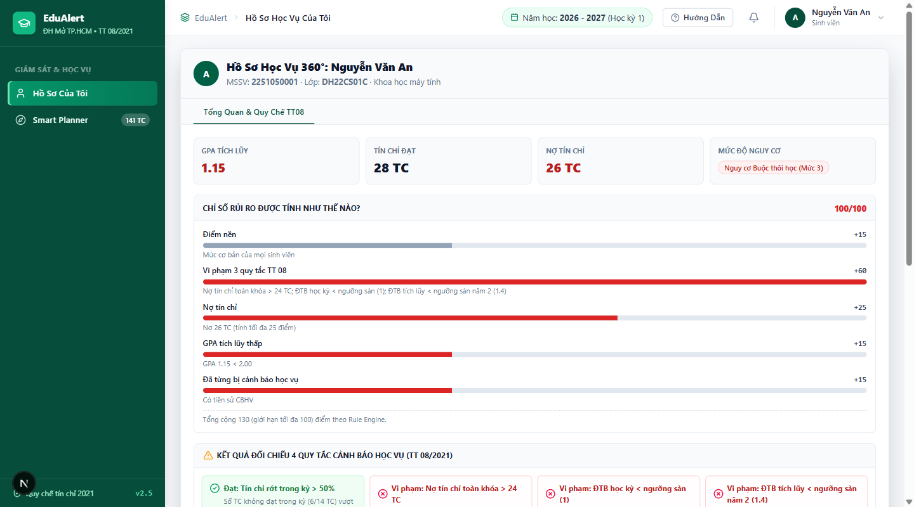

**Smart Academic Planner** — đối chiếu chương trình 141 tín chỉ, môn rớt F cần trả nợ, các môn còn lại.

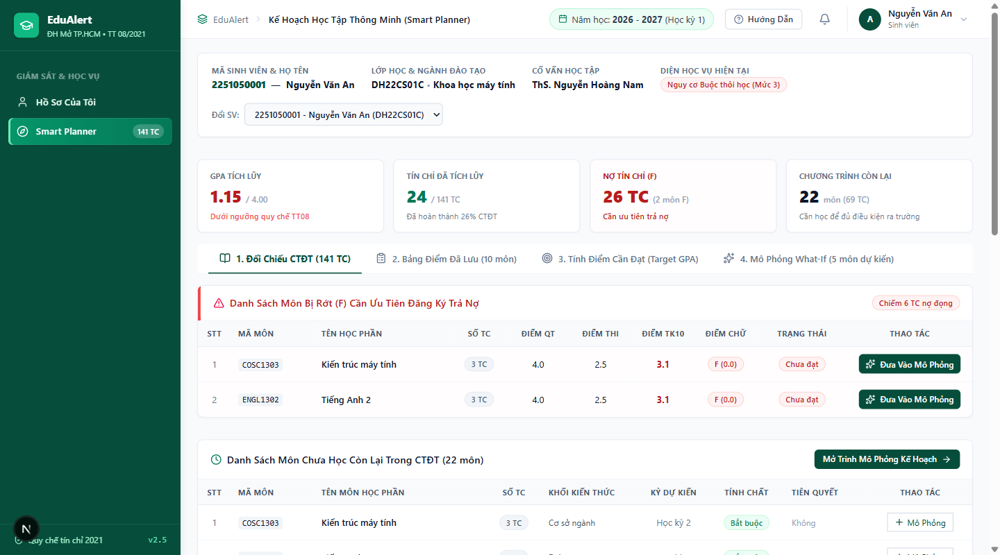

**Mô phỏng What-If** — thế điểm 2 môn F (Kiến trúc máy tính, Tiếng Anh 2): GPA tích lũy 1.15 → 1.80, nợ tín chỉ 26 → 20 TC, trạng thái chuyển sang Bình thường (kịch bản 5 môn, 15 TC, mục tiêu A+).

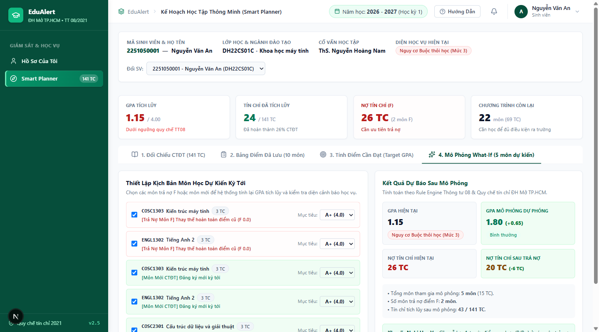

**Nhập bảng điểm (giảng viên)** — nhập điểm quá trình 40% và điểm thi 60%, hệ thống tự tính TK10, điểm chữ, thang 4 và kết quả Đạt/Rớt.

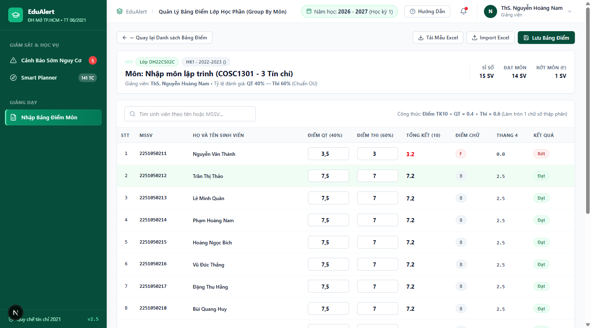

**Quản lý Khoa và Quản lý Tài khoản (quản trị viên)**

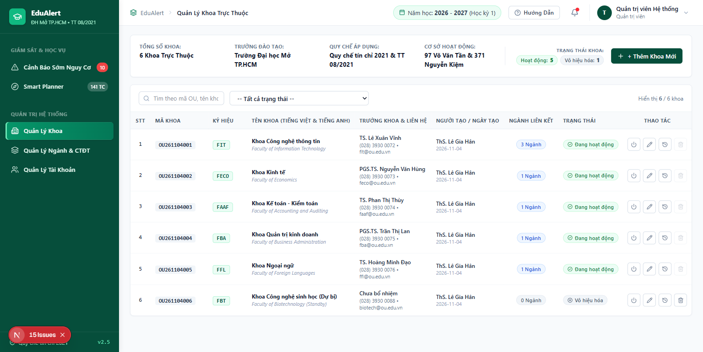

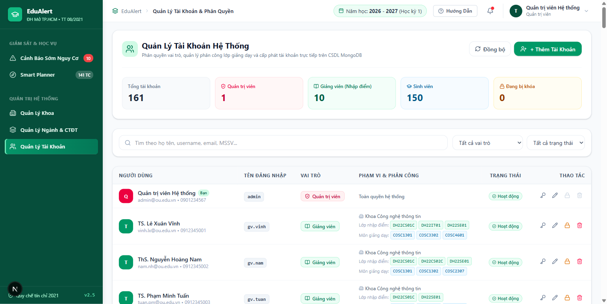

**Giao diện trên điện thoại** — bảng dữ liệu chuyển thành thẻ, tab con cuộn ngang.

<table>
  <tr>
    <td align="center">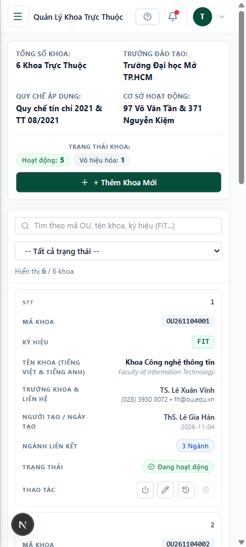<br><sub>Quản lý Khoa</sub></td>
    <td align="center">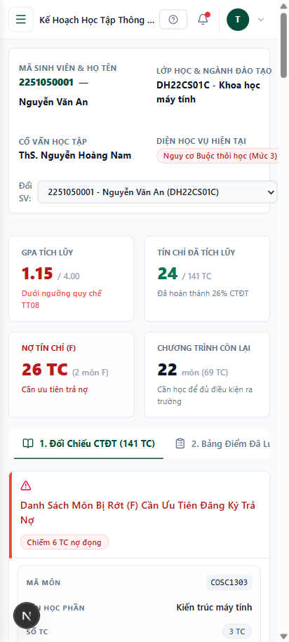<br><sub>Smart Planner</sub></td>
    <td align="center">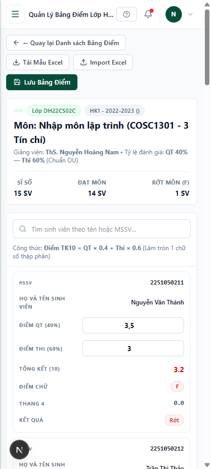<br><sub>Nhập điểm</sub></td>
  </tr>
</table>

---

## 7. VẬN DỤNG TRÍ TUỆ NHÂN TẠO (AI GENERATIVE & SENTIMENT ANALYSIS)

Hệ thống tích hợp AI qua API Route [`/api/ai-counseling`](file:///D:/Han_PersonalSpace/Project-EduAlert/app/api/ai-counseling/route.js) với 2 năng lực cốt lõi:

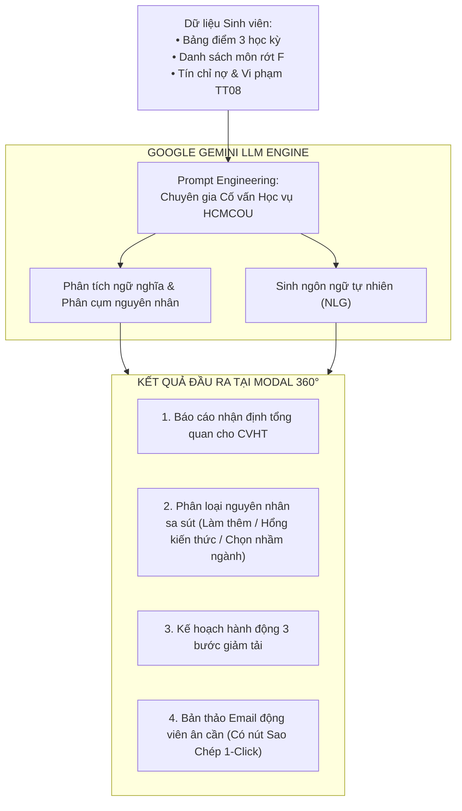

---

## 8. CASE STUDY ĐIỂN HÌNH: CỨU NGUY SINH VIÊN NGUYỄN VĂN AN

* **Hồ sơ sinh viên:** Nguyễn Văn An (MSSV: `2251050001`), Lớp `DH22CS01C`, Ngành Khoa học máy tính.
* **Hiện trạng rủi ro:** 
  * GPA tích lũy: **1.15 / 4.00**.
  * Tín chỉ nợ: **26 TC** (Vượt trần 24 TC của Rule 2).
  * Môn rớt: Rớt F môn *Kiến trúc máy tính* (COSC1303, 3 TC) và *Tiếng Anh 2* (ENGL1302, 3 TC).
  * Trạng thái: **Nguy cơ Buộc thôi học (Mức 3)**.
* **Quy trình cứu nguy thực tế qua EduAlert:**
  1. **Bước 1 - Phát hiện:** CVHT mở Dashboard Cảnh báo, hệ thống lập tức gắn cờ đỏ bạn An ở vị trí ưu tiên số 1.
  2. **Bước 2 - Phân tích AI:** Mở Hồ sơ 360°, bấm **"AI Cố Vấn & Email"**. AI chỉ ra An bị hổng kiến thức nền tảng và quá tải do đi làm thêm; AI tự sinh bản thảo thư mời An lên gặp cố vấn với văn phong thấu hiểu, không gây áp lực.
  3. **Bước 3 - Thiết lập kế hoạch với Smart Planner:** CVHT mở tab Mô phỏng What-If, đưa 2 môn F (Kiến trúc máy tính, Tiếng Anh 2) vào kịch bản kỳ tới cùng các môn dự kiến (tổng 5 môn, 15 TC) và chọn mục tiêu điểm cho từng môn.
  4. **Bước 4 - Kết quả dự phóng:** Với kịch bản 5 môn (15 TC) và mục tiêu A+ (mặc định của công cụ), nhờ cơ chế "thế điểm" GPA tích lũy của An bật từ **1.15 lên 1.80 (+0.65)**, nợ tín chỉ giảm từ 26 xuống **20 TC (−6 TC)** và trạng thái chuyển sang **Bình thường**. Kết quả thay đổi theo mục tiêu điểm người dùng chọn.

---

## 9. HƯỚNG DẪN CÀI ĐẶT & TRIỂN KHAI (DEPLOYMENT GUIDE)

### 9.1. Chạy môi trường Local Development
```bash
# 1. Clone repository từ GitHub
git clone https://github.com/legiahan2705/Project-EduAlert.git
cd Project-EduAlert

# 2. Cài đặt toàn bộ thư viện dependencies
npm install

# 3. Tạo file .env.local (KHÔNG commit file này lên GitHub)
cat > .env.local <<EOF
MONGODB_URI=<chuỗi kết nối MongoDB Atlas của bạn>
AUTH_SECRET=<chuỗi bí mật bất kỳ để ký cookie phiên>
GEMINI_API_KEY=<khóa Gemini, có thể để trống>
EOF

# 4. (Chỉ khi cơ sở dữ liệu còn trống) Nạp dữ liệu mẫu và tài khoản mẫu
npm run seed
npm run seed:users

# 5. Khởi chạy ứng dụng
npm run dev
# Truy cập: http://localhost:3000
```

### 9.2. Triển khai lên Vercel Cloud (Serverless)
1. Đăng nhập [vercel.com](https://vercel.com) bằng tài khoản GitHub `legiahan2705`.
2. Bấm **Add New... $\to$ Project** $\to$ Chọn `Project-EduAlert` $\to$ Bấm **Import**.
3. Tại mục **Environment Variables**, cấu hình biến:
   * **Name:** `MONGODB_URI`
   * **Value:** chuỗi kết nối lấy từ Atlas (Connect → Drivers); **không** đưa vào mã nguồn hay tài liệu
   * Thêm hai biến: `AUTH_SECRET` (khóa ký cookie phiên, bắt buộc) và `GEMINI_API_KEY` (nếu dùng trợ lý AI)
4. Bấm **Deploy**. Sau 45 giây, hệ thống sẽ online toàn cầu với tên miền chính thức dạng: `https://project-edualert.vercel.app`.

---

## 10. KẾT LUẬN & HƯỚNG PHÁT TRIỂN

### 10.1. Kết luận
Dự án **EduAlert** đã giải quyết trọn vẹn bài toán nhức nhối trong quản lý học vụ đại học. Bằng việc kết hợp hài hòa giữa **tính chuẩn xác của quy chế đào tạo** và **sự thông minh, đồng cảm của AI Generative**, hệ thống không chỉ là một công cụ quản lý mà thực sự trở thành một người đồng hành tin cậy của cả giảng viên cố vấn và sinh viên.

### 10.2. Hướng phát triển trong tương lai
* Tích hợp đồng bộ dữ liệu trực tiếp với hệ thống LMS (Moodle / Canvas) của trường để theo dõi chuyên cần thời gian thực.
* Phát triển chatbot tương tác đa kênh (Zalo OA / Telegram Bot) tự động gửi thông báo lịch thi và nhắc nhở học vụ đến từng sinh viên và phụ huynh.
* Áp dụng thuật toán tối ưu hóa di truyền (Genetic Algorithm) để tự động sắp xếp thời khóa biểu cá nhân hóa không bị trùng lịch cho sinh viên trả nợ môn.

### 10.3. Hạn chế hiện tại và hướng xử lý

| Hạn chế | Đề xuất |
| :--- | :--- |
| Dữ liệu mẫu có **15 sinh viên lớp DH22CS02C trùng mã số** với lớp DH22CS01C (từ `2251050211` đến `2251050225`), gây cảnh báo trùng `key` của React và có thể chọn nhầm sinh viên theo MSSV | Đổi dãy mã của lớp DH22CS02C trong `src/engine/mockData.js` sang dãy khác rồi nạp lại dữ liệu |
| Việc bắt đổi mật khẩu lần đầu hiện chỉ chặn ở **giao diện**; người gọi API trực tiếp vẫn dùng được các API khác khi chưa đổi | Kiểm tra cờ `mustChangePassword` trong `authorize()` và từ chối các API khác cho tới khi đổi xong |
| Nếu thiếu `AUTH_SECRET`, hệ thống dùng khoá dự phòng viết sẵn trong mã nguồn | Bắt buộc đặt `AUTH_SECRET` khi deploy và bỏ khoá dự phòng ở production |
| Bộ đếm đăng nhập sai nằm trong bộ nhớ tiến trình, không dùng chung giữa nhiều phiên bản serverless | Lưu bộ đếm ở MongoDB hoặc dịch vụ cache dùng chung |
| Chưa có nhật ký thao tác toàn hệ thống (hiện chỉ có `auditLogs` của Khoa và Ngành) | Thêm collection nhật ký chung cho tạo, sửa, xoá và đăng nhập |
| Thêm sinh viên mới chỉ làm được từng người | Bổ sung nhập hàng loạt từ file Excel kèm xem trước và báo lỗi theo dòng |
| Ứng dụng Android phụ thuộc vào máy chủ web; bản thử nghiệm trỏ tới IP nội bộ nên chỉ dùng được khi máy tính bật | Triển khai web lên Vercel rồi build lại APK với địa chỉ `https` |
| Trợ lý AI cần khoá Gemini; khi thiếu khoá chỉ có phân tích theo luật | Cấu hình `GEMINI_API_KEY` và theo dõi chi phí sử dụng |
| Dữ liệu thử nghiệm là dữ liệu mẫu, chưa kiểm chứng trên dữ liệu thật của nhà trường | Thử nghiệm với dữ liệu thật đã ẩn danh hóa |

> **Lưu ý bảo mật:** không bao giờ đưa chuỗi kết nối MongoDB (có mật khẩu), `AUTH_SECRET` hay `GEMINI_API_KEY` vào mã nguồn hoặc tài liệu. Chỉ khai báo qua file `.env.local` (đã nằm trong `.gitignore`) hoặc mục Environment Variables của Vercel.
