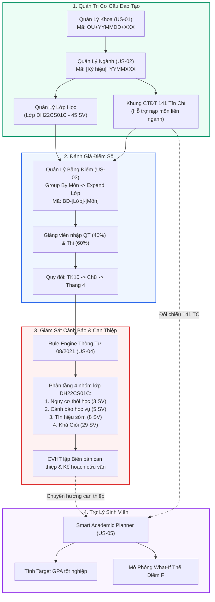

# Tổng Hợp Bộ Tài Liệu User Stories (Hệ Thống EduAlert v2.5)

> **Dự án:** EduAlert - Hệ Thống Quản Lý Đào Tạo, Giám Sát Học Vụ & Cảnh Báo Sớm Nguy Cơ Sinh Viên  
> **Đơn vị mẫu:** Trường Đại học Mở TP.HCM (HCMCOU)  
> **Căn cứ quy chế:** Quy chế Đào tạo Tín chỉ Đại học & Thông tư 08/2021/TT-BGDĐT  
> **Thiết kế UI:** Phong cách Clean Enterprise ERP (Xanh Emerald & Slate tối giản, không text thừa)  
> **Cập nhật:** Phiên bản 2.5 (Tháng 11/2026)  

---

## 1. Danh Mục Trọn Bộ Tài Liệu User Stories v2.5

Bộ tài liệu được chuẩn hóa theo format đặc tả hệ thống ERP SIS hiện đại, bám sát các yêu cầu nghiệp vụ chuyên sâu:

| Mã US | Tên Tính Năng & Phân Hệ | Tệp Tài Liệu Chi Tiết | Trọng Tâm Nghiệp Vụ |
| :---: | :--- | :--- | :--- |
| **`US-01`** | **Quản Lý Khoa Trực Thuộc (Faculty Management)** | [`US-01_Quan_Ly_Khoa.md`](./US-01_Quan_Ly_Khoa.md) | • CRUD Khoa độc lập. • Mã tự sinh: `OU + YYMMDD + XXX` (tịnh tiến). • Tên VN, tên EN, ký hiệu viết tắt duy nhất. • Người tạo, ngày tạo, Vô hiệu hóa / Kích hoạt. • Chặn xóa khi có ngành liên kết. • Xem lịch sử thao tác Audit Log (Cũ $\to$ Mới). |
| **`US-02`** | **Quản Lý Ngành & Workspace Chi Tiết 4 Tab** | [`US-02_Quan_Ly_Nganh_Va_Chi_Tiet.md`](./US-02_Quan_Ly_Nganh_Va_Chi_Tiet.md) | • Mã ngành tự sinh: `[Ký hiệu Khoa] + YYMM + XXX` (kèm Live Preview Badge). • Bố cục 2 cột cân đối, full-width inputs. • **Workspace chi tiết 4 Tab:**   1. Thông tin tổng quan ngành & kiểm toán.   2. CTĐT 141 TC (CRUD môn 8 học kỳ, **nạp môn liên ngành từ Khoa khác**).   3. Danh sách lớp & sinh viên từ Năm 1 (tự tính GPA từ bảng điểm môn học).   4. Lịch sử thao tác của user. |
| **`US-03`** | **Quản Lý Bảng Điểm (Group By Môn $\to$ Expand Lớp)** | [`US-03_Quan_Ly_Bang_Diem_Group_By_Mon.md`](./US-03_Quan_Ly_Bang_Diem_Group_By_Mon.md) | • Phân quyền: **Admin không quản lý bảng điểm** (chỉ Giảng viên bộ môn được phân công). • **Group by theo Mã Môn** $\to$ Click expand ra danh sách lớp học môn đó. • Nhập điểm QT 40% + Thi 60% = TK10, Chữ, Thang 4, Đạt/Rớt. • Tự động tái tính toán GPA tích lũy, tín chỉ đạt và nợ môn cho toàn bộ SV trong lớp khi lưu điểm. |
| **`US-04`** | **Giám Sát Lớp Học & Cảnh Báo Sớm (Lớp DH22CS01C)** | [`US-04_Giam_Sat_Lop_Hoc_Va_Canh_Bao_Som.md`](./US-04_Giam_Sat_Lop_Hoc_Va_Canh_Bao_Som.md) | • **Case Study Lớp `DH22CS01C` (45 sinh viên)** - Ngành Khoa học máy tính, Khoa CNTT. • Phân tầng 4 nhóm sinh viên (Nguy cơ thôi học, Cảnh báo học vụ, Tín hiệu sớm, An toàn/Khá Giỏi). • Phân tích nguyên nhân & Hướng hỗ trợ cá nhân hóa từng sinh viên cụ thể (Nguyễn Văn An, Phạm Minh Tuấn...). • Hồ sơ học vụ 360° & Sổ tay tư vấn CVHT tích hợp AI Gemini. |
| **`US-05`** | **Smart Academic Planner & Cải Thiện GPA** | [`US-05_Smart_Academic_Planner_Sinh_Vien.md`](./US-05_Smart_Academic_Planner_Sinh_Vien.md) | • Dành cho Sinh viên tự theo dõi tiến độ. • Đối chiếu khung CTĐT 141 tín chỉ (Đạt 🟢, Nợ F 🔴, Còn lại 🟡). • Target GPA: Tính điểm cần đạt cho các môn còn lại & Gợi ý cải thiện môn D/C. • Mô phỏng What-If đăng ký môn và kịch bản trả nợ F (Cơ chế thế điểm F kéo vọt GPA). |
| **`US-06`** | **Quản Lý Tài Khoản (RBAC) & Tự Khôi Phục Mật Khẩu** | [`US-06_Quan_Ly_Tai_Khoan_Va_Phan_Quyen.md`](./US-06_Quan_Ly_Tai_Khoan_Va_Phan_Quyen.md) | • Quản lý đa vai trò: Admin, Giảng viên, Sinh viên. • Mã hóa an toàn scryptSync + salt. • **Quên mật khẩu tự phục vụ:** Xác thực 2 bước qua Email trường hoặc SĐT hồ sơ, cập nhật mật khẩu mới và đăng nhập tức thời. |

---

## 2. Kiến Trúc Luồng Nghiệp Vụ Khép Kín Toàn Dự Án

---

## 3. Kiến Trúc Xác Thực & Phân Quyền Vai Trò Thực Tế (RBAC)

Đã loại bỏ hoàn toàn khối giả lập vai trò trên giao diện người dùng. Hệ thống sẵn sàng tích hợp với module Authentication phân quyền thực tế:

* **Sinh viên (`STUDENT`):** Chỉ xem thông tin cá nhân, đối chiếu CTĐT 141 tín chỉ, bảng điểm cá nhân và sử dụng Smart Academic Planner để lập kế hoạch học tập, mô phỏng trả nợ môn.
* **Giảng viên bộ môn (`LECTURER`):** Xem danh sách các môn được phân công, mở bảng điểm và nhập điểm QT (40%) + Thi (60%) cho các lớp học phần mình đang phụ trách; theo dõi tình hình học tập của lớp đối với môn mình dạy.
* **Cố vấn học tập (`CVHT`):** Theo dõi toàn diện tình hình học tập của các lớp phụ trách (điển hình lớp `DH22CS01C` - 45 sinh viên), rà soát 4 điều kiện cảnh báo học vụ theo Thông tư 08/2021, mở Hồ sơ sinh viên và lập Biên bản tư vấn can thiệp học tập.
* **Quản trị viên / Ban Đào tạo (`ADMIN / KHOA`):** Toàn quyền cấu hình cây tổ chức Khoa, Ngành, Khung CTĐT 141 tín chỉ đa ngành, lớp sinh hoạt và theo dõi lịch sử kiểm toán Audit Log.
