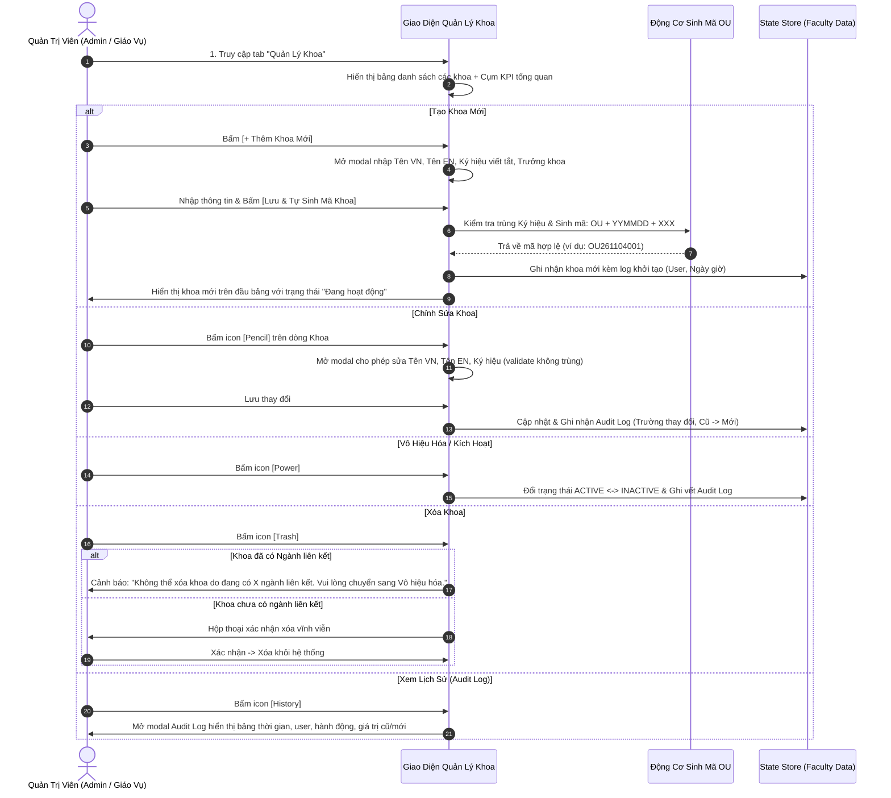

# User Story: Quản Lý Khoa Trực Thuộc (Faculty Management)

> **Mã User Story:** `US-EDUALERT-01`  
> **Tên tính năng:** Quản Lý Danh Mục Khoa, Sinh Mã Tự Động & Kiểm Toán Vết (Faculty Lifecycle & Audit Log)  
> **Phân hệ:** Quản Trị Cơ Cấu Đào Tạo (Core Administration)  
> **Phiên bản:** Version 2.5 (Clean ERP Design, Next.js 16, React 19, TypeScript)  
> **Trạng thái:** Baseline / Đã triển khai & Kiểm thử thành công  

---

## 1. Tóm Tắt User Story (Story Statement)

* **Là một:** Quản trị viên hệ thống (Admin) hoặc Lãnh đạo Nhà trường / Phòng Đào tạo,
* **Tôi muốn:** Có một phân hệ Quản lý Khoa trực quan để thực hiện đầy đủ các nghiệp vụ CRUD Khoa, trong đó Mã Khoa được tự động sinh theo quy tắc `OU + YYMMDD + XXX`, hỗ trợ đặt Tên Khoa bằng tiếng Việt và tiếng Anh, đặt Ký hiệu viết tắt duy nhất (không trùng lặp), ghi nhận thông tin Người tạo và Ngày tạo, hỗ trợ chuyển đổi trạng thái Kích hoạt $\leftrightarrow$ Vô hiệu hóa, ràng buộc an toàn dữ liệu không cho phép xóa khoa khi đã có ngành đào tạo liên kết, đồng thời có tính năng Xem lịch sử thao tác (Audit Log) theo dõi chi tiết thời gian, user, hành động, giá trị cũ và giá trị mới, không cần thiết kế view xem chi tiết riêng,
* **Để:** Chuẩn hóa cơ cấu tổ chức cao nhất của trường, bảo vệ toàn vẹn dữ liệu học vụ toàn khóa và truy vết minh bạch mọi biến động thông tin.

---

## 2. Bối Cảnh & Giá Trị Nghiệp Vụ

1. **Quy tắc sinh mã tự động chống trùng lặp:**
   $$\text{Mã Khoa} = \text{"OU"} + \text{YYMMDD} + \text{XXX}$$
   * `YYMMDD`: 2 chữ số năm + 2 chữ số tháng + 2 chữ số ngày tại thời điểm tạo.
   * `XXX`: Số thứ tự tịnh tiến trong ngày (ví dụ tạo ngày 04/11/2026: `OU261104001`, `OU261104002`...).
2. **Ký hiệu viết tắt chuẩn hóa (Short Code):**
   * Ví dụ: `FIT` (Khoa CNTT), `FECO` (Khoa Kinh tế), `FAAF` (Khoa Kế toán - Kiểm toán), `FBA` (Khoa QTKD), `FFL` (Khoa Ngoại ngữ).
   * Ký hiệu viết tắt là **DUY NHẤT** trong toàn trường và là tiền tố dùng để sinh mã ngành sau này.
3. **Quy tắc chặn xóa bảo toàn dữ liệu (Data Integrity):**
   * Nếu Khoa đã có Ngành đào tạo liên kết hoặc có sinh viên/lớp học $\to$ **TUYỆT ĐỐI CHẶN XÓA**, nút Xóa bị vô hiệu hóa hoặc bật thông báo giải thích cụ thể cho người dùng.
   * Khi Khoa tạm ngưng hoạt động hoặc sáp nhập $\to$ Thực hiện thao tác **Vô hiệu hóa (Deactivate)** thay vì xóa.
   * Chỉ cho phép Xóa khi Khoa mới tạo nhầm và chưa phát sinh bất kỳ ngành liên kết nào.
4. **Nhật ký kiểm toán (Audit Trail):**
   * Mọi thao tác Thêm, Sửa (tên tiếng Việt, tên tiếng Anh, ký hiệu), Đổi trạng thái đều được lưu vào mảng `auditLogs` gồm: `{ id, timestamp, userId, userName, action, oldValue, newValue }`.

---

## 3. Luồng Nghiệp Vụ (Business Workflow)

---

## 4. Bố Cục Màn Hình (Layout Specifications)

Màn hình Quản Lý Khoa được thiết kế theo phong cách ERP tối giản:

| STT | Khối giao diện | Nội dung & Chức năng chi tiết |
| :-: | :--- | :--- |
| **1** | **Banner Tổng Quan (Summary Banner)** | • Tổng số khoa hiện có. • Số khoa Đang hoạt động (Xanh lá). • Số khoa Vô hiệu hóa (Xám). • Nút tác vụ chính: `[ + Thêm Khoa Mới ]` (Xanh ngọc chuẩn ERP). |
| **2** | **Thanh Lọc & Tìm Kiếm** | • Ô input tìm kiếm theo mã tự sinh `OU...`, tên tiếng Việt, tên tiếng Anh, ký hiệu `FIT...` • Dropdown lọc trạng thái: `Tất cả trạng thái`, `Đang hoạt động`, `Vô hiệu hóa`. • Huy hiệu số lượng hiển thị. |
| **3** | **Bảng Dữ Liệu Khoa (ERP Table)** | Gồm 9 cột chuẩn hóa: 1. `STT`: Số thứ tự mono. 2. `Mã Khoa (Tự Sinh)`: Badge xám mono `OU261104001`. 3. `Ký Hiệu`: Badge nổi bật `FIT`, `FECO`, `FAAF`... 4. `Tên Khoa`: Tên tiếng Việt in đậm, tên tiếng Anh in nghiêng bên dưới. 5. `Trưởng Khoa & Liên Hệ`: Họ tên, SĐT, Email văn phòng. 6. `Người Tạo / Ngày Tạo`: Tên cán bộ tạo & ngày giờ khởi tạo. 7. `Ngành Trực Thuộc`: Huy hiệu đếm số lượng ngành liên kết. 8. `Trạng Thái`: Badge bo tròn `Đang hoạt động` (Xanh) hoặc `Vô hiệu hóa` (Xám). 9. `Thao Tác`: Cụm 4 nút icon: `[ Power ]` (Đổi trạng thái), `[ Pencil ]` (Sửa), `[ History ]` (Xem audit log), `[ Trash ]` (Xóa - làm mờ nếu có ngành). |
| **4** | **Modal Xem Lịch Sử (Audit Log)** | Bảng chi tiết: `Thời Gian`, `Người Thực Hiện`, `Hành Động` (`CREATE`, `UPDATE`, `STATUS_CHANGE`), `Giá Trị Cũ`, `Giá Trị Mới`. |

---

## 5. Tiêu Chuẩn Chấp Thuận (Acceptance Criteria)

* **AC-01.1:** Mã khoa được hệ thống tự động sinh ra đúng định dạng `OU + YYMMDD + XXX`. Người dùng không được can thiệp sửa mã này.
* **AC-01.2:** Ký hiệu viết tắt của khoa phải là duy nhất. Khi thêm mới hoặc chỉnh sửa, nếu nhập ký hiệu trùng với bất kỳ khoa nào khác, hệ thống phải chặn lại và hiển thị cảnh báo lỗi.
* **AC-01.3:** Khi khoa đang có ít nhất 1 ngành liên kết trong cơ sở dữ liệu, nút Xóa phải chuyển sang trạng thái disabled hoặc khi bấm vào phải hiển thị hộp thoại từ chối xóa và hướng dẫn người dùng chuyển sang trạng thái "Vô hiệu hóa".
* **AC-01.4:** Khi thay đổi trạng thái hoặc thông tin khoa, hệ thống phải tự động nạp 1 bản ghi vào lịch sử (Audit Log) ghi nhận chính xác tên user, thời gian thực và mô tả thay đổi.
* **AC-01.5:** Không có view xem chi tiết riêng cho khoa nhằm tối ưu tốc độ và sự tinh gọn của hệ thống.

---

## 6. Quy Tắc Nghiệp Vụ (Business Rules)

1. **BR-01.1 (Quy tắc sinh mã XXX):** Biến số `XXX` được đếm dựa trên số lượng khoa được tạo trong cùng ngày `YYMMDD`, bắt đầu từ `001`.
2. **BR-01.2 (Chặn xóa có điều kiện):**
   $$\text{CanDelete(Faculty)} = (\text{Count(LinkedMajors)} == 0) \land (\text{Count(Classes)} == 0)$$
3. **BR-01.3 (Hiệu lực đào tạo):** Khi một Khoa bị chuyển sang trạng thái `Vô hiệu hóa`, các ngành trực thuộc khoa đó vẫn được bảo lưu dữ liệu học vụ lịch sử nhưng sẽ không được phép mở mới lớp học phần hoặc tuyển sinh mới.

