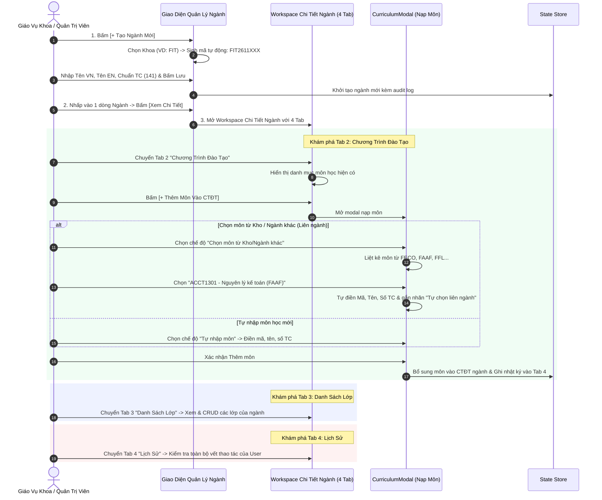

# User Story: Quản Lý Ngành Đào Tạo & Workspace Chi Tiết 4 Tab

> **Mã User Story:** `US-EDUALERT-02`  
> **Tên tính năng:** Quản Lý Ngành Đào Tạo, Mã Tự Sinh & Không Gian Chi Tiết 4 Tab Đa Ngành  
> **Phân hệ:** Quản Trị Cơ Cấu Đào Tạo (Core Administration)  
> **Phiên bản:** Version 2.5 (Clean ERP Design, Next.js 16, React 19, TypeScript)  
> **Trạng thái:** Đã triển khai trên dữ liệu mẫu (mock, chưa có backend); chưa có kiểm thử tự động  

---

## 1. Tóm Tắt User Story (Story Statement)

* **Là một:** Giáo vụ Quản lý Đào tạo / Trưởng Khoa,
* **Tôi muốn:** Tạo mới ngành đào tạo với mã ngành tự sinh theo công thức `[Ký hiệu viết tắt của Khoa] + YYMM + XXX`, chọn khoa trực thuộc, ghi nhận người tạo, ngày tạo, trạng thái hoạt động/ngừng hoạt động, và khi nhấp "Xem Chi Tiết" sẽ mở ra Workspace gồm 4 tab chuyên sâu:
  1. **Tab 1: Thông tin tổng quan ngành** (Mã, Tên VN/EN, Chuẩn tín chỉ 141 TC, Khoa, Người tạo, Ngày tạo, Quy mô).
  2. **Tab 2: Chương trình đào tạo (CTĐT)** (CRUD các môn học vào CTĐT, đặc biệt **hỗ trợ nạp các môn thuộc ngành/khoa khác vào CTĐT của ngành này** làm môn liên ngành hoặc tự chọn).
  3. **Tab 3: Danh sách lớp** (CRUD các lớp học sinh hoạt thuộc ngành này).
  4. **Tab 4: Lịch sử** (Xem vết kiểm toán Audit Log các hành động của user đối với ngành),
* **Để:** Hoàn thiện cơ sở dữ liệu khung chương trình đào tạo tín chỉ liên ngành linh hoạt, phục vụ trực tiếp cho việc mở lớp học phần và đối chiếu tiến độ tốt nghiệp của sinh viên.

---

## 2. Bối Cảnh & Giá Trị Nghiệp Vụ

1. **Quy tắc sinh mã ngành tự động:**
   $$\text{Mã Ngành} = \text{[Ký hiệu viết tắt của Khoa]} + \text{YYMM} + \text{XXX}$$
   * Ví dụ Khoa CNTT (`FIT`) tạo ngành vào tháng 11/2026: `FIT2611001` (Khoa học máy tính), `FIT2611002` (Công nghệ thông tin)...
   * Ví dụ Khoa Kinh tế (`FECO`): `FECO2611001` (Kinh tế học)...
   * **Lưu ý:** các ngành mẫu `FIT2200001` (Khoa học máy tính), `FIT2200002`, `FIT2200003` là mã seed có sẵn và **không** theo công thức (`2200` không phải `YYMM` hợp lệ). Mã sinh mới từ giao diện luôn theo đúng công thức.
2. **Nhu cầu đào tạo liên ngành (Interdisciplinary Curriculum):**
   * Trong xu thế đào tạo hiện đại, một sinh viên ngành *Khoa học máy tính* cần học thêm các môn tự chọn từ Khoa Kế toán (`ACCT1301 - Nguyên lý kế toán doanh nghiệp`) hoặc Khoa Kinh tế (`ECON1301 - Kinh tế vi mô`).
   * Hệ thống cho phép chọn môn từ Kho toàn trường (`GLOBAL_COURSE_POOL`) để nạp vào khung CTĐT của ngành này một cách liền mạch.
3. **Quản trị phân cấp & Audit Log:**
   * Mọi thao tác bổ sung môn, sửa môn, xóa môn hoặc thay đổi trạng thái ngành đều được lưu vết minh bạch trong Tab 4 (Lịch sử).

---

## 3. Luồng Nghiệp Vụ (Business Workflow)



---

## 4. Bố Cục Màn Hình (Layout Specifications)

### 4.1. Màn Hình Danh Sách Ngành Đào Tạo
* **Banner tóm tắt:** Tổng số ngành, Số ngành đang hoạt động, Nút `[ + Tạo Ngành Mới ]`.
* **Thanh lọc Khoa (Pills Bar):** Lọc nhanh theo từng Khoa (`Tất Cả Khoa`, `FIT`, `FECO`, `FAAF`...).
* **Bảng danh sách ngành:** Cột Mã ngành tự sinh, Tên ngành, Khoa, Chuẩn tín chỉ (141 TC), Số môn trong CTĐT, Số lớp, Trạng thái (`Đang hoạt động` / `Vô hiệu hóa`), Thao tác: `[ Xem Chi Tiết ]`, `[ Sửa ]`, `[ Power ]`.

---

### 4.2. Workspace Chi Tiết Ngành 4 Tab (`MajorDetailWorkspace.jsx`)

```
+-----------------------------------------------------------------------------------------+
| [ <- Quay lại Danh sách Ngành ]                      [ Chỉnh Sửa ]  [ Vô Hiệu Hóa ]     |
| BANNER: FIT2200001 - Khoa học máy tính (Computer Science) | Khoa CNTT | Chuẩn 141 TC   |
+-----------------------------------------------------------------------------------------+
| [ 1. Thông Tin Tổng Quan ] | [ 2. CTĐT (21 môn) ] | [ 3. Danh Sách Lớp (2) ] | [ 4. Lịch Sử ] |
+-----------------------------------------------------------------------------------------+
|                                                                                         |
|  TAB 1: THÔNG TIN TỔNG QUAN                                                             |
|   - Bảng thông số: Mã tự sinh, Tên VN/EN, Hệ đào tạo, Chuẩn 141 TC, Mô tả chi tiết.    |
|   - Thông tin kiểm toán: Người tạo (ThS. Nguyễn Hoàng Nam), Ngày tạo, Quy mô đào tạo.  |
|                                                                                         |
|  TAB 2: CHƯƠNG TRÌNH ĐÀO TẠO (CTĐT)                                                     |
|   - Thanh KPI: Tổng số môn, Chuẩn 141 TC, Môn bắt buộc vs Tự chọn liên ngành.          |
|   - Nút [+ Thêm Môn Vào CTĐT] -> Hỗ trợ nạp môn từ Khoa khác (ACCT1301, ECON1301...). |
|   - Bảng môn học: Mã môn, Tên học phần, Số TC, Học kỳ dự kiến, Tiên quyết, Thao tác.    |
|                                                                                         |
|  TAB 3: DANH SÁCH LỚP                                                                   |
|   - Danh sách lớp học sinh hoạt thuộc ngành (DH22CS01C, DH22CS02C...).                  |
|   - Thao tác: [+ Thêm Lớp Mới], Sửa lớp, Xem danh sách sinh viên trực thuộc lớp.       |
|                                                                                         |
|  TAB 4: LỊCH SỬ THAO TÁC (AUDIT LOG)                                                    |
|   - Bảng vết: Thời gian | Người thực hiện | Hành động | Phạm vi | Giá trị cũ | Mới.      |
+-----------------------------------------------------------------------------------------+
```

---

## 5. Tiêu Chuẩn Chấp Thuận (Acceptance Criteria)

* **AC-02.1:** Khi tạo ngành mới, mã ngành phải được tự động sinh theo tiền tố ký hiệu của khoa đã chọn: `[Ký hiệu Khoa] + YYMM + XXX`.
* **AC-02.2:** Người dùng có thể chuyển đổi mượt mà qua lại giữa 4 tab trong Workspace chi tiết mà không bị reload trang hoặc mất trạng thái đang chọn.
* **AC-02.3:** Trong Tab 2 (CTĐT), modal nạp môn phải hỗ trợ 2 chế độ: Chọn môn từ Kho trường/Ngành khác (liên ngành) hoặc tự nhập môn mới. Khi chọn môn liên ngành, hệ thống tự động điền các thông số môn học.
* **AC-02.4:** Mọi thao tác thêm/sửa/xóa môn trong CTĐT hoặc thay đổi trạng thái ngành phải được tự động ghi nhận ngay vào Tab 4 (Lịch sử) với đầy đủ thông tin kiểm toán.
* **AC-02.5:** Tab 3 (Danh sách lớp) chỉ hiển thị các lớp học thuộc đúng ngành đang xem, cho phép mở nhanh danh sách sinh viên của lớp đó.

---

## 6. Quy Tắc Nghiệp Vụ (Business Rules)

1. **BR-02.1 (Tính kế thừa môn học liên ngành):** Khi một môn học của khoa khác (ví dụ `ACCT1301` của FAAF) được đưa vào CTĐT của ngành Khoa học máy tính (FIT), mã môn và số tín chỉ được giữ nguyên chuẩn toàn trường; sinh viên học ngành này khi tích lũy môn đó sẽ được tính điểm vào điểm trung bình chung tích lũy bình thường.
2. **BR-02.2 (Chặn xóa ngành đang có lớp):** Tuyệt đối không cho phép xóa Ngành đào tạo nếu ngành đó đã có lớp sinh hoạt hoặc đang có sinh viên theo học.

