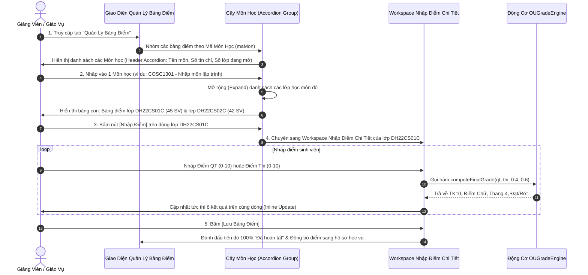

# User Story: Quản Lý Bảng Điểm Học Phần & Group By Theo Môn Học

> **Mã User Story:** `US-EDUALERT-03`  
> **Tên tính năng:** Quản Lý Danh Sách Bảng Điểm Phân Cấp (Group By Môn $\to$ Expand Lớp) & Nhập Điểm Học Phần  
> **Phân hệ:** Quản Lý Đào Tạo & Đánh Giá Điểm Số (Grading System)  
> **Phiên bản:** Version 2.5 (Clean ERP Design, Next.js 16, React 19, TypeScript)  
> **Trạng thái:** Đã triển khai trên dữ liệu mẫu (mock, chưa có backend); chưa có kiểm thử tự động  

---

## 1. Tóm Tắt User Story (Story Statement)

* **Là một:** Giảng viên phụ trách học phần (hoặc Giáo vụ Khoa),
* **Tôi muốn:** Xem danh sách toàn bộ các bảng điểm học phần được gom nhóm thông minh theo từng Mã Môn Học (Group by theo Mã Môn), khi nhấp mở rộng (expand) môn học sẽ bung ra danh sách bảng điểm của tất cả các lớp có học môn đó (kèm Mã bảng điểm tự sinh `BD-[Mã Lớp]-[Mã Môn]`, giảng viên, sĩ số, tiến độ nhập điểm), với quy tắc mở bảng điểm đơn giản nhất có thể và hỗ trợ mở Workspace nhập điểm chi tiết từng sinh viên (QT 40% + Thi 60%),
* **Để:** Dễ dàng quản lý toàn diện các lớp học phần theo môn giảng dạy, tránh nhầm lẫn bảng điểm giữa các lớp và tự động hóa việc tính toán điểm tổng kết theo đúng quy chế tín chỉ HCMCOU.

---

## 2. Bối Cảnh & Giá Trị Nghiệp Vụ

1. **Cấu trúc Gom nhóm theo Môn học (Group By Course $\to$ Expand Classes):**
   * Trong thực tế đào tạo, một môn học (ví dụ `COSC1301 - Nhập môn lập trình`) thường được giảng dạy đồng thời cho nhiều lớp (ví dụ lớp `DH22CS01C` và lớp `DH22CS02C`).
   * Việc hiển thị phẳng truyền thống gây rối mắt và khó quản lý. Cấu trúc Accordion / Tree View gom theo Môn học giúp người dùng thấy ngay môn nào đang mở bao nhiêu lớp, tổng bao nhiêu sinh viên đang học, và click mở rộng để xem chi tiết từng bảng điểm lớp học phần.
2. **Quy tắc sinh mã bảng điểm tự động tối giản:**
   $$\text{Mã Bảng Điểm} = \text{"BD-"} + \text{[Mã Lớp]} + \text{"-"} + \text{[Mã Môn]}$$
   * Ví dụ: Bảng điểm của lớp `DH22CS01C` cho môn `COSC1301` có mã: `BD-DH22CS01C-COSC1301`.
   * Đơn giản, trực quan và dễ định danh. Mã cơ bản chỉ phân biệt theo (Lớp, Môn); khi cùng lớp mở lại cùng môn ở học kỳ khác (học lại), mã cơ bản đã tồn tại nên **thêm hậu tố học kỳ**: `BD-DH22CS01C-COSC1301-2324HK3`. *(Hậu tố là đặc tả; code hiện chưa xử lý.)*
3. **Quy tắc tính điểm chuẩn ĐH Mở TP.HCM:**
   $$\text{Điểm TK (hệ 10)} = (\text{Điểm QT} \times 0.4) + (\text{Điểm Thi} \times 0.6) \quad (\text{Làm tròn 1 chữ số thập phân})$$
   * Điều kiện Đạt môn: Điểm $\text{TK} \ge 4.0$ (đúng với `OUGradeEngine`). Ngưỡng "điểm liệt" của điểm thi chưa được áp dụng — xem `02_Quy_Tac_Tinh_Diem_OU.md`, mục 1.
   * Tự động quy đổi sang Điểm Chữ ($A^+ \to F$) và Thang 4 ($4.0 \to 0.0$).

---

## 3. Luồng Nghiệp Vụ (Business Workflow)

---

## 4. Bố Cục Màn Hình (Layout Specifications)

### 4.1. Màn Hình Danh Sách Gom Nhóm Theo Môn (`viewMode = 'list'`)
* **Thanh Header & Nút mở lớp:** Nút `[ + Mở Bảng Điểm Lớp Học Phần ]` (Mở modal đơn giản: Chọn môn, chọn lớp, nhập giảng viên $\to$ Tự sinh mã).
* **Bộ lọc tinh gọn:** Tìm kiếm nhanh theo mã môn, lớp, giảng viên; Lọc theo Khoa, Học kỳ, Trạng thái.
* **Cấu trúc Cây Accordion:**
  * **Dòng Cha (Học Phần):** Nút mũi tên Chevron, Ký hiệu mã môn, Tên môn học in đậm, Số tín chỉ, Khoa phụ trách, Huy hiệu đếm số lớp đang học (ví dụ: `2 Lớp đang học (87 SV)`).
  * **Bảng Con (Các lớp học môn đó - bung ra khi click):**
    * Cột 1: `Mã Bảng Điểm (Tự Sinh)` (ví dụ `BD-DH22CS01C-COSC1301`).
    * Cột 2: `Lớp Học Phần` (kèm badge nhận diện lớp trọng điểm).
    * Cột 3: `Giảng Viên Phụ Trách` (Họ tên & email).
    * Cột 4: `Học Kỳ` (HK1, HK2, HK3).
    * Cột 5: `Sĩ Số` (45 SV).
    * Cột 6: `Tiến Độ Nhập Điểm` (Thanh tiến độ % + Badge `Đã hoàn tất` / `Đang nhập` / `Chưa nhập`).
    * Cột 7: `Hành Động`: Nút `[ Nhập Điểm ]` (Màu xanh ngọc).

---

### 4.2. Workspace Nhập Điểm Chi Tiết (`viewMode = 'entry'`)
* **Thanh công cụ trên:** Nút `[ <- Quay lại Danh sách ]`, `[ Tải Mẫu Excel ]`, `[ Import Excel ]`, `[ Lưu Bảng Điểm ]`.
* **Banner tóm tắt học phần:** Mã bảng điểm, Tên môn, Lớp, Giảng viên, Sĩ số, Số sinh viên Đạt vs Rớt môn.
* **Bảng nhập điểm inline từng sinh viên:**
  * Cột: `STT`, `MSSV`, `Họ và Tên`, `Điểm QT (40%)` (input số), `Điểm Thi (60%)` (input số), `Tổng Kết (10)` (tự tính), `Điểm Chữ`, `Thang 4`, `Kết Quả` (`Đạt` / `Rớt`).

---

## 5. Tiêu Chuẩn Chấp Thuận (Acceptance Criteria)

* **AC-03.1:** Toàn bộ bảng điểm học phần phải được tự động nhóm theo `maMon`. Khi tải trang hoặc lọc, các môn có bảng điểm phải được tổng hợp chính xác số lớp trực thuộc.
* **AC-03.2:** Người dùng có thể click vào bất kỳ vị trí nào trên thanh tiêu đề môn học để Đóng (Collapse) hoặc Mở rộng (Expand) danh sách các lớp của môn đó.
* **AC-03.3:** Mã bảng điểm mới khi tạo phải tuân thủ cấu trúc tự sinh `BD-[Mã Lớp]-[Mã Môn]` (kèm hậu tố học kỳ nếu mã cơ bản đã tồn tại), không bị trùng lặp.
* **AC-03.4:** Trong Workspace nhập điểm, khi giảng viên thay đổi điểm QT hoặc Thi, các cột TK10, Điểm chữ và Thang 4 phải nhảy số thời gian thực mà không có độ trễ.
* **AC-03.5:** Khi điểm TK10 $< 4.0$, hệ thống phải tự động gán điểm chữ $F$, thang $4 = 0.0$ và gắn badge đỏ `Rớt`.

---

## 6. Quy Tắc Nghiệp Vụ (Business Rules)

1. **BR-03.1 (Quy tắc mở bảng điểm simple):** Một lớp học phần chỉ có duy nhất 1 bảng điểm chính thức cho mỗi môn học trong một học kỳ. Không được tạo 2 bảng điểm trùng cặp `(Lớp, Môn, Học kỳ)`. Mã bảng điểm phải đủ để phân biệt các cặp này (xem hậu tố học kỳ ở mục 2).
2. **BR-03.2 (Bảo vệ điểm đã chốt):** Bảng điểm sau khi được xác nhận "Đã hoàn tất" sẽ được đồng bộ trực tiếp sang Động cơ Cảnh báo sớm (US-04) và Hồ sơ tích lũy của sinh viên (US-05).

