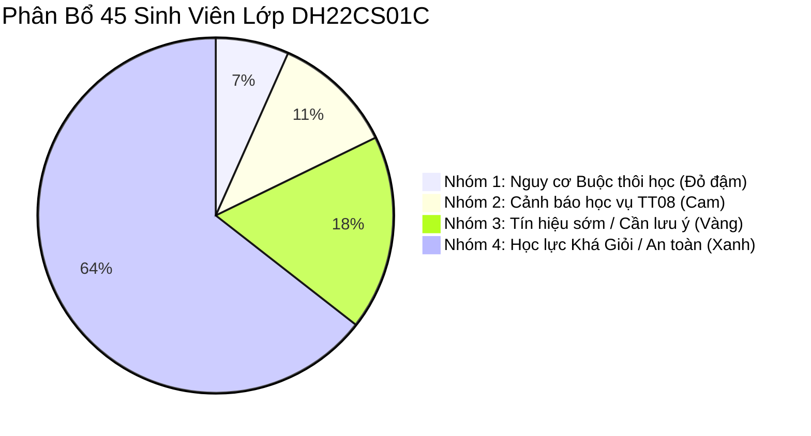
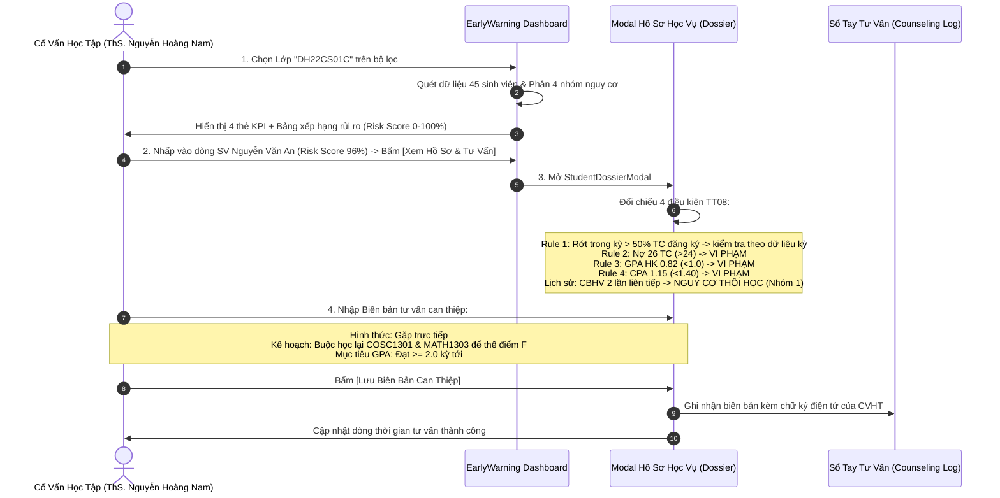

# User Story: Giám Sát Học Vụ Theo Lớp & Cảnh Báo Sớm Nguy Cơ (Case Study Lớp DH22CS01C)

> **Mã User Story:** `US-EDUALERT-04`  
> **Tên tính năng:** Giám Sát Học Tập Theo Lớp Sinh Hoạt, Phân Tầng 4 Nhóm Rủi Ro (TT 08/2021) & Can Thiệp Cá Nhân Hóa  
> **Phân hệ:** Giám Sát & Cảnh Báo Sớm Học Vụ (Early Warning System)  
> **Phiên bản:** Version 2.5 (Clean ERP Design, Next.js 16, React 19, TypeScript)  
> **Trạng thái:** Đã triển khai trên dữ liệu mẫu (mock, chưa có backend); chưa có kiểm thử tự động  

---

## 1. Tóm Tắt User Story (Story Statement)

* **Là một:** Cố vấn học tập (CVHT) phụ trách lớp sinh hoạt (điển hình lớp `DH22CS01C` - Ngành Khoa học máy tính, Khoa Công nghệ thông tin, 45 sinh viên),
* **Tôi muốn:** Có một bảng điều khiển giám sát thông minh tự động rà soát điểm số và phân tầng toàn bộ 45 sinh viên trong lớp thành **4 nhóm học lực & rủi ro học vụ rõ rệt**, tra cứu Hồ sơ học vụ sinh viên (Student Dossier) để thấy chi tiết 4 điều kiện vi phạm theo Thông tư 08/2021, và lập Biên bản tư vấn can thiệp học tập với các gợi ý giải pháp cứu vãn cho từng cá nhân cụ thể,
* **Để:** Kịp thời nắm bắt tình trạng học tập chung của lớp, phát hiện chính xác những sinh viên sắp bị buộc thôi học hoặc cảnh báo học vụ, và chủ động đồng hành hỗ trợ sinh viên vượt qua khó khăn trước khi quá muộn.

---

## 2. Bối Cảnh & Phân Tích Chuyên Sâu Lớp Trọng Điểm `DH22CS01C`

* **Lớp:** `DH22CS01C` (ĐH Khoa học máy tính Khóa 2022 - Lớp 01C).
* **Ngành:** Khoa học máy tính (Mã: `FIT2200001` - Chuẩn 141 tín chỉ) thuộc Khoa Công nghệ thông tin (`FIT`).
* **Sĩ số:** **45 sinh viên**.
* **Thời điểm theo dõi:** Năm thứ 2, rà soát sau khi kết thúc HK3 (năm học 2023–2024), trước HK4.
* **Cố vấn học tập:** ThS. Nguyễn Hoàng Nam.

### 2.1. Ma Trận Phân Tầng 4 Nhóm Sinh Viên Trong Lớp

| Phân Nhóm | Sĩ số | Đặc điểm nhận diện học vụ theo TT 08/2021 | Sinh viên tiêu biểu trong lớp |
| :--- | :---: | :--- | :--- |
| **Nhóm 1: Nguy cơ Buộc thôi học (Mức 3)** | **3 SV** | • **Tiêu chí xếp nhóm:** đã bị CBHV $\ge 2$ lần liên tiếp. • Thường đi kèm: $\text{GPA}_{\text{TL}}$ Năm 2 $< 1.40$ (Rule 4), nợ $> 24$ TC (Rule 2, gãy chuỗi môn tiên quyết). | 1. Nguyễn Văn An (`2251050001` - CPA 1.15, Nợ 26 TC) 2. Trần Quốc Bảo (`2251050015` - CPA 1.28, Nợ 28 TC) 3. Lê Hoàng Long (`2251050032` - CPA 1.32, Nợ 25 TC) |
| **Nhóm 2: Cảnh báo học vụ (CBHV Mức 1 & 2)** | **5 SV** | • **Tiêu chí xếp nhóm:** bị CBHV lần 1, tức vi phạm $\ge 1$ Rule (xem `02_Quy_Tac_Tinh_Diem_OU.md`): - Rule 1: tín chỉ rớt trong kỳ $> 50\%$ ĐK. - Rule 3: GPA học kỳ $< 1.00$. - Rule 4: GPA tích lũy Năm 2 $< 1.40$. | 1. Phạm Minh Tuấn (`2251050008` - GPA HK: 0.85, CPA 1.36) 2. Đỗ Thanh Hà (`2251050019` - CPA 1.38) 3. Vũ Anh Khoa (`2251050024` - Rớt $> 50\%$ TC kỳ vừa qua, nợ 18 TC) 4. Hoàng Trọng Nghĩa (`2251050036`) 5. Bùi Thu Trang (`2251050041`) |
| **Nhóm 3: Tín hiệu sớm (Nguy cơ rớt môn)** | **8 SV** | • Chưa vi phạm Rule nào nhưng GPA tích lũy tiệm cận ngưỡng nguy hiểm ($1.45 - 1.70$). • Rớt 1 môn tiên quyết quan trọng (Toán rời rạc hoặc Kỹ thuật lập trình). | Sinh viên nhóm này nếu kỳ tới tiếp tục rớt môn sẽ lập tức rơi vào Nhóm 2. |
| **Nhóm 4: An toàn & Khá Giỏi** | **29 SV** | • GPA tích lũy $\ge 2.50$, tiến độ tích lũy đạt chuẩn CTĐT, không nợ môn cốt lõi. | Lê Gia Hân, Trần Bảo Ngọc, Nguyễn Thị Minh Châu... |

---

### 2.2. Hướng Phân Tích & Giải Pháp Can Thiệp Hỗ Trợ Cho Từng Sinh Viên Cụ Thể

#### Trường hợp 1: Sinh viên Nguyễn Văn An (MSSV: `2251050001`) - Nguy cơ Buộc thôi học
* **Vấn đề cốt lõi:** Đã bị CBHV lần 1 ở HK2 năm nhất; HK3 vừa rồi GPA chỉ đạt $0.82$, nâng tổng số lần cảnh báo lên $2$ lần liên tiếp. Tích lũy được 28 TC nhưng nợ tới 26 TC môn F. Đặc biệt, rớt môn *Nhập môn lập trình (COSC1301)* khiến sinh viên không thể đăng ký *Kỹ thuật lập trình* và *Cấu trúc dữ liệu & giải thuật*.
* **Giải pháp can thiệp của CVHT & Hệ thống:**
  1. *Giới hạn tín chỉ:* Khống chế tối đa không quá $14$ tín chỉ ở kỳ kế tiếp.
  2. *Chiến lược trả nợ F:* Buộc phải đăng ký học lại ngay 2 môn: *Nhập môn lập trình (3 TC)* và *Toán rời rạc (3 TC)*.
  3. *Hiệu ứng thế điểm F:* Khi trả nợ đạt điểm $B$ (2.5) cho cả 2 môn, theo quy chế HCMCOU điểm mới thế hoàn toàn điểm 0 cũ. Mẫu số CPA không đổi ($28 + 26 = 54$ TC), tổng điểm $62.1 \to 77.1$, nên CPA tăng $1.15 \to 1.43$, **vượt ngưỡng $1.40$**, tín chỉ nợ giảm $26 \to 20$ TC (dưới trần 24). *(Chỉ đạt $C$ (1.5) thì CPA $\approx 1.32$, chưa đủ.)*
  4. *Biên bản tư vấn:* CVHT hẹn gặp trực tiếp, phân tích lộ trình và lập biên bản cam kết có chữ ký của sinh viên.

#### Trường hợp 2: Sinh viên Phạm Minh Tuấn (MSSV: `2251050008`) - Cảnh báo học vụ lần 1
* **Vấn đề cốt lõi:** Kỳ vừa qua đăng ký 21 tín chỉ nhưng đi làm thêm ca đêm, vắng học dẫn đến rớt 4 môn (12 TC $\approx 57\% > 50\%$ số đăng ký), GPA học kỳ tụt xuống $0.85$, CPA $1.36$, nợ tích lũy 15 TC. Rule Engine cho mức **Nguy cơ cao** (vi phạm nhiều Rule) nhưng đây là lần CBHV đầu tiên nên thuộc **Nhóm 2**.
* **Giải pháp can thiệp:**
  1. Rút kinh nghiệm giảm tải xuống 15 tín chỉ.
  2. Chọn môn F có số tín chỉ cao nhất (Cơ sở dữ liệu - 4 TC) để học lại trước.
  3. Sử dụng công cụ Smart Planner tính Target GPA: Đạt điểm $B$ ở môn CSDL để xóa án cảnh báo học vụ.

---

## 3. Luồng Nghiệp Vụ (Business Workflow)

---

## 4. Bố Cục Màn Hình (Layout Specifications)

### 4.1. Dashboard Giám Sát Cảnh Báo Lớp (`EarlyWarningTab.jsx`)
* **Bộ lọc lớp học:** Dropdown chọn Lớp (Mặc định chọn lớp trọng điểm `DH22CS01C`), Dropdown chọn Mức độ nguy cơ (`Tất cả`, `Nguy cơ buộc thôi học`, `Cảnh báo học vụ`, `Tín hiệu sớm`, `An toàn`), Ô tìm kiếm theo tên hoặc MSSV.
* **Cụm 4 Thẻ KPI Học Vụ:**
  * Thẻ 1 (Xanh lam): Tổng số sinh viên rà soát trong lớp (45 SV).
  * Thẻ 2 (Đỏ đậm): Nguy cơ Buộc thôi học (3 SV - Chiếm 6.7%).
  * Thẻ 3 (Cam): Cảnh báo học vụ TT08 (5 SV - Chiếm 11.1%).
  * Thẻ 4 (Vàng): Tín hiệu sớm rớt môn (8 SV - Chiếm 17.8%).
* **Bảng Xếp Hạng Rủi Ro Học Vụ:**
  * Sắp xếp tự động theo Risk Score giảm dần (ưu tiên can thiệp sinh viên nguy cơ cao nhất).
  * Cột: `Mã SV`, `Họ và Tên`, `Lớp`, `GPA Học Kỳ`, `GPA Tích Lũy`, `Tín Chỉ Nợ F`, `Điểm Rèn Luyện (ĐRL)`, `Chỉ Số Rủi Ro (%)`, `Trạng Thái Cảnh Báo`, `Hành Động` (`[ Xem Hồ Sơ & Tư Vấn ]`, `[ Lập Kế Hoạch Smart Planner ]`).

---

### 4.2. Modal Hồ Sơ Học Vụ Sinh Viên (`StudentDossierModal.jsx`)
* **Khối 1 (Đánh giá 4 Rule Thông tư 08/2021 — đánh số theo `02_Quy_Tac_Tinh_Diem_OU.md`):**
  * Rule 1: Tín chỉ không đạt trong kỳ $> 50\%$ số đăng ký.
  * Rule 2: Nợ tín chỉ toàn khóa $> 24$ TC.
  * Rule 3: GPA học kỳ ($<0.8$ HK đầu hoặc $<1.0$ các HK sau).
  * Rule 4: GPA tích lũy dưới sàn theo năm đào tạo (Năm 2: $<1.40$).
  * *Thông tin bổ sung (không phải Rule):* Số lần CBHV liên tiếp, dùng để xếp nhóm can thiệp.
* **Khối 2 (Lịch sử học kỳ & Diễn biến GPA):** Bảng từng học kỳ gồm TC đăng ký, TC không đạt, GPA học kỳ, GPA tích lũy. **Học kỳ gần nhất trong bảng là nguồn dữ liệu để chấm Rule 1 (rớt $> 50\%$) và Rule 3 (GPA học kỳ).** Ràng buộc dữ liệu: tổng TC đăng ký các kỳ $=$ TC tích lũy $+$ TC nợ; tổng TC không đạt $=$ TC nợ (khi chưa học lại).
* **Khối 3 (Sổ tay tư vấn & Biên bản can thiệp CVHT):**
  * Danh sách các biên bản can thiệp trước đó.
  * Form ghi nhận can thiệp mới: Chọn hình thức (Gặp trực tiếp, Gọi điện, Email), Nội dung tư vấn, Mục tiêu GPA kỳ kế tiếp, Nút `[ Lưu Biên Bản Tư Vấn ]`.

---

## 5. Tiêu Chuẩn Chấp Thuận (Acceptance Criteria)

* **AC-04.1:** Khi chọn lớp `DH22CS01C`, hệ thống phải nạp đủ 45 sinh viên và phân loại chính xác 3 sinh viên nhóm 1, 5 sinh viên nhóm 2, 8 sinh viên nhóm 3 và 29 sinh viên nhóm 4.
* **AC-04.2:** Bảng xếp hạng rủi ro phải hiển thị sinh viên có Risk Score cao nhất (Nguyễn Văn An - 96%) ở dòng đầu tiên.
* **AC-04.3:** Trong Modal Hồ sơ học vụ sinh viên, trạng thái vi phạm của 4 Rule quy chế phải được gắn badge màu rõ rệt (Đỏ: Vi phạm / Xanh: An toàn).
* **AC-04.4:** Khi CVHT nhập và lưu biên bản can thiệp, dữ liệu phải được lưu vết ngay lập tức vào hồ sơ của sinh viên mà không bị mất khi đóng modal.

---

## 6. Quy Tắc Nghiệp Vụ (Business Rules)

1. **BR-04.1 (Quy chế buộc thôi học ĐH Mở TP.HCM):** Sinh viên bị cảnh báo học vụ 2 lần liên tiếp sẽ bị đưa vào danh sách xem xét buộc thôi học tại kỳ kế tiếp nếu không cải thiện được điểm số.
2. **BR-04.2 (Giới hạn tín chỉ khi bị cảnh báo):** Sinh viên đang trong diện cảnh báo học vụ chỉ được phép đăng ký tối đa 14 tín chỉ trong học kỳ chính tiếp theo.

