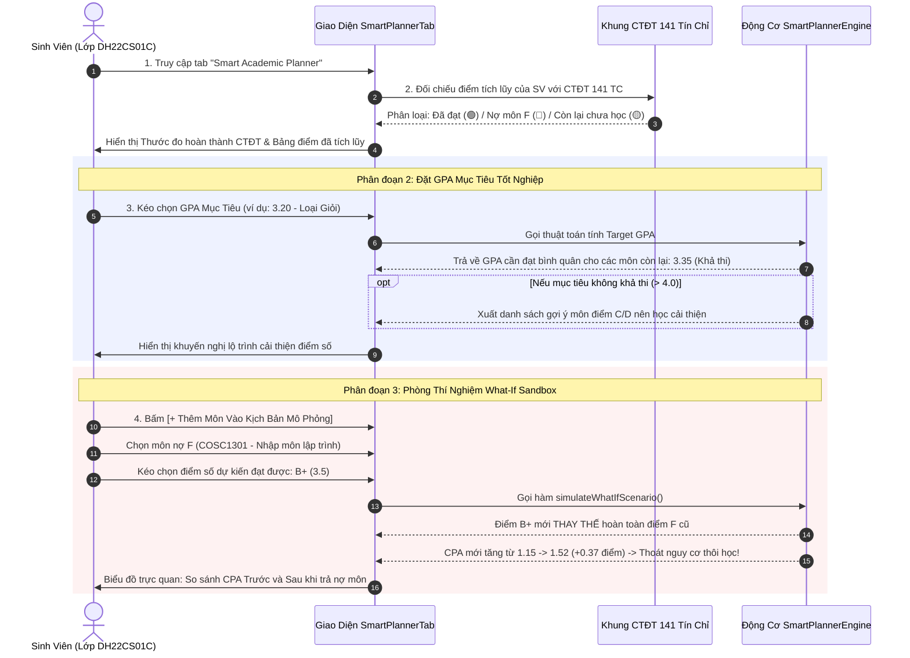

# User Story: Kế Hoạch Học Tập Thông Minh & Gợi Ý Cải Thiện GPA (Smart Planner)

> **Mã User Story:** `US-EDUALERT-05`  
> **Tên tính năng:** Trợ Lý Kế Hoạch Học Tập Thông Minh, Đối Chiếu 141 Tín Chỉ & Mô Phỏng What-If Cho Sinh Viên  
> **Phân hệ:** Trợ Lý Học Tập Sinh Viên (Student Self-Service)  
> **Phiên bản:** Version 2.5 (Clean ERP Design, Next.js 16, React 19, TypeScript)  
> **Trạng thái:** Baseline / Đã triển khai & Kiểm thử thành công  

---

## 1. Tóm Tắt User Story (Story Statement)

* **Là một:** Sinh viên (ví dụ sinh viên lớp `DH22CS01C`),
* **Tôi muốn:** Tự theo dõi tiến độ tích lũy học tập của bản thân đối chiếu với Khung chương trình đào tạo chuẩn (141 tín chỉ), biết rõ mình đã đạt bao nhiêu môn, đang nợ những môn F nào, đặt điểm GPA mục tiêu tốt nghiệp (Xuất sắc, Giỏi, Khá) để hệ thống tự động tính điểm cần đạt cho các môn còn lại, đồng thời sử dụng công cụ mô phỏng "What-If" giả định điểm số kỳ tới và thấy trước hiệu ứng trả nợ môn F giúp kéo GPA tích lũy lên như thế nào,
* **Để:** Chủ động làm chủ việc học, chọn môn đăng ký học kỳ mới một cách thông minh, ưu tiên trả nợ các môn then chốt để sớm thoát khỏi nguy cơ cảnh báo học vụ và đạt được mục tiêu tốt nghiệp mong muốn.

---

## 2. Bối Cảnh & Giá Trị Nghiệp Vụ

1. **Quy chế thế điểm môn học lại (HCMCOU):**
   * Khi sinh viên học lại một môn đã từng bị điểm $F$ (0.0) và đạt điểm mới ($\ge 4.0$), điểm mới sẽ **thay thế hoàn toàn** điểm $F$ cũ khi tính điểm trung bình chung tích lũy (CPA).
   * Đây là cơ chế "đòn bẩy" mạnh mẽ nhất giúp các sinh viên có nguy cơ thôi học (như bạn Nguyễn Văn An) lội ngược dòng ngoạn mục.
2. **Thuật toán tính điểm cần đạt theo mục tiêu (Target GPA Engine):**
   $$\text{GPA}_{\text{cần đạt}} = \frac{\text{GPA}_{\text{mục tiêu}} \times \text{Tổng TC chuẩn (141)} - \text{GPA}_{\text{hiện tại}} \times \text{TC}_{\text{đã tích lũy}}}{\text{TC}_{\text{còn lại}}}$$
   * Nếu $\text{GPA}_{\text{cần đạt}} \le 3.50$: Mục tiêu rất khả thi, duy trì học lực bình thường.
   * Nếu $\text{GPA}_{\text{cần đạt}} > 4.00$: Không thể đạt được chỉ bằng các môn còn lại $\rightarrow$ Hệ thống tự động **gợi ý danh sách các môn điểm thấp (D, C) nên học cải thiện** để kéo điểm lên.
3. **Mô phỏng What-If an toàn (Sandbox):**
   * Cho phép sinh viên thoải mái thử nghiệm các kịch bản điểm giả định mà không làm biến đổi dữ liệu điểm gốc đã lưu trên máy chủ đào tạo.

---

## 3. Luồng Nghiệp Vụ (Business Workflow)

---

## 4. Bố Cục Màn Hình (Layout Specifications)

Màn hình Smart Planner gồm 4 phân đoạn chức năng liên hoàn:

### 4.1. Phân Đoạn 1: Thước Đo Hoàn Thành Khung CTĐT 141 Tín Chỉ
* **Banner hồ sơ sinh viên:** Avatar, Họ tên, MSSV, Ngành đào tạo, Khóa học.
* **Thanh tiến độ tích lũy:** Hiển thị số tín chỉ đã đạt / 141 tín chỉ kèm tỷ lệ phần trăm (%).
* **Cụm 3 Thẻ Môn Học:**
  * Thẻ 1 (🟢): Các môn đã hoàn thành (Điểm $\ge 4.0$).
  * Thẻ 2 (🔴): Các môn đang nợ F cần học lại gấp.
  * Thẻ 3 (🟡): Các môn còn lại theo lộ trình đào tạo.

---

### 4.2. Phân Đoạn 2: Bảng Điểm Tích Lũy Hiện Hành
* Bảng tra cứu lịch sử điểm số tất cả các môn đã học qua các kỳ.
* Cột: Mã môn, Tên môn, Số TC, Điểm QT (40%), Điểm Thi (60%), TK10, Điểm chữ, Thang 4, Kết quả.

---

### 4.3. Phân Đoạn 3: Bộ Tính Điểm Mục Tiêu (Target GPA Engine)
* **Slider / Input:** Chọn mức GPA mong muốn (từ $2.00$ đến $4.00$).
* **Huy hiệu xếp loại tự động:** Xuất sắc ($\ge 3.60$), Giỏi ($3.20 - 3.59$), Khá ($2.50 - 3.19$).
* **Kết quả tính toán:** Điểm trung bình cần đạt cho các môn còn lại.
* **Khuyến nghị thông minh:** Liệt kê các môn điểm $D$ hoặc $C$ có số tín chỉ cao để gợi ý học cải thiện nâng điểm.

---

### 4.4. Phân Đoạn 4: Phòng Thí Nghiệm Mô Phỏng Giả Định What-If (Sandbox)
* **Bảng danh sách môn dự kiến học kỳ tới:**
  * Chọn môn học lại (trả nợ F) hoặc đăng ký môn mới.
  * Dropdown chọn điểm giả định ($A, B^+, B, C...$).
* **Bộ dự báo kết quả tức thì (Outcome Predictor):**
  * GPA dự kiến của học kỳ tới.
  * GPA tích lũy mới toàn khóa (New CPA sau khi thế điểm F).
  * Độ lệch tăng điểm ($+\Delta$).
  * Xác nhận trạng thái xóa án cảnh báo học vụ.

---

## 5. Tiêu Chuẩn Chấp Thuận (Acceptance Criteria)

* **AC-05.1:** Khi chuyển sang tài khoản sinh viên khác, toàn bộ tiến độ 141 tín chỉ, các môn nợ F và kịch bản mô phỏng phải đồng bộ chính xác theo sinh viên đó.
* **AC-05.2:** Thuật toán tính toán Target GPA phải phản hồi tức thì dưới 50ms khi người dùng thay đổi giá trị điểm mục tiêu.
* **AC-05.3:** Trong mô phỏng What-If, đối với môn nợ F được chọn học lại, hệ thống phải thực hiện đúng quy chế thay thế điểm: Lấy điểm mới thế vào vị trí điểm cũ để tính lại CPA, phản ánh sự nhảy vọt của điểm tích lũy.
* **AC-05.4:** Tất cả các thao tác trên phòng thí nghiệm What-If hoàn toàn chạy trên client memory, không làm sai lệch bảng điểm thực tế đã lưu.

---

## 6. Quy Tắc Nghiệp Vụ (Business Rules)

1. **BR-05.1 (Quy chế học cải thiện điểm):** Sinh viên chỉ được đăng ký học cải thiện điểm đối với các môn có điểm tổng kết đạt $D, D^+, C$. Điểm mới cao hơn sẽ được lấy để tính CPA tích lũy.
2. **BR-05.2 (Thứ tự ưu tiên trả nợ):** Đối với sinh viên đang nợ môn F là môn tiên quyết (như *Nhập môn lập trình*), hệ thống Smart Planner phải tự động gắn cờ ưu tiên số 1 trong danh sách gợi ý đăng ký kỳ kế tiếp.

