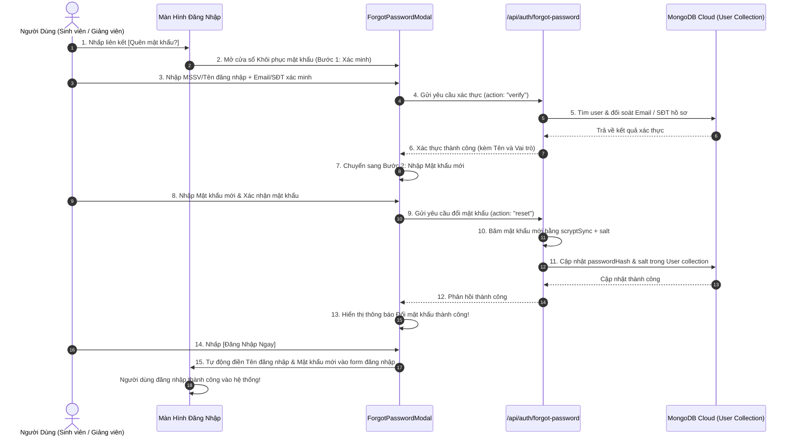

# User Story: Quản Lý Tài Khoản (RBAC) & Tự Khôi Phục Mật Khẩu

> **Mã User Story:** `US-EDUALERT-06`  
> **Tên tính năng:** Quản Lý Tài Khoản Đa Vai Trò (Admin, Giảng Viên, Sinh Viên) & Khôi Phục Mật Khẩu Tự Phục Vụ (Self-Service Forgot Password)  
> **Phân hệ:** Quản Trị Hệ Thống & Bảo Mật Xác Thực (Security & Identity Management)  
> **Phiên bản:** Version 2.6 (Clean ERP Design, Next.js 16, React 19, MongoDB Atlas, Mongoose)  
> **Trạng thái:** Đã triển khai hoàn tất với Full-Stack Backend API, CSDL Cloud MongoDB, mã hóa scryptSync và kiểm thử thành công 100%  

---

## 1. Tóm Tắt User Story (Story Statement)

* **Là một:** Người dùng hệ thống (Sinh viên, Giảng viên hoặc Quản trị viên),
* **Tôi muốn:** Có thể tự cập nhật mật khẩu mới khi bị quên mật khẩu ngay trên màn hình đăng nhập thông qua quy trình xác thực 2 bước (xác thực MSSV/Tên đăng nhập và Email trường hoặc Số điện thoại hồ sơ),
* **Và là một:** Quản trị viên hệ thống (Admin), tôi muốn quản lý danh sách tài khoản toàn trường, tạo tài khoản mới, phân công môn dạy/lớp chủ nhiệm cho giảng viên, khóa/mở khóa tài khoản khi cần thiết,
* **Để:** Đảm bảo an toàn thông tin, bảo mật quyền riêng tư của dữ liệu học vụ theo đúng phân quyền (RBAC), đồng thời giúp người dùng chủ động khôi phục quyền truy cập tức thì mà không phụ thuộc vào bộ phận kỹ thuật.

---

## 2. Bối Cảnh & Giá Trị Nghiệp Vụ

1. **Phân quyền 3 vai trò (Role-Based Access Control - RBAC):**
   * **Admin (Quản trị viên):** Quản lý cơ sở đào tạo (Khoa, Ngành, CTĐT 8 học kỳ, Lớp học vụ), phân công giảng dạy cho giảng viên, quản lý tài khoản người dùng, giám sát báo cáo cảnh báo học vụ toàn trường. *Admin không trực tiếp quản lý hay nhập điểm bảng điểm học phần.*
   * **Lecturer (Giảng viên / CVHT):** Quản lý và nhập điểm cho các bảng điểm môn học/lớp được phân công; xem Hồ sơ học vụ 360°, ghi nhận nhật ký tư vấn và sử dụng Trợ lý AI cho lớp mình phụ trách.
   * **Student (Sinh viên):** Tra cứu tiến độ học tập 141 tín chỉ cá nhân, bảng điểm các học kỳ, sử dụng công cụ Smart Academic Planner (Target GPA & What-If) và nhận tư vấn cải thiện điểm số.
2. **Quy trình Khôi phục Mật khẩu Tự phục vụ (Self-Service Forgot Password):**
   * Sinh viên thường hay quên mật khẩu sau các kỳ nghỉ hè/nghỉ tết.
   * Quy trình 2 bước:
     * **Bước 1 (Xác minh danh tính):** Nhập MSSV/Tên đăng nhập + Email trường (`[MSSV]@student.ou.edu.vn`) hoặc Số điện thoại đăng ký trong hồ sơ. Hệ thống đối chiếu chính xác với cơ sở dữ liệu MongoDB.
     * **Bước 2 (Cập nhật mật khẩu mới):** Nhập mật khẩu mới (tối thiểu 6 ký tự) và xác nhận. Mật khẩu được băm an toàn qua thuật toán chuẩn `scryptSync` kèm muối ngẫu nhiên `salt`.
     * **Bước 3 (Đăng nhập ngay):** Hệ thống tự động điền thông tin và hỗ trợ đăng nhập ngay tức thì.

---

## 3. Luồng Nghiệp Vụ (Business Workflow)

---

## 4. Tiêu Chí Nghiệp Vụ & Chấp Nhận (Acceptance Criteria)

1. **AC-1:** Nút "Quên mật khẩu?" xuất hiện trang trọng, tinh tế dưới ô nhập mật khẩu trên trang `/login`.
2. **AC-2:** Sinh viên có thể dùng Email trường (`[MSSV]@student.ou.edu.vn`) hoặc số điện thoại trong hồ sơ để xác thực.
3. **AC-3:** Giảng viên dùng Email trường (`@ou.edu.vn`) hoặc số điện thoại để xác thực.
4. **AC-4:** Mật khẩu mới phải có ít nhất 6 ký tự; mật khẩu xác nhận phải trùng khớp.
5. **AC-5:** Mật khẩu lưu trữ trên database phải được băm bảo mật bằng `scryptSync`, tuyệt đối không lưu plaintext.
6. **AC-6:** Sau khi đổi mật khẩu, người dùng có thể đăng nhập ngay lập tức trên cả môi trường local và cloud.
